# Index

Generated by `tools/build_index.py` from note front matter; do not edit by hand.

## Discussions

| id | title | status | created | from | leads to | related |
|---|---|---|---|---|---|---|
| [DIS-001](discussions/DIS-001-deferred-disease-task-questions.md) | Deferred disease-task questions (precirrhosis, kidney tasks, image-level area) | parked | 2026-10-23 |  | [DEC-033](decisions/DEC-033-precirrhosis-as-middle-grade-of-cirrhosis-task.md) | [DEC-004](decisions/DEC-004-training-tasks.md), [DEC-006](decisions/DEC-006-losses-optim-tracking.md) |
| [DIS-002](discussions/DIS-002-workflow-and-folder-structure.md) | Workflow and folder structure review | concluded | 2026-10-27 |  | [DEC-008](decisions/DEC-008-repo-layout.md), [DEC-009](decisions/DEC-009-light-process-and-checks.md), [DEC-010](decisions/DEC-010-runs-record-task.md) | [DEC-003](decisions/DEC-003-trainrecipe-files-structure.md), [DEC-007](decisions/DEC-007-session-branches-no-worktrees.md) |
| [DIS-003](discussions/DIS-003-project-setup-structure.md) | Project setup structure review (milestone m-0) | concluded | 2026-10-28 |  | [DEC-011](decisions/DEC-011-docs-vs-research-notes.md), [DEC-012](decisions/DEC-012-dataset-docs-layout.md), [DEC-013](decisions/DEC-013-shared-score-formulas-losses.md), [DEC-014](decisions/DEC-014-gogs-git-remote.md), [DEC-015](decisions/DEC-015-commonbox-runs-models.md), [DEC-016](decisions/DEC-016-notes-hook-backlog-features.md) | [DIS-002](discussions/DIS-002-workflow-and-folder-structure.md), [DEC-002](decisions/DEC-002-dataset-files-structure.md), [DEC-007](decisions/DEC-007-session-branches-no-worktrees.md), [DEC-008](decisions/DEC-008-repo-layout.md), [DEC-009](decisions/DEC-009-light-process-and-checks.md) |
| [DIS-004](discussions/DIS-004-bmode-cropper.md) | B-mode cropper for ultrasound frames | concluded | 2026-10-28 |  | [DEC-017](decisions/DEC-017-bmode-cropper.md) | [DEC-012](decisions/DEC-012-dataset-docs-layout.md) |
| [DIS-005](discussions/DIS-005-labeling-tool-and-default-env.md) | Dedicated labeling tool for review tasks, and a default env matching the GPU box | concluded | 2026-10-28 |  | [DEC-019](decisions/DEC-019-label-studio-review-projects.md), [DEC-020](decisions/DEC-020-default-venv-matches-gpu-box.md) | [DEC-017](decisions/DEC-017-bmode-cropper.md), [DEC-018](decisions/DEC-018-plain-style-for-local-research.md), [DEC-012](decisions/DEC-012-dataset-docs-layout.md) |
| [DIS-006](discussions/DIS-006-human-friendly-communication.md) | Human-friendly communication between Claude and the user, research-writing standard, and links between documents | concluded | 2026-10-28 |  | [DEC-021](decisions/DEC-021-communication-and-research-writing-standards.md) | [DEC-009](decisions/DEC-009-light-process-and-checks.md), [DEC-011](decisions/DEC-011-docs-vs-research-notes.md) |
| [DIS-007](discussions/DIS-007-device-type-tagging-and-sensitivity.md) | Inferring the ultrasound device type of each image, and how sensitive models and diagnosis are to it | parked | 2026-10-29 |  |  | [DIS-001](discussions/DIS-001-deferred-disease-task-questions.md) |
| [DIS-008](discussions/DIS-008-gpu-rental-runpod-vs-aws.md) | GPU rental for training, RunPod Secure Cloud vs AWS EC2 | open | 2026-10-29 |  |  | [DEC-001](decisions/DEC-001-encrypted-data-store.md), [DEC-005](decisions/DEC-005-enc1-dataset-style.md), [DEC-020](decisions/DEC-020-default-venv-matches-gpu-box.md), [DEC-023](decisions/DEC-023-aws-s3-for-enc1-and-ec2-for-label-studio.md), [DEC-024](decisions/DEC-024-plain-never-leaves-machine01-ec2-label-studio-decrypts-in-ram.md) |
| [DIS-009](discussions/DIS-009-claude-as-second-annotator.md) | Claude as a second, blind annotator for the TASK-032 B-mode boxes | concluded | 2026-10-30 |  | [DEC-029](decisions/DEC-029-claude-labels-named-labeling-projects.md), [DEC-035](decisions/DEC-035-qwen3-vl-second-annotator-on-gpu-box.md) | [DEC-017](decisions/DEC-017-bmode-cropper.md), [DEC-019](decisions/DEC-019-label-studio-review-projects.md), [DEC-024](decisions/DEC-024-plain-never-leaves-machine01-ec2-label-studio-decrypts-in-ram.md), [DEC-025](decisions/DEC-025-aws-labelstud-public-https.md), [DEC-026](decisions/DEC-026-cloud-agent-runs-cloud-services.md) |
| [DIS-010](discussions/DIS-010-multi-agent-setup.md) | Multi-agent setup - agent roles, consult and lead sessions, parallel writers | concluded | 2026-11-02 |  | [DEC-032](decisions/DEC-032-agent-roster-consult-and-lead-skills.md) | [DEC-007](decisions/DEC-007-session-branches-no-worktrees.md), [DEC-009](decisions/DEC-009-light-process-and-checks.md), [DEC-026](decisions/DEC-026-cloud-agent-runs-cloud-services.md), [DEC-027](decisions/DEC-027-agent-ssh-to-aws-labelstud-through-ssm.md), [DEC-028](decisions/DEC-028-worktrees-for-parallel-sessions.md) |
| [DIS-011](discussions/DIS-011-diffuse-disease-polygon-extent.md) | Diffuse-disease polygons may cover part of the organ | concluded | 2026-11-03 |  | [DEC-034](decisions/DEC-034-organ-layer-from-organ-polygons-only.md) | [DEC-006](decisions/DEC-006-losses-optim-tracking.md), [DIS-001](discussions/DIS-001-deferred-disease-task-questions.md) |
| [DIS-012](discussions/DIS-012-choice-labels-vs-polygon-labels.md) | Choice labels as a double check of polygon labels, and image-quality choices, in 261023 | concluded | 2026-11-03 |  | [DEC-036](decisions/DEC-036-choice-polygon-relation-table.md) | [DEC-012](decisions/DEC-012-dataset-docs-layout.md), [DEC-018](decisions/DEC-018-plain-style-for-local-research.md), [DEC-034](decisions/DEC-034-organ-layer-from-organ-polygons-only.md) |
| [DIS-013](discussions/DIS-013-cropper-v2-from-the-users-review.md) | Tune the B-mode cropper on the user's TASK-032 review and prelabel the remaining frames with it | concluded | 2026-11-03 |  | [DEC-037](decisions/DEC-037-cropper-v2-and-second-review-project.md) | [DEC-017](decisions/DEC-017-bmode-cropper.md), [DEC-019](decisions/DEC-019-label-studio-review-projects.md), [DEC-035](decisions/DEC-035-qwen3-vl-second-annotator-on-gpu-box.md) |
| [DIS-014](discussions/DIS-014-ready-label-on-the-board.md) | Show on the board which tasks are ready to start | concluded | 2026-11-03 |  | [DEC-038](decisions/DEC-038-ready-label-derived-by-script.md) | [DEC-016](decisions/DEC-016-notes-hook-backlog-features.md), [DEC-032](decisions/DEC-032-agent-roster-consult-and-lead-skills.md) |
| [DIS-015](discussions/DIS-015-task-dependency-view.md) | A view of task dependencies on the board | concluded | 2026-11-03 |  | [DEC-039](decisions/DEC-039-task-dependency-pages.md) | [DEC-031](decisions/DEC-031-records-and-docs-on-the-task-board.md), [DEC-038](decisions/DEC-038-ready-label-derived-by-script.md) |
| [DIS-016](discussions/DIS-016-load-only-relevant-context.md) | Load only the context a task needs - a root context map, and decisions tagged by area | concluded | 2026-11-04 |  | [DEC-040](decisions/DEC-040-context-map-and-decision-areas.md) | [DEC-011](decisions/DEC-011-docs-vs-research-notes.md), [DEC-021](decisions/DEC-021-communication-and-research-writing-standards.md), [DEC-031](decisions/DEC-031-records-and-docs-on-the-task-board.md), [DEC-032](decisions/DEC-032-agent-roster-consult-and-lead-skills.md) |
| [DIS-017](discussions/DIS-017-label-groups-per-recipe.md) | Label groups are chosen per recipe, not fixed in task code | concluded | 2026-11-04 |  | [DEC-041](decisions/DEC-041-label-groups-per-recipe.md) | [DEC-003](decisions/DEC-003-trainrecipe-files-structure.md), [DEC-004](decisions/DEC-004-training-tasks.md), [DEC-034](decisions/DEC-034-organ-layer-from-organ-polygons-only.md) |
| [DIS-018](discussions/DIS-018-qwen-prompt-tuning-and-comparison-set.md) | Qwen3-VL prompt tuning and comparison use the user's v1 review with the DEC-037 datasource hold-out | concluded | 2026-11-04 |  | [DEC-042](decisions/DEC-042-qwen-tuning-and-comparison-on-the-users-v1-review.md) | [DEC-035](decisions/DEC-035-qwen3-vl-second-annotator-on-gpu-box.md), [DEC-037](decisions/DEC-037-cropper-v2-and-second-review-project.md), [DIS-009](discussions/DIS-009-claude-as-second-annotator.md) |
| [DIS-019](discussions/DIS-019-cirrhosis-training-task.md) | A hepatic-cirrhosis training task - organ layer as ground truth only, filtered sample set, datasource-held-out test, per-sample matrices | concluded | 2026-11-05 |  | [DEC-043](decisions/DEC-043-cirrhosis-task-gt-organ-layer-predicted-cirrhosis-only.md), [DEC-044](decisions/DEC-044-cirrhosis-sample-set-quality-filter-and-split.md), [DEC-045](decisions/DEC-045-per-sample-confusion-matrices-in-runs.md), [DEC-046](decisions/DEC-046-cirrhosis-v4-drops-the-qwen3-vl-quality-step.md) | [DEC-004](decisions/DEC-004-training-tasks.md), [DEC-006](decisions/DEC-006-losses-optim-tracking.md), [DEC-033](decisions/DEC-033-precirrhosis-as-middle-grade-of-cirrhosis-task.md), [DEC-034](decisions/DEC-034-organ-layer-from-organ-polygons-only.md), [DEC-035](decisions/DEC-035-qwen3-vl-second-annotator-on-gpu-box.md), [DEC-036](decisions/DEC-036-choice-polygon-relation-table.md), [DEC-041](decisions/DEC-041-label-groups-per-recipe.md), [DEC-042](decisions/DEC-042-qwen-tuning-and-comparison-on-the-users-v1-review.md), [DIS-012](discussions/DIS-012-choice-labels-vs-polygon-labels.md) |
| [DIS-020](discussions/DIS-020-cirrhosis-v4-per-project-sample-rules.md) | Per-project sample rules for cirrhosis v4 - case codes per project group, precirrhosis excluded, liver-area fallback | concluded | 2026-11-09 |  | [DEC-047](decisions/DEC-047-cirrhosis-v4-cases-per-project-group-and-liver-fallback.md) | [DEC-043](decisions/DEC-043-cirrhosis-task-gt-organ-layer-predicted-cirrhosis-only.md), [DEC-044](decisions/DEC-044-cirrhosis-sample-set-quality-filter-and-split.md), [DEC-046](decisions/DEC-046-cirrhosis-v4-drops-the-qwen3-vl-quality-step.md), [DEC-034](decisions/DEC-034-organ-layer-from-organ-polygons-only.md), [DIS-019](discussions/DIS-019-cirrhosis-training-task.md) |
| [DIS-021](discussions/DIS-021-training-progress-and-tensorboard-on-the-gpu-box.md) | Training progress and TensorBoard on the GPU box | concluded | 2026-11-10 |  | [DEC-048](decisions/DEC-048-tensorboard-on-the-gpu-box-through-an-ssh-tunnel.md) | [DEC-006](decisions/DEC-006-losses-optim-tracking.md), [DEC-024](decisions/DEC-024-plain-never-leaves-machine01-ec2-label-studio-decrypts-in-ram.md), [DEC-045](decisions/DEC-045-per-sample-confusion-matrices-in-runs.md) |
| [DIS-022](discussions/DIS-022-data-augmentation-for-ultrasound-segmentation.md) | Data augmentation for ultrasound segmentation training | concluded | 2026-11-10 |  | [DEC-049](decisions/DEC-049-mild-ultrasound-augmentation-us-mild-v1.md) | [DEC-006](decisions/DEC-006-losses-optim-tracking.md), [DEC-017](decisions/DEC-017-bmode-cropper.md), [DEC-043](decisions/DEC-043-cirrhosis-task-gt-organ-layer-predicted-cirrhosis-only.md), [DEC-045](decisions/DEC-045-per-sample-confusion-matrices-in-runs.md), [DIS-007](discussions/DIS-007-device-type-tagging-and-sensitivity.md) |
| [DIS-023](discussions/DIS-023-transunet-r50-b16-from-scratch-at-512.md) | TransUNet R50-ViT-B/16 (official get_r50_b16_config) from scratch at 512 px on lseg_cirrhosis_v4 | concluded | 2026-11-11 |  | [DEC-050](decisions/DEC-050-transunet-r50-b16-from-scratch-512.md) | [DEC-006](decisions/DEC-006-losses-optim-tracking.md), [DEC-043](decisions/DEC-043-cirrhosis-task-gt-organ-layer-predicted-cirrhosis-only.md), [DEC-045](decisions/DEC-045-per-sample-confusion-matrices-in-runs.md), [DEC-047](decisions/DEC-047-cirrhosis-v4-cases-per-project-group-and-liver-fallback.md) |
| [DIS-024](discussions/DIS-024-milestone-membership.md) | Milestone membership - why new training tasks were missing from m-1 | concluded | 2026-11-11 |  | [DEC-051](decisions/DEC-051-milestone-membership-rule.md) | [DEC-016](decisions/DEC-016-notes-hook-backlog-features.md), [DEC-039](decisions/DEC-039-task-dependency-pages.md) |
| [DIS-025](discussions/DIS-025-task-plan-and-step-results.md) | Where a task's planned steps and their results are recorded | concluded | 2026-11-11 |  | [DEC-055](decisions/DEC-055-task-plan-steps-and-step-results.md) | [DEC-016](decisions/DEC-016-notes-hook-backlog-features.md), [DEC-031](decisions/DEC-031-records-and-docs-on-the-task-board.md), [DEC-032](decisions/DEC-032-agent-roster-consult-and-lead-skills.md) |
| [DIS-026](discussions/DIS-026-glossary-for-the-whole-research-project.md) | One glossary for the whole research project, not only the labeling product | concluded | 2026-11-12 |  | [DEC-057](decisions/DEC-057-glossary-for-the-whole-research-project.md) | [DEC-056](decisions/DEC-056-labeling-terminology-single-glossary.md), [DEC-040](decisions/DEC-040-context-map-and-decision-areas.md), [DEC-032](decisions/DEC-032-agent-roster-consult-and-lead-skills.md), [DEC-021](decisions/DEC-021-communication-and-research-writing-standards.md) |
| [DIS-027](discussions/DIS-027-fact-driven-model-and-sample-label-index.md) | Fact-driven model of labels, the sample-label index and presence tables of dataset 261023 (milestone refine-data1023) | concluded | 2026-11-12 |  | [DEC-058](decisions/DEC-058-milestone-refine-data1023.md), [DEC-059](decisions/DEC-059-fact-driven-model-sample-label-index-presence-policies.md) | [DEC-036](decisions/DEC-036-choice-polygon-relation-table.md), [DEC-044](decisions/DEC-044-cirrhosis-sample-set-quality-filter-and-split.md), [DEC-045](decisions/DEC-045-per-sample-confusion-matrices-in-runs.md), [DEC-047](decisions/DEC-047-cirrhosis-v4-cases-per-project-group-and-liver-fallback.md), [DEC-051](decisions/DEC-051-milestone-membership-rule.md), [DEC-052](decisions/DEC-052-privacy-covers-images-tables-readable-after-asking.md), [DEC-053](decisions/DEC-053-table-naming-and-preservation.md), [DEC-057](decisions/DEC-057-glossary-for-the-whole-research-project.md) |
| [DIS-028](discussions/DIS-028-first-presence-policies-of-261023.md) | First presence policies of 261023 after the index counts and the rule respect statistics (TASK-122) | concluded | 2026-11-13 |  | [DEC-060](decisions/DEC-060-first-presence-policies-of-261023.md), [DEC-061](decisions/DEC-061-a9-value-absent-target-side-and-task-123-readings.md) | [DEC-053](decisions/DEC-053-table-naming-and-preservation.md), [DEC-058](decisions/DEC-058-milestone-refine-data1023.md), [DEC-059](decisions/DEC-059-fact-driven-model-sample-label-index-presence-policies.md) |
| [DIS-029](discussions/DIS-029-bmode-box-detector.md) | B-mode box detector - one class with a wholeness value, negatives, sample kinds, ResNet vs Qwen3-VL | concluded | 2026-11-17 |  | [DEC-062](decisions/DEC-062-bmode-box-detector-bmode-det-v1.md), [DEC-063](decisions/DEC-063-public-non-patient-datasets-root.md), [DEC-064](decisions/DEC-064-bmode-det-v2-split-enc-copy-and-run-config.md) | [DEC-017](decisions/DEC-017-bmode-cropper.md), [DEC-024](decisions/DEC-024-plain-never-leaves-machine01-ec2-label-studio-decrypts-in-ram.md), [DEC-035](decisions/DEC-035-qwen3-vl-second-annotator-on-gpu-box.md), [DEC-037](decisions/DEC-037-cropper-v2-and-second-review-project.md), [DEC-042](decisions/DEC-042-qwen-tuning-and-comparison-on-the-users-v1-review.md), [DEC-044](decisions/DEC-044-cirrhosis-sample-set-quality-filter-and-split.md), [DEC-045](decisions/DEC-045-per-sample-confusion-matrices-in-runs.md), [DEC-051](decisions/DEC-051-milestone-membership-rule.md), [EXP-001](experiments/EXP-001-qwen3-vl-quality-filter-tuning-cirrhosis-v4.md) |
| [DIS-030](discussions/DIS-030-mission-upper-abdomen-anatomy-segmentation.md) | Mission of research epic 1 - a first working upper-abdomen anatomy segmentation model from the strict_v1 presence table | concluded | 2026-11-17 |  | [DEC-065](decisions/DEC-065-mission-upper-abdomen-anatomy-segmentation.md) | [EXP-003](experiments/EXP-003-transunet-r50-b16-from-scratch-512-and-224-lseg-cirrhosis-v4.md), [DEC-044](decisions/DEC-044-cirrhosis-sample-set-quality-filter-and-split.md), [DEC-059](decisions/DEC-059-fact-driven-model-sample-label-index-presence-policies.md), [DEC-060](decisions/DEC-060-first-presence-policies-of-261023.md), [DEC-061](decisions/DEC-061-a9-value-absent-target-side-and-task-123-readings.md) |
| [DIS-031](discussions/DIS-031-qwen-box-prompt-on-public-negatives.md) | Does the Qwen3-VL B-mode box prompt answer "No B-mode image" on the public negatives (MedNIST, Imagenette-320)? | concluded | 2026-11-17 |  | [EXP-004](experiments/EXP-004-qwen3-vl-box-prompt-on-public-negatives-mednist-imagenette320.md) | [DEC-035](decisions/DEC-035-qwen3-vl-second-annotator-on-gpu-box.md), [DEC-042](decisions/DEC-042-qwen-tuning-and-comparison-on-the-users-v1-review.md), [DEC-062](decisions/DEC-062-bmode-box-detector-bmode-det-v1.md), [DEC-063](decisions/DEC-063-public-non-patient-datasets-root.md), [DIS-029](discussions/DIS-029-bmode-box-detector.md) |
| [DIS-032](discussions/DIS-032-epic1-model-task-definition-label-set-loss.md) | Epic 1 point 1 - model task definition - per-class sigmoid with masked unknowns, or one softmax with a per-pixel allowed-class set | concluded | 2026-11-17 |  | [DEC-066](decisions/DEC-066-epic1-model-task-label-set-softmax.md) | [DEC-065](decisions/DEC-065-mission-upper-abdomen-anatomy-segmentation.md), [DEC-059](decisions/DEC-059-fact-driven-model-sample-label-index-presence-policies.md), [DEC-060](decisions/DEC-060-first-presence-policies-of-261023.md), [DEC-006](decisions/DEC-006-losses-optim-tracking.md) |
| [DIS-033](discussions/DIS-033-epic1-data-preparation.md) | Epic 1 point 2 - data preparation - which samples enter, minimum crop size, input size, and what the candidate build measures | concluded | 2026-11-18 |  | [DEC-069](decisions/DEC-069-epic1-data-preparation.md) | [DEC-065](decisions/DEC-065-mission-upper-abdomen-anatomy-segmentation.md), [DEC-066](decisions/DEC-066-epic1-model-task-label-set-softmax.md), [DEC-068](decisions/DEC-068-us-mild-v2-zero-image-and-background-outside-the-crop.md), [DEC-044](decisions/DEC-044-cirrhosis-sample-set-quality-filter-and-split.md), [DEC-053](decisions/DEC-053-table-naming-and-preservation.md) |

## Decisions

| id | title | status | created | from | leads to | related |
|---|---|---|---|---|---|---|
| [DEC-001](decisions/DEC-001-encrypted-data-store.md) | Encrypted data store for all off-workstation data | accepted | 2026-10-22 |  |  |  |
| [DEC-002](decisions/DEC-002-dataset-files-structure.md) | Dataset files structure | accepted | 2026-10-22 |  |  | [DEC-001](decisions/DEC-001-encrypted-data-store.md) |
| [DEC-003](decisions/DEC-003-trainrecipe-files-structure.md) | Train recipe, plan and run files structure | accepted | 2026-10-22 |  |  | [DEC-002](decisions/DEC-002-dataset-files-structure.md), [DEC-004](decisions/DEC-004-training-tasks.md), [DEC-041](decisions/DEC-041-label-groups-per-recipe.md) |
| [DEC-004](decisions/DEC-004-training-tasks.md) | Training tasks | accepted | 2026-10-22 |  |  | [DEC-002](decisions/DEC-002-dataset-files-structure.md), [DEC-003](decisions/DEC-003-trainrecipe-files-structure.md), [DEC-041](decisions/DEC-041-label-groups-per-recipe.md) |
| [DEC-005](decisions/DEC-005-enc1-dataset-style.md) | `enc1` dataset style and key handling for off-workstation training | accepted | 2026-10-22 |  |  | [DEC-001](decisions/DEC-001-encrypted-data-store.md), [DEC-002](decisions/DEC-002-dataset-files-structure.md) |
| [DEC-006](decisions/DEC-006-losses-optim-tracking.md) | Losses, optimisation, confusion-based metrics and result tracking | accepted | 2026-10-23 |  |  | [DEC-003](decisions/DEC-003-trainrecipe-files-structure.md), [DEC-004](decisions/DEC-004-training-tasks.md) |
| [DEC-007](decisions/DEC-007-session-branches-no-worktrees.md) | Sessions use branches in the main checkout, never git worktrees | superseded by [DEC-028](decisions/DEC-028-worktrees-for-parallel-sessions.md) | 2026-10-27 |  |  |  |
| [DEC-008](decisions/DEC-008-repo-layout.md) | Repo layout - dataset CLI, no empty packages, notebook areas | accepted | 2026-10-27 | [DIS-002](discussions/DIS-002-workflow-and-folder-structure.md) |  | [DEC-002](decisions/DEC-002-dataset-files-structure.md), [DEC-003](decisions/DEC-003-trainrecipe-files-structure.md), [DEC-005](decisions/DEC-005-enc1-dataset-style.md), [DEC-007](decisions/DEC-007-session-branches-no-worktrees.md) |
| [DEC-009](decisions/DEC-009-light-process-and-checks.md) | Lighter task process and checks tiered by cost | accepted | 2026-10-27 | [DIS-002](discussions/DIS-002-workflow-and-folder-structure.md) |  | [DEC-007](decisions/DEC-007-session-branches-no-worktrees.md) |
| [DEC-010](decisions/DEC-010-runs-record-task.md) | Training runs record the board task they serve | accepted | 2026-10-27 | [DIS-002](discussions/DIS-002-workflow-and-folder-structure.md) |  | [DEC-006](decisions/DEC-006-losses-optim-tracking.md) |
| [DEC-011](decisions/DEC-011-docs-vs-research-notes.md) | docs/ describes how things work now; research_notes/ records why | accepted | 2026-10-28 | [DIS-003](discussions/DIS-003-project-setup-structure.md) |  | [DEC-007](decisions/DEC-007-session-branches-no-worktrees.md), [DEC-009](decisions/DEC-009-light-process-and-checks.md) |
| [DEC-012](decisions/DEC-012-dataset-docs-layout.md) | Dataset docs - style specs in docs/, one notes folder per dataset version | accepted | 2026-10-28 | [DIS-003](discussions/DIS-003-project-setup-structure.md) |  | [DEC-002](decisions/DEC-002-dataset-files-structure.md), [DEC-005](decisions/DEC-005-enc1-dataset-style.md), [DEC-008](decisions/DEC-008-repo-layout.md), [DEC-011](decisions/DEC-011-docs-vs-research-notes.md) |
| [DEC-013](decisions/DEC-013-shared-score-formulas-losses.md) | Losses reuse the matrix score formulas (soft confusion matrix, fdsc_ce) | accepted | 2026-10-28 | [DIS-003](discussions/DIS-003-project-setup-structure.md) |  | [DEC-004](decisions/DEC-004-training-tasks.md), [DEC-006](decisions/DEC-006-losses-optim-tracking.md) |
| [DEC-014](decisions/DEC-014-gogs-git-remote.md) | Self-hosted Gogs on machine01 as the git remote of both repos | accepted | 2026-10-28 | [DIS-003](discussions/DIS-003-project-setup-structure.md) |  | [DEC-007](decisions/DEC-007-session-branches-no-worktrees.md) |
| [DEC-015](decisions/DEC-015-commonbox-runs-models.md) | Common box on machine02 for runs, checkpoints and chosen models | accepted | 2026-10-28 | [DIS-003](discussions/DIS-003-project-setup-structure.md) |  | [DEC-001](decisions/DEC-001-encrypted-data-store.md), [DEC-003](decisions/DEC-003-trainrecipe-files-structure.md), [DEC-006](decisions/DEC-006-losses-optim-tracking.md), [DEC-010](decisions/DEC-010-runs-record-task.md) |
| [DEC-016](decisions/DEC-016-notes-hook-backlog-features.md) | Pre-commit hook for research_notes; Backlog decision, doc and draft features unused | accepted | 2026-10-28 | [DIS-003](discussions/DIS-003-project-setup-structure.md) |  | [DEC-009](decisions/DEC-009-light-process-and-checks.md), [DEC-011](decisions/DEC-011-docs-vs-research-notes.md), [DEC-012](decisions/DEC-012-dataset-docs-layout.md) |
| [DEC-017](decisions/DEC-017-bmode-cropper.md) | Classical B-mode box cropper, checked against label polygons and a reviewed set | accepted | 2026-10-28 | [DIS-004](discussions/DIS-004-bmode-cropper.md) |  | [DEC-012](decisions/DEC-012-dataset-docs-layout.md) |
| [DEC-018](decisions/DEC-018-plain-style-for-local-research.md) | Local research on machine01 uses the plain dataset style | accepted | 2026-10-28 |  |  | [DEC-002](decisions/DEC-002-dataset-files-structure.md), [DEC-005](decisions/DEC-005-enc1-dataset-style.md), [DEC-017](decisions/DEC-017-bmode-cropper.md) |
| [DEC-019](decisions/DEC-019-label-studio-review-projects.md) | Local Label Studio for review projects, one project per review task, driven through its API | accepted | 2026-10-28 | [DIS-005](discussions/DIS-005-labeling-tool-and-default-env.md) |  | [DEC-017](decisions/DEC-017-bmode-cropper.md), [DEC-018](decisions/DEC-018-plain-style-for-local-research.md), [DEC-012](decisions/DEC-012-dataset-docs-layout.md) |
| [DEC-020](decisions/DEC-020-default-venv-matches-gpu-box.md) | New default venv on machine01, matching the GPU box training env and running Label Studio | accepted | 2026-10-28 | [DIS-005](discussions/DIS-005-labeling-tool-and-default-env.md) |  | [DEC-019](decisions/DEC-019-label-studio-review-projects.md) |
| [DEC-021](decisions/DEC-021-communication-and-research-writing-standards.md) | Communication rules for Claude, a research-writing standard, and links between notes made by the index tool | accepted | 2026-10-28 | [DIS-006](discussions/DIS-006-human-friendly-communication.md) |  | [DEC-009](decisions/DEC-009-light-process-and-checks.md), [DEC-011](decisions/DEC-011-docs-vs-research-notes.md) |
| [DEC-022](decisions/DEC-022-label-studio-open-to-outside-helpers.md) | Label Studio may be opened to outside helpers for a labeling session | proposed | 2026-10-29 |  |  | [DEC-019](decisions/DEC-019-label-studio-review-projects.md), [DEC-018](decisions/DEC-018-plain-style-for-local-research.md) |
| [DEC-023](decisions/DEC-023-aws-s3-for-enc1-and-ec2-for-label-studio.md) | AWS S3 hosts the enc1 dataset files; EC2 hosts the Label Studio server | accepted | 2026-10-29 |  |  | [DEC-018](decisions/DEC-018-plain-style-for-local-research.md), [DEC-019](decisions/DEC-019-label-studio-review-projects.md), [DEC-022](decisions/DEC-022-label-studio-open-to-outside-helpers.md) |
| [DEC-024](decisions/DEC-024-plain-never-leaves-machine01-ec2-label-studio-decrypts-in-ram.md) | Plain-style data never leaves machine01; S3 holds enc1 images only; Label Studio on EC2 decrypts them in RAM | accepted | 2026-10-29 |  |  | [DEC-005](decisions/DEC-005-enc1-dataset-style.md), [DEC-018](decisions/DEC-018-plain-style-for-local-research.md), [DEC-022](decisions/DEC-022-label-studio-open-to-outside-helpers.md), [DEC-023](decisions/DEC-023-aws-s3-for-enc1-and-ec2-for-label-studio.md) |
| [DEC-025](decisions/DEC-025-aws-labelstud-public-https.md) | aws-labelstud, the Label Studio server on EC2, is reached over public HTTPS; first project's images only; idle stop | accepted | 2026-10-29 |  |  | [DEC-019](decisions/DEC-019-label-studio-review-projects.md), [DEC-022](decisions/DEC-022-label-studio-open-to-outside-helpers.md), [DEC-023](decisions/DEC-023-aws-s3-for-enc1-and-ec2-for-label-studio.md), [DEC-024](decisions/DEC-024-plain-never-leaves-machine01-ec2-label-studio-decrypts-in-ram.md) |
| [DEC-026](decisions/DEC-026-cloud-agent-runs-cloud-services.md) | A cloud agent runs the cloud services, with shell commands on aws-labelstud and a log of its actions | accepted | 2026-10-29 |  |  | [DEC-023](decisions/DEC-023-aws-s3-for-enc1-and-ec2-for-label-studio.md), [DEC-024](decisions/DEC-024-plain-never-leaves-machine01-ec2-label-studio-decrypts-in-ram.md), [DEC-025](decisions/DEC-025-aws-labelstud-public-https.md) |
| [DEC-027](decisions/DEC-027-agent-ssh-to-aws-labelstud-through-ssm.md) | The cloud agent has SSH access to aws-labelstud, through SSM (no open port) | accepted | 2026-10-29 |  |  | [DEC-025](decisions/DEC-025-aws-labelstud-public-https.md), [DEC-026](decisions/DEC-026-cloud-agent-runs-cloud-services.md) |
| [DEC-028](decisions/DEC-028-worktrees-for-parallel-sessions.md) | Each session works in its own git worktree, made by scripts/worktree.sh | accepted | 2026-10-30 |  |  | [DEC-007](decisions/DEC-007-session-branches-no-worktrees.md) |
| [DEC-029](decisions/DEC-029-claude-labels-named-labeling-projects.md) | Claude (Anthropic API) may label the frames of labeling projects the user names, starting with TASK-032 | superseded by [DEC-035](decisions/DEC-035-qwen3-vl-second-annotator-on-gpu-box.md) | 2026-10-30 | [DIS-009](discussions/DIS-009-claude-as-second-annotator.md) |  | [DEC-017](decisions/DEC-017-bmode-cropper.md), [DEC-019](decisions/DEC-019-label-studio-review-projects.md), [DEC-024](decisions/DEC-024-plain-never-leaves-machine01-ec2-label-studio-decrypts-in-ram.md), [DEC-026](decisions/DEC-026-cloud-agent-runs-cloud-services.md) |
| [DEC-030](decisions/DEC-030-public-copy-of-the-task-032-guide.md) | A public copy of the TASK-032 labeller's guide, with its 8 example frames served from S3 | proposed | 2026-10-30 |  |  | [DEC-023](decisions/DEC-023-aws-s3-for-enc1-and-ec2-for-label-studio.md), [DEC-024](decisions/DEC-024-plain-never-leaves-machine01-ec2-label-studio-decrypts-in-ram.md), [DEC-025](decisions/DEC-025-aws-labelstud-public-https.md), [DEC-029](decisions/DEC-029-claude-labels-named-labeling-projects.md) |
| [DEC-031](decisions/DEC-031-records-and-docs-on-the-task-board.md) | DEC / DIS records and docs/ shown on the task board as read-only copies | accepted | 2026-11-02 |  |  | [DEC-016](decisions/DEC-016-notes-hook-backlog-features.md), [DEC-011](decisions/DEC-011-docs-vs-research-notes.md), [DEC-021](decisions/DEC-021-communication-and-research-writing-standards.md) |
| [DEC-032](decisions/DEC-032-agent-roster-consult-and-lead-skills.md) | Agent roster, named spawns, /consult and /lead skills, up to 2 parallel writers | accepted | 2026-11-02 | [DIS-010](discussions/DIS-010-multi-agent-setup.md) |  | [DEC-026](decisions/DEC-026-cloud-agent-runs-cloud-services.md), [DEC-027](decisions/DEC-027-agent-ssh-to-aws-labelstud-through-ssm.md), [DEC-028](decisions/DEC-028-worktrees-for-parallel-sessions.md), [DEC-009](decisions/DEC-009-light-process-and-checks.md) |
| [DEC-033](decisions/DEC-033-precirrhosis-as-middle-grade-of-cirrhosis-task.md) | Precirrhosis returns to the cirrhosis task as the middle of three ordered grades | proposed | 2026-11-02 | [DIS-001](discussions/DIS-001-deferred-disease-task-questions.md) |  | [DEC-004](decisions/DEC-004-training-tasks.md), [DEC-006](decisions/DEC-006-losses-optim-tracking.md) |
| [DEC-034](decisions/DEC-034-organ-layer-from-organ-polygons-only.md) | The organ layer of disease tasks uses organ polygons only | accepted | 2026-11-03 | [DIS-011](discussions/DIS-011-diffuse-disease-polygon-extent.md) |  | [DEC-006](decisions/DEC-006-losses-optim-tracking.md), [DEC-033](decisions/DEC-033-precirrhosis-as-middle-grade-of-cirrhosis-task.md) |
| [DEC-035](decisions/DEC-035-qwen3-vl-second-annotator-on-gpu-box.md) | Qwen3-VL-8B (4-bit) on the GPU box is the second, blind annotator for the TASK-032 B-mode boxes | accepted | 2026-11-03 | [DIS-009](discussions/DIS-009-claude-as-second-annotator.md) |  | [DEC-017](decisions/DEC-017-bmode-cropper.md), [DEC-024](decisions/DEC-024-plain-never-leaves-machine01-ec2-label-studio-decrypts-in-ram.md), [DEC-025](decisions/DEC-025-aws-labelstud-public-https.md), [DEC-029](decisions/DEC-029-claude-labels-named-labeling-projects.md), [DEC-042](decisions/DEC-042-qwen-tuning-and-comparison-on-the-users-v1-review.md) |
| [DEC-036](decisions/DEC-036-choice-polygon-relation-table.md) | Map every choice label to a role and related polygon labels, and report one choice-polygon relation table per dataset version | accepted | 2026-11-03 | [DIS-012](discussions/DIS-012-choice-labels-vs-polygon-labels.md) |  | [DEC-012](decisions/DEC-012-dataset-docs-layout.md), [DEC-018](decisions/DEC-018-plain-style-for-local-research.md), [DEC-034](decisions/DEC-034-organ-layer-from-organ-polygons-only.md) |
| [DEC-037](decisions/DEC-037-cropper-v2-and-second-review-project.md) | Cropper v2 is tuned on the user's v1 review with a datasource hold-out, and prelabels a second project with the unfinished v1 frames | accepted | 2026-11-03 | [DIS-013](discussions/DIS-013-cropper-v2-from-the-users-review.md) |  | [DEC-017](decisions/DEC-017-bmode-cropper.md), [DEC-019](decisions/DEC-019-label-studio-review-projects.md), [DEC-018](decisions/DEC-018-plain-style-for-local-research.md) |
| [DEC-038](decisions/DEC-038-ready-label-derived-by-script.md) | A derived ready label on board tasks, kept in sync by ready_tasks.py from three hooks | accepted | 2026-11-03 | [DIS-014](discussions/DIS-014-ready-label-on-the-board.md) |  | [DEC-016](decisions/DEC-016-notes-hook-backlog-features.md), [DEC-032](decisions/DEC-032-agent-roster-consult-and-lead-skills.md), [DEC-031](decisions/DEC-031-records-and-docs-on-the-task-board.md) |
| [DEC-039](decisions/DEC-039-task-dependency-pages.md) | Generated Mermaid dependency pages on the board, one per milestone, refreshed with the ready label | accepted | 2026-11-03 | [DIS-015](discussions/DIS-015-task-dependency-view.md) |  | [DEC-031](decisions/DEC-031-records-and-docs-on-the-task-board.md), [DEC-038](decisions/DEC-038-ready-label-derived-by-script.md) |
| [DEC-040](decisions/DEC-040-context-map-and-decision-areas.md) | A root context map in docs/README.md, decisions tagged by area, and workflow.md linked instead of imported | accepted | 2026-11-04 | [DIS-016](discussions/DIS-016-load-only-relevant-context.md) |  | [DEC-011](decisions/DEC-011-docs-vs-research-notes.md), [DEC-021](decisions/DEC-021-communication-and-research-writing-standards.md), [DEC-031](decisions/DEC-031-records-and-docs-on-the-task-board.md), [DEC-032](decisions/DEC-032-agent-roster-consult-and-lead-skills.md) |
| [DEC-041](decisions/DEC-041-label-groups-per-recipe.md) | Label groups (class maps) are set in the recipe; task code keeps the task kind | accepted | 2026-11-04 | [DIS-017](discussions/DIS-017-label-groups-per-recipe.md) |  | [DEC-003](decisions/DEC-003-trainrecipe-files-structure.md), [DEC-004](decisions/DEC-004-training-tasks.md), [DEC-034](decisions/DEC-034-organ-layer-from-organ-polygons-only.md) |
| [DEC-042](decisions/DEC-042-qwen-tuning-and-comparison-on-the-users-v1-review.md) | Qwen3-VL prompt tuning and its comparison use the user's v1 review, split by datasource as in DEC-037 | accepted | 2026-11-04 | [DIS-018](discussions/DIS-018-qwen-prompt-tuning-and-comparison-set.md) |  | [DEC-035](decisions/DEC-035-qwen3-vl-second-annotator-on-gpu-box.md), [DEC-037](decisions/DEC-037-cropper-v2-and-second-review-project.md) |
| [DEC-043](decisions/DEC-043-cirrhosis-task-gt-organ-layer-predicted-cirrhosis-only.md) | Cirrhosis task lseg_cirrhosis_v4 - GT organ and cirrhosis layers, the model predicts cirrhosis only, VOID for unknown organ status, strict eligibility | accepted | 2026-11-05 | [DIS-019](discussions/DIS-019-cirrhosis-training-task.md) |  | [DEC-004](decisions/DEC-004-training-tasks.md), [DEC-006](decisions/DEC-006-losses-optim-tracking.md), [DEC-033](decisions/DEC-033-precirrhosis-as-middle-grade-of-cirrhosis-task.md), [DEC-034](decisions/DEC-034-organ-layer-from-organ-polygons-only.md), [DEC-041](decisions/DEC-041-label-groups-per-recipe.md), [DEC-044](decisions/DEC-044-cirrhosis-sample-set-quality-filter-and-split.md), [DEC-045](decisions/DEC-045-per-sample-confusion-matrices-in-runs.md), [DEC-047](decisions/DEC-047-cirrhosis-v4-cases-per-project-group-and-liver-fallback.md) |
| [DEC-044](decisions/DEC-044-cirrhosis-sample-set-quality-filter-and-split.md) | Cirrhosis sample set - one sample per image and crop box, rule and Qwen3-VL quality filter, a fixed sample file, test held out by datasource | accepted | 2026-11-05 | [DIS-019](discussions/DIS-019-cirrhosis-training-task.md) | [EXP-001](experiments/EXP-001-qwen3-vl-quality-filter-tuning-cirrhosis-v4.md) | [DEC-035](decisions/DEC-035-qwen3-vl-second-annotator-on-gpu-box.md), [DEC-036](decisions/DEC-036-choice-polygon-relation-table.md), [DEC-037](decisions/DEC-037-cropper-v2-and-second-review-project.md), [DEC-042](decisions/DEC-042-qwen-tuning-and-comparison-on-the-users-v1-review.md), [DEC-043](decisions/DEC-043-cirrhosis-task-gt-organ-layer-predicted-cirrhosis-only.md), [DEC-046](decisions/DEC-046-cirrhosis-v4-drops-the-qwen3-vl-quality-step.md), [DIS-012](discussions/DIS-012-choice-labels-vs-polygon-labels.md) |
| [DEC-045](decisions/DEC-045-per-sample-confusion-matrices-in-runs.md) | Runs store a confusion matrix per sample for train, val and test at every evaluation, keyed by the sample number of the fixed sample file | accepted | 2026-11-05 | [DIS-019](discussions/DIS-019-cirrhosis-training-task.md) |  | [DEC-006](decisions/DEC-006-losses-optim-tracking.md), [DEC-043](decisions/DEC-043-cirrhosis-task-gt-organ-layer-predicted-cirrhosis-only.md), [DEC-044](decisions/DEC-044-cirrhosis-sample-set-quality-filter-and-split.md) |
| [DEC-046](decisions/DEC-046-cirrhosis-v4-drops-the-qwen3-vl-quality-step.md) | Cirrhosis v4 sample set drops the Qwen3-VL quality step; bad samples are left out by choice labels and user skips only | accepted | 2026-11-05 | [DIS-019](discussions/DIS-019-cirrhosis-training-task.md) |  | [DEC-044](decisions/DEC-044-cirrhosis-sample-set-quality-filter-and-split.md), [DEC-042](decisions/DEC-042-qwen-tuning-and-comparison-on-the-users-v1-review.md), [DEC-035](decisions/DEC-035-qwen3-vl-second-annotator-on-gpu-box.md) |
| [DEC-047](decisions/DEC-047-cirrhosis-v4-cases-per-project-group-and-liver-fallback.md) | Cirrhosis v4 sample rules per project group with case codes, precirrhosis excluded, liver-area fallback | accepted | 2026-11-09 | [DIS-020](discussions/DIS-020-cirrhosis-v4-per-project-sample-rules.md) |  | [DEC-043](decisions/DEC-043-cirrhosis-task-gt-organ-layer-predicted-cirrhosis-only.md), [DEC-044](decisions/DEC-044-cirrhosis-sample-set-quality-filter-and-split.md), [DEC-046](decisions/DEC-046-cirrhosis-v4-drops-the-qwen3-vl-quality-step.md), [DEC-034](decisions/DEC-034-organ-layer-from-organ-polygons-only.md) |
| [DEC-048](decisions/DEC-048-tensorboard-on-the-gpu-box-through-an-ssh-tunnel.md) | Watch GPU-box runs in TensorBoard through an ssh tunnel, without copying runs | accepted | 2026-11-10 | [DIS-021](discussions/DIS-021-training-progress-and-tensorboard-on-the-gpu-box.md) |  | [DEC-006](decisions/DEC-006-losses-optim-tracking.md), [DEC-024](decisions/DEC-024-plain-never-leaves-machine01-ec2-label-studio-decrypts-in-ram.md) |
| [DEC-049](decisions/DEC-049-mild-ultrasound-augmentation-us-mild-v1.md) | Mild ultrasound augmentation us_mild_v1 (torchvision v2), an unaugmented train reader for evaluation, and one comparison run against the no-augmentation baseline | accepted | 2026-11-10 | [DIS-022](discussions/DIS-022-data-augmentation-for-ultrasound-segmentation.md) | [EXP-002](experiments/EXP-002-augmentation-ablation-lseg-cirrhosis-v4.md) | [DEC-006](decisions/DEC-006-losses-optim-tracking.md), [DEC-017](decisions/DEC-017-bmode-cropper.md), [DEC-043](decisions/DEC-043-cirrhosis-task-gt-organ-layer-predicted-cirrhosis-only.md), [DEC-045](decisions/DEC-045-per-sample-confusion-matrices-in-runs.md) |
| [DEC-050](decisions/DEC-050-transunet-r50-b16-from-scratch-512.md) | Official TransUNet R50-ViT-B/16 model (get_r50_b16_config) as a new registered model, trained from scratch on lseg_cirrhosis_v4 at 512 px with a 224 px from-scratch control | accepted | 2026-11-11 | [DIS-023](discussions/DIS-023-transunet-r50-b16-from-scratch-at-512.md) | [EXP-003](experiments/EXP-003-transunet-r50-b16-from-scratch-512-and-224-lseg-cirrhosis-v4.md) | [DEC-006](decisions/DEC-006-losses-optim-tracking.md), [DEC-043](decisions/DEC-043-cirrhosis-task-gt-organ-layer-predicted-cirrhosis-only.md), [DEC-045](decisions/DEC-045-per-sample-confusion-matrices-in-runs.md), [DEC-047](decisions/DEC-047-cirrhosis-v4-cases-per-project-group-and-liver-fallback.md) |
| [DEC-051](decisions/DEC-051-milestone-membership-rule.md) | Milestone membership - each milestone description is an inclusion rule, and every new task gets a milestone by it | accepted | 2026-11-11 | [DIS-024](discussions/DIS-024-milestone-membership.md) |  | [DEC-016](decisions/DEC-016-notes-hook-backlog-features.md), [DEC-039](decisions/DEC-039-task-dependency-pages.md) |
| [DEC-052](decisions/DEC-052-privacy-covers-images-tables-readable-after-asking.md) | Patient privacy covers the images only; tables, file and folder names are readable after the user approves a list per task | accepted | 2026-11-11 |  |  | [DEC-018](decisions/DEC-018-plain-style-for-local-research.md), [DEC-024](decisions/DEC-024-plain-never-leaves-machine01-ec2-label-studio-decrypts-in-ram.md), [DEC-032](decisions/DEC-032-agent-roster-consult-and-lead-skills.md) |
| [DEC-053](decisions/DEC-053-table-naming-and-preservation.md) | Table naming logic_version_datastyle, and tables are preserved - new versions as new files, outdated ones to obsolete/ | accepted | 2026-11-11 |  |  | [DEC-018](decisions/DEC-018-plain-style-for-local-research.md), [DEC-037](decisions/DEC-037-cropper-v2-and-second-review-project.md), [DEC-044](decisions/DEC-044-cirrhosis-sample-set-quality-filter-and-split.md), [DEC-052](decisions/DEC-052-privacy-covers-images-tables-readable-after-asking.md) |
| [DEC-054](decisions/DEC-054-main-checkout-guard-hook.md) | A project hook denies Claude's file edits in the main checkout except research_notes/ and logs/; Claude Code's background-session guard is off | accepted | 2026-11-11 |  |  | [DEC-028](decisions/DEC-028-worktrees-for-parallel-sessions.md), [DEC-053](decisions/DEC-053-table-naming-and-preservation.md) |
| [DEC-055](decisions/DEC-055-task-plan-steps-and-step-results.md) | Every board task gets a numbered plan, one step per line, and one result note per step | accepted | 2026-11-11 | [DIS-025](discussions/DIS-025-task-plan-and-step-results.md) |  | [DEC-016](decisions/DEC-016-notes-hook-backlog-features.md), [DEC-031](decisions/DEC-031-records-and-docs-on-the-task-board.md), [DEC-032](decisions/DEC-032-agent-roster-consult-and-lead-skills.md) |
| [DEC-056](decisions/DEC-056-labeling-terminology-single-glossary.md) | One glossary fixes the names of the labeling product; older docs keep their words and the glossary maps them | superseded by [DEC-057](decisions/DEC-057-glossary-for-the-whole-research-project.md) | 2026-11-12 |  |  | [DEC-002](decisions/DEC-002-dataset-files-structure.md), [DEC-021](decisions/DEC-021-communication-and-research-writing-standards.md), [DEC-044](decisions/DEC-044-cirrhosis-sample-set-quality-filter-and-split.md), [DEC-045](decisions/DEC-045-per-sample-confusion-matrices-in-runs.md) |
| [DEC-057](decisions/DEC-057-glossary-for-the-whole-research-project.md) | One glossary for the whole research project in docs/glossary.md, checked by the reviewer agent | accepted | 2026-11-12 | [DIS-026](discussions/DIS-026-glossary-for-the-whole-research-project.md) |  | [DEC-056](decisions/DEC-056-labeling-terminology-single-glossary.md), [DEC-040](decisions/DEC-040-context-map-and-decision-areas.md), [DEC-032](decisions/DEC-032-agent-roster-consult-and-lead-skills.md), [DEC-021](decisions/DEC-021-communication-and-research-writing-standards.md) |
| [DEC-058](decisions/DEC-058-milestone-refine-data1023.md) | Milestone refine-data1023 - sample-label index and presence tables of dataset 261023 in four steps, repeatable on later versions | accepted | 2026-11-12 | [DIS-027](discussions/DIS-027-fact-driven-model-and-sample-label-index.md) |  | [DEC-051](decisions/DEC-051-milestone-membership-rule.md), [DEC-052](decisions/DEC-052-privacy-covers-images-tables-readable-after-asking.md), [DEC-053](decisions/DEC-053-table-naming-and-preservation.md), [DEC-059](decisions/DEC-059-fact-driven-model-sample-label-index-presence-policies.md) |
| [DEC-059](decisions/DEC-059-fact-driven-model-sample-label-index-presence-policies.md) | Fact-driven model of labels - fact items by target level and fact kind, the sample-label index, and presence tables from named presence policies | accepted | 2026-11-12 | [DIS-027](discussions/DIS-027-fact-driven-model-and-sample-label-index.md) |  | [DEC-036](decisions/DEC-036-choice-polygon-relation-table.md), [DEC-044](decisions/DEC-044-cirrhosis-sample-set-quality-filter-and-split.md), [DEC-045](decisions/DEC-045-per-sample-confusion-matrices-in-runs.md), [DEC-052](decisions/DEC-052-privacy-covers-images-tables-readable-after-asking.md), [DEC-053](decisions/DEC-053-table-naming-and-preservation.md), [DEC-057](decisions/DEC-057-glossary-for-the-whole-research-project.md), [DEC-058](decisions/DEC-058-milestone-refine-data1023.md) |
| [DEC-060](decisions/DEC-060-first-presence-policies-of-261023.md) | First presence policies of 261023 - strict_v1, loose_v1 and posrich_v1, after dropping rule items below 95% respect, with a steatosis grade-mismatch state | accepted | 2026-11-13 | [DIS-028](discussions/DIS-028-first-presence-policies-of-261023.md) |  | [DEC-053](decisions/DEC-053-table-naming-and-preservation.md), [DEC-058](decisions/DEC-058-milestone-refine-data1023.md), [DEC-059](decisions/DEC-059-fact-driven-model-sample-label-index-presence-policies.md) |
| [DEC-061](decisions/DEC-061-a9-value-absent-target-side-and-task-123-readings.md) | strict_v1 A9 also checks the target side of a value-absent implied tag (R50), and three readings of DEC-060 taken in TASK-123 | accepted | 2026-11-17 | [DIS-028](discussions/DIS-028-first-presence-policies-of-261023.md) |  | [DEC-059](decisions/DEC-059-fact-driven-model-sample-label-index-presence-policies.md), [DEC-060](decisions/DEC-060-first-presence-policies-of-261023.md) |
| [DEC-062](decisions/DEC-062-bmode-box-detector-bmode-det-v1.md) | B-mode box detector bmode_det v1 - FCOS ResNet-50 with one class and a wholeness value per box, own and public negatives, datasource-held-out test | accepted | 2026-11-17 | [DIS-029](discussions/DIS-029-bmode-box-detector.md) |  | [DEC-017](decisions/DEC-017-bmode-cropper.md), [DEC-035](decisions/DEC-035-qwen3-vl-second-annotator-on-gpu-box.md), [DEC-037](decisions/DEC-037-cropper-v2-and-second-review-project.md), [DEC-044](decisions/DEC-044-cirrhosis-sample-set-quality-filter-and-split.md), [DEC-045](decisions/DEC-045-per-sample-confusion-matrices-in-runs.md), [DEC-063](decisions/DEC-063-public-non-patient-datasets-root.md), [DEC-064](decisions/DEC-064-bmode-det-v2-split-enc-copy-and-run-config.md) |
| [DEC-063](decisions/DEC-063-public-non-patient-datasets-root.md) | Public non-patient datasets get their own root and may go to the GPU box and RunPod | accepted | 2026-11-17 | [DIS-029](discussions/DIS-029-bmode-box-detector.md) |  | [DEC-024](decisions/DEC-024-plain-never-leaves-machine01-ec2-label-studio-decrypts-in-ram.md), [DEC-062](decisions/DEC-062-bmode-box-detector-bmode-det-v1.md) |
| [DEC-064](decisions/DEC-064-bmode-det-v2-split-enc-copy-and-run-config.md) | bmode_det v2 - test from chosen datasource groups without the test-share rule, enc1 copy of the sample file, run config as a recipe and plan | accepted | 2026-11-17 | [DIS-029](discussions/DIS-029-bmode-box-detector.md) |  | [DEC-062](decisions/DEC-062-bmode-box-detector-bmode-det-v1.md), [DEC-044](decisions/DEC-044-cirrhosis-sample-set-quality-filter-and-split.md), [DEC-053](decisions/DEC-053-table-naming-and-preservation.md), [DEC-003](decisions/DEC-003-trainrecipe-files-structure.md), [DEC-024](decisions/DEC-024-plain-never-leaves-machine01-ec2-label-studio-decrypts-in-ram.md) |
| [DEC-065](decisions/DEC-065-mission-upper-abdomen-anatomy-segmentation.md) | Mission of the first research epic - a working upper-abdomen anatomy segmentation model on 261023, trained from the strict_v1 presence table | accepted | 2026-11-17 | [DIS-030](discussions/DIS-030-mission-upper-abdomen-anatomy-segmentation.md) |  | [DEC-003](decisions/DEC-003-trainrecipe-files-structure.md), [DEC-006](decisions/DEC-006-losses-optim-tracking.md), [DEC-043](decisions/DEC-043-cirrhosis-task-gt-organ-layer-predicted-cirrhosis-only.md), [DEC-044](decisions/DEC-044-cirrhosis-sample-set-quality-filter-and-split.md), [DEC-049](decisions/DEC-049-mild-ultrasound-augmentation-us-mild-v1.md), [DEC-050](decisions/DEC-050-transunet-r50-b16-from-scratch-512.md), [DEC-053](decisions/DEC-053-table-naming-and-preservation.md), [DEC-059](decisions/DEC-059-fact-driven-model-sample-label-index-presence-policies.md), [DEC-060](decisions/DEC-060-first-presence-policies-of-261023.md), [DEC-061](decisions/DEC-061-a9-value-absent-target-side-and-task-123-readings.md) |
| [DEC-066](decisions/DEC-066-epic1-model-task-label-set-softmax.md) | Epic 1 point 1 - model task definition - four organs, one softmax output, a per-pixel allowed-class set as target, label-set losses | accepted | 2026-11-17 | [DIS-032](discussions/DIS-032-epic1-model-task-definition-label-set-loss.md) |  | [DEC-065](decisions/DEC-065-mission-upper-abdomen-anatomy-segmentation.md), [DEC-059](decisions/DEC-059-fact-driven-model-sample-label-index-presence-policies.md), [DEC-060](decisions/DEC-060-first-presence-policies-of-261023.md), [DEC-061](decisions/DEC-061-a9-value-absent-target-side-and-task-123-readings.md), [DEC-006](decisions/DEC-006-losses-optim-tracking.md) |
| [DEC-067](decisions/DEC-067-us-mild-v1-fill-for-label-set-targets.md) | us_mild_v1 fill for label-set targets - filled target pixels are {background} | superseded by [DEC-068](decisions/DEC-068-us-mild-v2-zero-image-and-background-outside-the-crop.md) | 2026-11-18 |  |  | [DEC-049](decisions/DEC-049-mild-ultrasound-augmentation-us-mild-v1.md), [DEC-066](decisions/DEC-066-epic1-model-task-label-set-softmax.md) |
| [DEC-068](decisions/DEC-068-us-mild-v2-zero-image-and-background-outside-the-crop.md) | us_mild_v2 - outside the crop the image is 0 and the target is background, for class-id and label-set tasks | accepted | 2026-11-18 |  |  | [DEC-049](decisions/DEC-049-mild-ultrasound-augmentation-us-mild-v1.md), [DEC-066](decisions/DEC-066-epic1-model-task-label-set-softmax.md), [DEC-067](decisions/DEC-067-us-mild-v1-fill-for-label-set-targets.md) |
| [DEC-069](decisions/DEC-069-epic1-data-preparation.md) | Epic 1 point 2 - data preparation - candidates with a first-set state, no quality skip, no first-set positive without polygon, shorter side at least 224 px; input 224 x 224 | accepted | 2026-11-18 | [DIS-033](discussions/DIS-033-epic1-data-preparation.md) |  | [DEC-065](decisions/DEC-065-mission-upper-abdomen-anatomy-segmentation.md), [DEC-066](decisions/DEC-066-epic1-model-task-label-set-softmax.md), [DEC-068](decisions/DEC-068-us-mild-v2-zero-image-and-background-outside-the-crop.md), [DEC-044](decisions/DEC-044-cirrhosis-sample-set-quality-filter-and-split.md), [DEC-053](decisions/DEC-053-table-naming-and-preservation.md) |

## Experiments

| id | title | status | created | from | leads to | related |
|---|---|---|---|---|---|---|
| [EXP-001](experiments/EXP-001-qwen3-vl-quality-filter-tuning-cirrhosis-v4.md) | Qwen3-VL quality filter for the cirrhosis v4 candidates, prompt tuning on the search part (no usable filter) | done | 2026-11-05 | [DEC-044](decisions/DEC-044-cirrhosis-sample-set-quality-filter-and-split.md) |  | [DEC-046](decisions/DEC-046-cirrhosis-v4-drops-the-qwen3-vl-quality-step.md), [DEC-035](decisions/DEC-035-qwen3-vl-second-annotator-on-gpu-box.md), [DEC-042](decisions/DEC-042-qwen-tuning-and-comparison-on-the-users-v1-review.md), [DEC-037](decisions/DEC-037-cropper-v2-and-second-review-project.md) |
| [EXP-002](experiments/EXP-002-augmentation-ablation-lseg-cirrhosis-v4.md) | Augmentation ablation - different augmentation styles on lseg_cirrhosis_v4 (draft) | planned | 2026-11-10 | [DEC-049](decisions/DEC-049-mild-ultrasound-augmentation-us-mild-v1.md) |  | [DIS-022](discussions/DIS-022-data-augmentation-for-ultrasound-segmentation.md), [DEC-043](decisions/DEC-043-cirrhosis-task-gt-organ-layer-predicted-cirrhosis-only.md), [DEC-045](decisions/DEC-045-per-sample-confusion-matrices-in-runs.md), [DEC-006](decisions/DEC-006-losses-optim-tracking.md) |
| [EXP-003](experiments/EXP-003-transunet-r50-b16-from-scratch-512-and-224-lseg-cirrhosis-v4.md) | TransUNet R50-ViT-B/16 from scratch at 512 px and 224 px on lseg_cirrhosis_v4, against the pretrained 224 px baseline | done | 2026-11-12 | [DEC-050](decisions/DEC-050-transunet-r50-b16-from-scratch-512.md) |  | [DIS-023](discussions/DIS-023-transunet-r50-b16-from-scratch-at-512.md), [DEC-006](decisions/DEC-006-losses-optim-tracking.md), [DEC-043](decisions/DEC-043-cirrhosis-task-gt-organ-layer-predicted-cirrhosis-only.md), [DEC-044](decisions/DEC-044-cirrhosis-sample-set-quality-filter-and-split.md), [DEC-045](decisions/DEC-045-per-sample-confusion-matrices-in-runs.md), [DEC-047](decisions/DEC-047-cirrhosis-v4-cases-per-project-group-and-liver-fallback.md) |
| [EXP-004](experiments/EXP-004-qwen3-vl-box-prompt-on-public-negatives-mednist-imagenette320.md) | Qwen3-VL B-mode detection prompt (DEC-035, unchanged) on public datasets that have no ultrasound image, MedNIST and Imagenette-320 | done | 2026-11-18 | [DIS-031](discussions/DIS-031-qwen-box-prompt-on-public-negatives.md) |  | [DEC-035](decisions/DEC-035-qwen3-vl-second-annotator-on-gpu-box.md), [DEC-062](decisions/DEC-062-bmode-box-detector-bmode-det-v1.md), [DEC-063](decisions/DEC-063-public-non-patient-datasets-root.md) |

## Accepted decisions by area

Accepted DECs only; a decision with two areas is listed under both. Superseded and proposed ones are in the Decisions table above.

### data-security

- [DEC-001](decisions/DEC-001-encrypted-data-store.md): Encrypted data store for all off-workstation data
- [DEC-005](decisions/DEC-005-enc1-dataset-style.md): `enc1` dataset style and key handling for off-workstation training
- [DEC-018](decisions/DEC-018-plain-style-for-local-research.md): Local research on machine01 uses the plain dataset style
- [DEC-023](decisions/DEC-023-aws-s3-for-enc1-and-ec2-for-label-studio.md): AWS S3 hosts the enc1 dataset files; EC2 hosts the Label Studio server
- [DEC-024](decisions/DEC-024-plain-never-leaves-machine01-ec2-label-studio-decrypts-in-ram.md): Plain-style data never leaves machine01; S3 holds enc1 images only; Label Studio on EC2 decrypts them in RAM
- [DEC-045](decisions/DEC-045-per-sample-confusion-matrices-in-runs.md): Runs store a confusion matrix per sample for train, val and test at every evaluation, keyed by the sample number of the fixed sample file
- [DEC-052](decisions/DEC-052-privacy-covers-images-tables-readable-after-asking.md): Patient privacy covers the images only; tables, file and folder names are readable after the user approves a list per task
- [DEC-063](decisions/DEC-063-public-non-patient-datasets-root.md): Public non-patient datasets get their own root and may go to the GPU box and RunPod

### datasets

- [DEC-002](decisions/DEC-002-dataset-files-structure.md): Dataset files structure
- [DEC-005](decisions/DEC-005-enc1-dataset-style.md): `enc1` dataset style and key handling for off-workstation training
- [DEC-012](decisions/DEC-012-dataset-docs-layout.md): Dataset docs - style specs in docs/, one notes folder per dataset version
- [DEC-018](decisions/DEC-018-plain-style-for-local-research.md): Local research on machine01 uses the plain dataset style
- [DEC-034](decisions/DEC-034-organ-layer-from-organ-polygons-only.md): The organ layer of disease tasks uses organ polygons only
- [DEC-036](decisions/DEC-036-choice-polygon-relation-table.md): Map every choice label to a role and related polygon labels, and report one choice-polygon relation table per dataset version
- [DEC-043](decisions/DEC-043-cirrhosis-task-gt-organ-layer-predicted-cirrhosis-only.md): Cirrhosis task lseg_cirrhosis_v4 - GT organ and cirrhosis layers, the model predicts cirrhosis only, VOID for unknown organ status, strict eligibility
- [DEC-044](decisions/DEC-044-cirrhosis-sample-set-quality-filter-and-split.md): Cirrhosis sample set - one sample per image and crop box, rule and Qwen3-VL quality filter, a fixed sample file, test held out by datasource
- [DEC-046](decisions/DEC-046-cirrhosis-v4-drops-the-qwen3-vl-quality-step.md): Cirrhosis v4 sample set drops the Qwen3-VL quality step; bad samples are left out by choice labels and user skips only
- [DEC-047](decisions/DEC-047-cirrhosis-v4-cases-per-project-group-and-liver-fallback.md): Cirrhosis v4 sample rules per project group with case codes, precirrhosis excluded, liver-area fallback
- [DEC-053](decisions/DEC-053-table-naming-and-preservation.md): Table naming logic_version_datastyle, and tables are preserved - new versions as new files, outdated ones to obsolete/
- [DEC-057](decisions/DEC-057-glossary-for-the-whole-research-project.md): One glossary for the whole research project in docs/glossary.md, checked by the reviewer agent
- [DEC-058](decisions/DEC-058-milestone-refine-data1023.md): Milestone refine-data1023 - sample-label index and presence tables of dataset 261023 in four steps, repeatable on later versions
- [DEC-059](decisions/DEC-059-fact-driven-model-sample-label-index-presence-policies.md): Fact-driven model of labels - fact items by target level and fact kind, the sample-label index, and presence tables from named presence policies
- [DEC-060](decisions/DEC-060-first-presence-policies-of-261023.md): First presence policies of 261023 - strict_v1, loose_v1 and posrich_v1, after dropping rule items below 95% respect, with a steatosis grade-mismatch state
- [DEC-062](decisions/DEC-062-bmode-box-detector-bmode-det-v1.md): B-mode box detector bmode_det v1 - FCOS ResNet-50 with one class and a wholeness value per box, own and public negatives, datasource-held-out test
- [DEC-063](decisions/DEC-063-public-non-patient-datasets-root.md): Public non-patient datasets get their own root and may go to the GPU box and RunPod
- [DEC-064](decisions/DEC-064-bmode-det-v2-split-enc-copy-and-run-config.md): bmode_det v2 - test from chosen datasource groups without the test-share rule, enc1 copy of the sample file, run config as a recipe and plan
- [DEC-065](decisions/DEC-065-mission-upper-abdomen-anatomy-segmentation.md): Mission of the first research epic - a working upper-abdomen anatomy segmentation model on 261023, trained from the strict_v1 presence table
- [DEC-069](decisions/DEC-069-epic1-data-preparation.md): Epic 1 point 2 - data preparation - candidates with a first-set state, no quality skip, no first-set positive without polygon, shorter side at least 224 px; input 224 x 224

### labeling

- [DEC-017](decisions/DEC-017-bmode-cropper.md): Classical B-mode box cropper, checked against label polygons and a reviewed set
- [DEC-019](decisions/DEC-019-label-studio-review-projects.md): Local Label Studio for review projects, one project per review task, driven through its API
- [DEC-035](decisions/DEC-035-qwen3-vl-second-annotator-on-gpu-box.md): Qwen3-VL-8B (4-bit) on the GPU box is the second, blind annotator for the TASK-032 B-mode boxes
- [DEC-036](decisions/DEC-036-choice-polygon-relation-table.md): Map every choice label to a role and related polygon labels, and report one choice-polygon relation table per dataset version
- [DEC-037](decisions/DEC-037-cropper-v2-and-second-review-project.md): Cropper v2 is tuned on the user's v1 review with a datasource hold-out, and prelabels a second project with the unfinished v1 frames
- [DEC-041](decisions/DEC-041-label-groups-per-recipe.md): Label groups (class maps) are set in the recipe; task code keeps the task kind
- [DEC-042](decisions/DEC-042-qwen-tuning-and-comparison-on-the-users-v1-review.md): Qwen3-VL prompt tuning and its comparison use the user's v1 review, split by datasource as in DEC-037
- [DEC-044](decisions/DEC-044-cirrhosis-sample-set-quality-filter-and-split.md): Cirrhosis sample set - one sample per image and crop box, rule and Qwen3-VL quality filter, a fixed sample file, test held out by datasource
- [DEC-046](decisions/DEC-046-cirrhosis-v4-drops-the-qwen3-vl-quality-step.md): Cirrhosis v4 sample set drops the Qwen3-VL quality step; bad samples are left out by choice labels and user skips only
- [DEC-057](decisions/DEC-057-glossary-for-the-whole-research-project.md): One glossary for the whole research project in docs/glossary.md, checked by the reviewer agent
- [DEC-058](decisions/DEC-058-milestone-refine-data1023.md): Milestone refine-data1023 - sample-label index and presence tables of dataset 261023 in four steps, repeatable on later versions
- [DEC-059](decisions/DEC-059-fact-driven-model-sample-label-index-presence-policies.md): Fact-driven model of labels - fact items by target level and fact kind, the sample-label index, and presence tables from named presence policies
- [DEC-060](decisions/DEC-060-first-presence-policies-of-261023.md): First presence policies of 261023 - strict_v1, loose_v1 and posrich_v1, after dropping rule items below 95% respect, with a steatosis grade-mismatch state
- [DEC-061](decisions/DEC-061-a9-value-absent-target-side-and-task-123-readings.md): strict_v1 A9 also checks the target side of a value-absent implied tag (R50), and three readings of DEC-060 taken in TASK-123

### training

- [DEC-003](decisions/DEC-003-trainrecipe-files-structure.md): Train recipe, plan and run files structure
- [DEC-004](decisions/DEC-004-training-tasks.md): Training tasks
- [DEC-006](decisions/DEC-006-losses-optim-tracking.md): Losses, optimisation, confusion-based metrics and result tracking
- [DEC-010](decisions/DEC-010-runs-record-task.md): Training runs record the board task they serve
- [DEC-013](decisions/DEC-013-shared-score-formulas-losses.md): Losses reuse the matrix score formulas (soft confusion matrix, fdsc_ce)
- [DEC-034](decisions/DEC-034-organ-layer-from-organ-polygons-only.md): The organ layer of disease tasks uses organ polygons only
- [DEC-041](decisions/DEC-041-label-groups-per-recipe.md): Label groups (class maps) are set in the recipe; task code keeps the task kind
- [DEC-043](decisions/DEC-043-cirrhosis-task-gt-organ-layer-predicted-cirrhosis-only.md): Cirrhosis task lseg_cirrhosis_v4 - GT organ and cirrhosis layers, the model predicts cirrhosis only, VOID for unknown organ status, strict eligibility
- [DEC-045](decisions/DEC-045-per-sample-confusion-matrices-in-runs.md): Runs store a confusion matrix per sample for train, val and test at every evaluation, keyed by the sample number of the fixed sample file
- [DEC-047](decisions/DEC-047-cirrhosis-v4-cases-per-project-group-and-liver-fallback.md): Cirrhosis v4 sample rules per project group with case codes, precirrhosis excluded, liver-area fallback
- [DEC-048](decisions/DEC-048-tensorboard-on-the-gpu-box-through-an-ssh-tunnel.md): Watch GPU-box runs in TensorBoard through an ssh tunnel, without copying runs
- [DEC-049](decisions/DEC-049-mild-ultrasound-augmentation-us-mild-v1.md): Mild ultrasound augmentation us_mild_v1 (torchvision v2), an unaugmented train reader for evaluation, and one comparison run against the no-augmentation baseline
- [DEC-050](decisions/DEC-050-transunet-r50-b16-from-scratch-512.md): Official TransUNet R50-ViT-B/16 model (get_r50_b16_config) as a new registered model, trained from scratch on lseg_cirrhosis_v4 at 512 px with a 224 px from-scratch control
- [DEC-057](decisions/DEC-057-glossary-for-the-whole-research-project.md): One glossary for the whole research project in docs/glossary.md, checked by the reviewer agent
- [DEC-062](decisions/DEC-062-bmode-box-detector-bmode-det-v1.md): B-mode box detector bmode_det v1 - FCOS ResNet-50 with one class and a wholeness value per box, own and public negatives, datasource-held-out test
- [DEC-064](decisions/DEC-064-bmode-det-v2-split-enc-copy-and-run-config.md): bmode_det v2 - test from chosen datasource groups without the test-share rule, enc1 copy of the sample file, run config as a recipe and plan
- [DEC-065](decisions/DEC-065-mission-upper-abdomen-anatomy-segmentation.md): Mission of the first research epic - a working upper-abdomen anatomy segmentation model on 261023, trained from the strict_v1 presence table
- [DEC-066](decisions/DEC-066-epic1-model-task-label-set-softmax.md): Epic 1 point 1 - model task definition - four organs, one softmax output, a per-pixel allowed-class set as target, label-set losses
- [DEC-068](decisions/DEC-068-us-mild-v2-zero-image-and-background-outside-the-crop.md): us_mild_v2 - outside the crop the image is 0 and the target is background, for class-id and label-set tasks
- [DEC-069](decisions/DEC-069-epic1-data-preparation.md): Epic 1 point 2 - data preparation - candidates with a first-set state, no quality skip, no first-set positive without polygon, shorter side at least 224 px; input 224 x 224

### workflow

- [DEC-008](decisions/DEC-008-repo-layout.md): Repo layout - dataset CLI, no empty packages, notebook areas
- [DEC-009](decisions/DEC-009-light-process-and-checks.md): Lighter task process and checks tiered by cost
- [DEC-011](decisions/DEC-011-docs-vs-research-notes.md): docs/ describes how things work now; research_notes/ records why
- [DEC-016](decisions/DEC-016-notes-hook-backlog-features.md): Pre-commit hook for research_notes; Backlog decision, doc and draft features unused
- [DEC-021](decisions/DEC-021-communication-and-research-writing-standards.md): Communication rules for Claude, a research-writing standard, and links between notes made by the index tool
- [DEC-028](decisions/DEC-028-worktrees-for-parallel-sessions.md): Each session works in its own git worktree, made by scripts/worktree.sh
- [DEC-031](decisions/DEC-031-records-and-docs-on-the-task-board.md): DEC / DIS records and docs/ shown on the task board as read-only copies
- [DEC-032](decisions/DEC-032-agent-roster-consult-and-lead-skills.md): Agent roster, named spawns, /consult and /lead skills, up to 2 parallel writers
- [DEC-038](decisions/DEC-038-ready-label-derived-by-script.md): A derived ready label on board tasks, kept in sync by ready_tasks.py from three hooks
- [DEC-039](decisions/DEC-039-task-dependency-pages.md): Generated Mermaid dependency pages on the board, one per milestone, refreshed with the ready label
- [DEC-040](decisions/DEC-040-context-map-and-decision-areas.md): A root context map in docs/README.md, decisions tagged by area, and workflow.md linked instead of imported
- [DEC-051](decisions/DEC-051-milestone-membership-rule.md): Milestone membership - each milestone description is an inclusion rule, and every new task gets a milestone by it
- [DEC-052](decisions/DEC-052-privacy-covers-images-tables-readable-after-asking.md): Patient privacy covers the images only; tables, file and folder names are readable after the user approves a list per task
- [DEC-053](decisions/DEC-053-table-naming-and-preservation.md): Table naming logic_version_datastyle, and tables are preserved - new versions as new files, outdated ones to obsolete/
- [DEC-054](decisions/DEC-054-main-checkout-guard-hook.md): A project hook denies Claude's file edits in the main checkout except research_notes/ and logs/; Claude Code's background-session guard is off
- [DEC-055](decisions/DEC-055-task-plan-steps-and-step-results.md): Every board task gets a numbered plan, one step per line, and one result note per step
- [DEC-057](decisions/DEC-057-glossary-for-the-whole-research-project.md): One glossary for the whole research project in docs/glossary.md, checked by the reviewer agent
- [DEC-058](decisions/DEC-058-milestone-refine-data1023.md): Milestone refine-data1023 - sample-label index and presence tables of dataset 261023 in four steps, repeatable on later versions

### infra

- [DEC-014](decisions/DEC-014-gogs-git-remote.md): Self-hosted Gogs on machine01 as the git remote of both repos
- [DEC-015](decisions/DEC-015-commonbox-runs-models.md): Common box on machine02 for runs, checkpoints and chosen models
- [DEC-020](decisions/DEC-020-default-venv-matches-gpu-box.md): New default venv on machine01, matching the GPU box training env and running Label Studio
- [DEC-035](decisions/DEC-035-qwen3-vl-second-annotator-on-gpu-box.md): Qwen3-VL-8B (4-bit) on the GPU box is the second, blind annotator for the TASK-032 B-mode boxes
- [DEC-048](decisions/DEC-048-tensorboard-on-the-gpu-box-through-an-ssh-tunnel.md): Watch GPU-box runs in TensorBoard through an ssh tunnel, without copying runs

### aws

- [DEC-023](decisions/DEC-023-aws-s3-for-enc1-and-ec2-for-label-studio.md): AWS S3 hosts the enc1 dataset files; EC2 hosts the Label Studio server
- [DEC-024](decisions/DEC-024-plain-never-leaves-machine01-ec2-label-studio-decrypts-in-ram.md): Plain-style data never leaves machine01; S3 holds enc1 images only; Label Studio on EC2 decrypts them in RAM
- [DEC-025](decisions/DEC-025-aws-labelstud-public-https.md): aws-labelstud, the Label Studio server on EC2, is reached over public HTTPS; first project's images only; idle stop
- [DEC-026](decisions/DEC-026-cloud-agent-runs-cloud-services.md): A cloud agent runs the cloud services, with shell commands on aws-labelstud and a log of its actions
- [DEC-027](decisions/DEC-027-agent-ssh-to-aws-labelstud-through-ssm.md): The cloud agent has SSH access to aws-labelstud, through SSM (no open port)

## Graph

Arrows follow `from` / `outcomes` (discussion → decision → experiment).

```mermaid
flowchart LR
  DEC_044[DEC-044] --> EXP_001[EXP-001]
  DEC_049[DEC-049] --> EXP_002[EXP-002]
  DEC_050[DEC-050] --> EXP_003[EXP-003]
  DIS_001[DIS-001] --> DEC_033[DEC-033]
  DIS_002[DIS-002] --> DEC_008[DEC-008]
  DIS_002[DIS-002] --> DEC_009[DEC-009]
  DIS_002[DIS-002] --> DEC_010[DEC-010]
  DIS_003[DIS-003] --> DEC_011[DEC-011]
  DIS_003[DIS-003] --> DEC_012[DEC-012]
  DIS_003[DIS-003] --> DEC_013[DEC-013]
  DIS_003[DIS-003] --> DEC_014[DEC-014]
  DIS_003[DIS-003] --> DEC_015[DEC-015]
  DIS_003[DIS-003] --> DEC_016[DEC-016]
  DIS_004[DIS-004] --> DEC_017[DEC-017]
  DIS_005[DIS-005] --> DEC_019[DEC-019]
  DIS_005[DIS-005] --> DEC_020[DEC-020]
  DIS_006[DIS-006] --> DEC_021[DEC-021]
  DIS_009[DIS-009] --> DEC_029[DEC-029]
  DIS_009[DIS-009] --> DEC_035[DEC-035]
  DIS_010[DIS-010] --> DEC_032[DEC-032]
  DIS_011[DIS-011] --> DEC_034[DEC-034]
  DIS_012[DIS-012] --> DEC_036[DEC-036]
  DIS_013[DIS-013] --> DEC_037[DEC-037]
  DIS_014[DIS-014] --> DEC_038[DEC-038]
  DIS_015[DIS-015] --> DEC_039[DEC-039]
  DIS_016[DIS-016] --> DEC_040[DEC-040]
  DIS_017[DIS-017] --> DEC_041[DEC-041]
  DIS_018[DIS-018] --> DEC_042[DEC-042]
  DIS_019[DIS-019] --> DEC_043[DEC-043]
  DIS_019[DIS-019] --> DEC_044[DEC-044]
  DIS_019[DIS-019] --> DEC_045[DEC-045]
  DIS_019[DIS-019] --> DEC_046[DEC-046]
  DIS_020[DIS-020] --> DEC_047[DEC-047]
  DIS_021[DIS-021] --> DEC_048[DEC-048]
  DIS_022[DIS-022] --> DEC_049[DEC-049]
  DIS_023[DIS-023] --> DEC_050[DEC-050]
  DIS_024[DIS-024] --> DEC_051[DEC-051]
  DIS_025[DIS-025] --> DEC_055[DEC-055]
  DIS_026[DIS-026] --> DEC_057[DEC-057]
  DIS_027[DIS-027] --> DEC_058[DEC-058]
  DIS_027[DIS-027] --> DEC_059[DEC-059]
  DIS_028[DIS-028] --> DEC_060[DEC-060]
  DIS_028[DIS-028] --> DEC_061[DEC-061]
  DIS_029[DIS-029] --> DEC_062[DEC-062]
  DIS_029[DIS-029] --> DEC_063[DEC-063]
  DIS_029[DIS-029] --> DEC_064[DEC-064]
  DIS_030[DIS-030] --> DEC_065[DEC-065]
  DIS_031[DIS-031] --> EXP_004[EXP-004]
  DIS_032[DIS-032] --> DEC_066[DEC-066]
  DIS_033[DIS-033] --> DEC_069[DEC-069]
```

