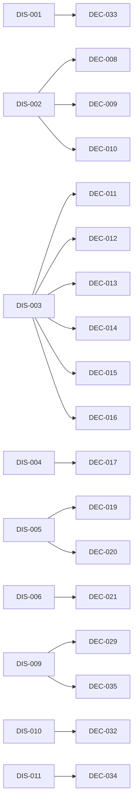

# Index

Generated by `tools/build_index.py` from note front matter; do not edit by hand.

## Discussions

| id | title | status | created | from | leads to | related |
|---|---|---|---|---|---|---|
| [DIS-001](discussions/DIS-001-deferred-disease-task-questions.md) | Deferred disease-task questions (precirrhosis, kidney tasks, image-level area) | parked | 2026-10-23 |  | [DEC-033](decisions/DEC-033-precirrhosis-as-middle-grade-of-cirrhosis-task.md) | [DEC-004](decisions/DEC-004-training-tasks.md), [DEC-006](decisions/DEC-006-losses-optim-tracking.md) |
| [DIS-002](discussions/DIS-002-workflow-and-folder-structure.md) | Workflow and folder structure review | concluded | 2026-10-27 |  | [DEC-008](decisions/DEC-008-repo-layout.md), [DEC-009](decisions/DEC-009-light-process-and-checks.md), [DEC-010](decisions/DEC-010-runs-record-task.md) | [DEC-003](decisions/DEC-003-trainrecipe-files-structure.md), [DEC-007](decisions/DEC-007-session-branches-no-worktrees.md) |
| [DIS-003](discussions/DIS-003-project-setup-structure.md) | Project setup structure review (milestone m-0) | concluded | 2026-10-28 |  | [DEC-011](decisions/DEC-011-docs-vs-research-notes.md), [DEC-012](decisions/DEC-012-dataset-docs-layout.md), [DEC-013](decisions/DEC-013-shared-score-formulas-losses.md), [DEC-014](decisions/DEC-014-gogs-git-remote.md), [DEC-015](decisions/DEC-015-commonbox-runs-models.md), [DEC-016](decisions/DEC-016-notes-hook-backlog-features.md) | [DIS-002](discussions/DIS-002-workflow-and-folder-structure.md), [DEC-002](decisions/DEC-002-dataset-files-structure.md), [DEC-007](decisions/DEC-007-session-branches-no-worktrees.md), [DEC-008](decisions/DEC-008-repo-layout.md), [DEC-009](decisions/DEC-009-light-process-and-checks.md) |
| [DIS-004](discussions/DIS-004-bmode-cropper.md) | B-mode cropper for ultrasound frames | concluded | 2026-10-28 |  | [DEC-017](decisions/DEC-017-bmode-cropper.md) | [DEC-012](decisions/DEC-012-dataset-docs-layout.md) |
| [DIS-005](discussions/DIS-005-labeling-tool-and-default-env.md) | Dedicated labeling tool for review tasks, and a default env matching the GPU box | concluded | 2026-10-28 |  | [DEC-019](decisions/DEC-019-label-studio-review-projects.md), [DEC-020](decisions/DEC-020-default-venv-matches-gpu-box.md) | [DEC-017](decisions/DEC-017-bmode-cropper.md), [DEC-018](decisions/DEC-018-plain-style-for-local-research.md), [DEC-012](decisions/DEC-012-dataset-docs-layout.md) |
| [DIS-006](discussions/DIS-006-human-friendly-communication.md) | Human-friendly communication between Claude and the user, research-writing standard, and links between documents | concluded | 2026-10-28 |  | [DEC-021](decisions/DEC-021-communication-and-research-writing-standards.md) | [DEC-009](decisions/DEC-009-light-process-and-checks.md), [DEC-011](decisions/DEC-011-docs-vs-research-notes.md) |
| [DIS-007](discussions/DIS-007-device-type-tagging-and-sensitivity.md) | Inferring the ultrasound device type of each image, and how sensitive models and diagnosis are to it | parked | 2026-10-29 |  |  | [DIS-001](discussions/DIS-001-deferred-disease-task-questions.md) |
| [DIS-008](discussions/DIS-008-gpu-rental-runpod-vs-aws.md) | GPU rental for training, RunPod Secure Cloud vs AWS EC2 | open | 2026-10-29 |  |  | [DEC-001](decisions/DEC-001-encrypted-data-store.md), [DEC-005](decisions/DEC-005-enc1-dataset-style.md), [DEC-020](decisions/DEC-020-default-venv-matches-gpu-box.md), [DEC-023](decisions/DEC-023-aws-s3-for-enc1-and-ec2-for-label-studio.md), [DEC-024](decisions/DEC-024-plain-never-leaves-machine01-ec2-label-studio-decrypts-in-ram.md) |
| [DIS-009](discussions/DIS-009-claude-as-second-annotator.md) | Claude as a second, blind annotator for the TASK-032 B-mode boxes | concluded | 2026-10-30 |  | [DEC-029](decisions/DEC-029-claude-labels-named-labeling-projects.md), [DEC-035](decisions/DEC-035-qwen3-vl-second-annotator-on-gpu-box.md) | [DEC-017](decisions/DEC-017-bmode-cropper.md), [DEC-019](decisions/DEC-019-label-studio-review-projects.md), [DEC-024](decisions/DEC-024-plain-never-leaves-machine01-ec2-label-studio-decrypts-in-ram.md), [DEC-025](decisions/DEC-025-aws-labelstud-public-https.md), [DEC-026](decisions/DEC-026-cloud-agent-runs-cloud-services.md) |
| [DIS-010](discussions/DIS-010-multi-agent-setup.md) | Multi-agent setup - agent roles, consult and lead sessions, parallel writers | concluded | 2026-11-02 |  | [DEC-032](decisions/DEC-032-agent-roster-consult-and-lead-skills.md) | [DEC-007](decisions/DEC-007-session-branches-no-worktrees.md), [DEC-009](decisions/DEC-009-light-process-and-checks.md), [DEC-026](decisions/DEC-026-cloud-agent-runs-cloud-services.md), [DEC-027](decisions/DEC-027-agent-ssh-to-aws-labelstud-through-ssm.md), [DEC-028](decisions/DEC-028-worktrees-for-parallel-sessions.md) |
| [DIS-011](discussions/DIS-011-diffuse-disease-polygon-extent.md) | Diffuse-disease polygons may cover part of the organ | concluded | 2026-11-03 |  | [DEC-034](decisions/DEC-034-organ-layer-from-organ-polygons-only.md) | [DEC-006](decisions/DEC-006-losses-optim-tracking.md), [DIS-001](discussions/DIS-001-deferred-disease-task-questions.md) |

## Decisions

| id | title | status | created | from | leads to | related |
|---|---|---|---|---|---|---|
| [DEC-001](decisions/DEC-001-encrypted-data-store.md) | Encrypted data store for all off-workstation data | accepted | 2026-10-22 |  |  |  |
| [DEC-002](decisions/DEC-002-dataset-files-structure.md) | Dataset files structure | accepted | 2026-10-22 |  |  | [DEC-001](decisions/DEC-001-encrypted-data-store.md) |
| [DEC-003](decisions/DEC-003-trainrecipe-files-structure.md) | Train recipe, plan and run files structure | accepted | 2026-10-22 |  |  | [DEC-002](decisions/DEC-002-dataset-files-structure.md), [DEC-004](decisions/DEC-004-training-tasks.md) |
| [DEC-004](decisions/DEC-004-training-tasks.md) | Training tasks | accepted | 2026-10-22 |  |  | [DEC-002](decisions/DEC-002-dataset-files-structure.md), [DEC-003](decisions/DEC-003-trainrecipe-files-structure.md) |
| [DEC-005](decisions/DEC-005-enc1-dataset-style.md) | `enc1` dataset style and key handling for off-workstation training | accepted | 2026-10-22 |  |  | [DEC-001](decisions/DEC-001-encrypted-data-store.md), [DEC-002](decisions/DEC-002-dataset-files-structure.md) |
| [DEC-006](decisions/DEC-006-losses-optim-tracking.md) | Losses, optimisation, confusion-based metrics and result tracking | accepted | 2026-10-23 |  |  | [DEC-003](decisions/DEC-003-trainrecipe-files-structure.md), [DEC-004](decisions/DEC-004-training-tasks.md) |
| [DEC-007](decisions/DEC-007-session-branches-no-worktrees.md) | Sessions use branches in the main checkout, never git worktrees | superseded by [DEC-028](decisions/DEC-028-worktrees-for-parallel-sessions.md) | 2026-10-27 |  |  |  |
| [DEC-008](decisions/DEC-008-repo-layout.md) | Repo layout - dataset CLI, no empty packages, notebook areas | accepted | 2026-10-27 | [DIS-002](discussions/DIS-002-workflow-and-folder-structure.md) |  | [DEC-002](decisions/DEC-002-dataset-files-structure.md), [DEC-003](decisions/DEC-003-trainrecipe-files-structure.md), [DEC-005](decisions/DEC-005-enc1-dataset-style.md), [DEC-007](decisions/DEC-007-session-branches-no-worktrees.md) |
| [DEC-009](decisions/DEC-009-light-process-and-checks.md) | Lighter task process and checks tiered by cost | accepted | 2026-10-27 | [DIS-002](discussions/DIS-002-workflow-and-folder-structure.md) |  | [DEC-007](decisions/DEC-007-session-branches-no-worktrees.md) |
| [DEC-010](decisions/DEC-010-runs-record-task.md) | Training runs record the board task they serve | accepted | 2026-10-27 | [DIS-002](discussions/DIS-002-workflow-and-folder-structure.md) |  | [DEC-006](decisions/DEC-006-losses-optim-tracking.md) |
| [DEC-011](decisions/DEC-011-docs-vs-research-notes.md) | docs/ describes how things work now; research_notes/ records why | accepted | 2026-10-28 | [DIS-003](discussions/DIS-003-project-setup-structure.md) |  | [DEC-007](decisions/DEC-007-session-branches-no-worktrees.md), [DEC-009](decisions/DEC-009-light-process-and-checks.md) |
| [DEC-012](decisions/DEC-012-dataset-docs-layout.md) | Dataset docs - style specs in docs/, one notes folder per dataset version | accepted | 2026-10-28 | [DIS-003](discussions/DIS-003-project-setup-structure.md) |  | [DEC-002](decisions/DEC-002-dataset-files-structure.md), [DEC-005](decisions/DEC-005-enc1-dataset-style.md), [DEC-008](decisions/DEC-008-repo-layout.md), [DEC-011](decisions/DEC-011-docs-vs-research-notes.md) |
| [DEC-013](decisions/DEC-013-shared-score-formulas-losses.md) | Losses reuse the matrix score formulas (soft confusion matrix, fdsc_ce) | accepted | 2026-10-28 | [DIS-003](discussions/DIS-003-project-setup-structure.md) |  | [DEC-004](decisions/DEC-004-training-tasks.md), [DEC-006](decisions/DEC-006-losses-optim-tracking.md) |
| [DEC-014](decisions/DEC-014-gogs-git-remote.md) | Self-hosted Gogs on machine01 as the git remote of both repos | accepted | 2026-10-28 | [DIS-003](discussions/DIS-003-project-setup-structure.md) |  | [DEC-007](decisions/DEC-007-session-branches-no-worktrees.md) |
| [DEC-015](decisions/DEC-015-commonbox-runs-models.md) | Common box on machine02 for runs, checkpoints and chosen models | accepted | 2026-10-28 | [DIS-003](discussions/DIS-003-project-setup-structure.md) |  | [DEC-001](decisions/DEC-001-encrypted-data-store.md), [DEC-003](decisions/DEC-003-trainrecipe-files-structure.md), [DEC-006](decisions/DEC-006-losses-optim-tracking.md), [DEC-010](decisions/DEC-010-runs-record-task.md) |
| [DEC-016](decisions/DEC-016-notes-hook-backlog-features.md) | Pre-commit hook for research_notes; Backlog decision, doc and draft features unused | accepted | 2026-10-28 | [DIS-003](discussions/DIS-003-project-setup-structure.md) |  | [DEC-009](decisions/DEC-009-light-process-and-checks.md), [DEC-011](decisions/DEC-011-docs-vs-research-notes.md), [DEC-012](decisions/DEC-012-dataset-docs-layout.md) |
| [DEC-017](decisions/DEC-017-bmode-cropper.md) | Classical B-mode box cropper, checked against label polygons and a reviewed set | accepted | 2026-10-28 | [DIS-004](discussions/DIS-004-bmode-cropper.md) |  | [DEC-012](decisions/DEC-012-dataset-docs-layout.md) |
| [DEC-018](decisions/DEC-018-plain-style-for-local-research.md) | Local research on machine01 uses the plain dataset style | accepted | 2026-10-28 |  |  | [DEC-002](decisions/DEC-002-dataset-files-structure.md), [DEC-005](decisions/DEC-005-enc1-dataset-style.md), [DEC-017](decisions/DEC-017-bmode-cropper.md) |
| [DEC-019](decisions/DEC-019-label-studio-review-projects.md) | Local Label Studio for review projects, one project per review task, driven through its API | accepted | 2026-10-28 | [DIS-005](discussions/DIS-005-labeling-tool-and-default-env.md) |  | [DEC-017](decisions/DEC-017-bmode-cropper.md), [DEC-018](decisions/DEC-018-plain-style-for-local-research.md), [DEC-012](decisions/DEC-012-dataset-docs-layout.md) |
| [DEC-020](decisions/DEC-020-default-venv-matches-gpu-box.md) | New default venv on machine01, matching the GPU box training env and running Label Studio | accepted | 2026-10-28 | [DIS-005](discussions/DIS-005-labeling-tool-and-default-env.md) |  | [DEC-019](decisions/DEC-019-label-studio-review-projects.md) |
| [DEC-021](decisions/DEC-021-communication-and-research-writing-standards.md) | Communication rules for Claude, a research-writing standard, and links between notes made by the index tool | accepted | 2026-10-28 | [DIS-006](discussions/DIS-006-human-friendly-communication.md) |  | [DEC-009](decisions/DEC-009-light-process-and-checks.md), [DEC-011](decisions/DEC-011-docs-vs-research-notes.md) |
| [DEC-022](decisions/DEC-022-label-studio-open-to-outside-helpers.md) | Label Studio may be opened to outside helpers for a labeling session | proposed | 2026-10-29 |  |  | [DEC-019](decisions/DEC-019-label-studio-review-projects.md), [DEC-018](decisions/DEC-018-plain-style-for-local-research.md) |
| [DEC-023](decisions/DEC-023-aws-s3-for-enc1-and-ec2-for-label-studio.md) | AWS S3 hosts the enc1 dataset files; EC2 hosts the Label Studio server | accepted | 2026-10-29 |  |  | [DEC-018](decisions/DEC-018-plain-style-for-local-research.md), [DEC-019](decisions/DEC-019-label-studio-review-projects.md), [DEC-022](decisions/DEC-022-label-studio-open-to-outside-helpers.md) |
| [DEC-024](decisions/DEC-024-plain-never-leaves-machine01-ec2-label-studio-decrypts-in-ram.md) | Plain-style data never leaves machine01; S3 holds enc1 images only; Label Studio on EC2 decrypts them in RAM | accepted | 2026-10-29 |  |  | [DEC-005](decisions/DEC-005-enc1-dataset-style.md), [DEC-018](decisions/DEC-018-plain-style-for-local-research.md), [DEC-022](decisions/DEC-022-label-studio-open-to-outside-helpers.md), [DEC-023](decisions/DEC-023-aws-s3-for-enc1-and-ec2-for-label-studio.md) |
| [DEC-025](decisions/DEC-025-aws-labelstud-public-https.md) | aws-labelstud, the Label Studio server on EC2, is reached over public HTTPS; first project's images only; idle stop | accepted | 2026-10-29 |  |  | [DEC-019](decisions/DEC-019-label-studio-review-projects.md), [DEC-022](decisions/DEC-022-label-studio-open-to-outside-helpers.md), [DEC-023](decisions/DEC-023-aws-s3-for-enc1-and-ec2-for-label-studio.md), [DEC-024](decisions/DEC-024-plain-never-leaves-machine01-ec2-label-studio-decrypts-in-ram.md) |
| [DEC-026](decisions/DEC-026-cloud-agent-runs-cloud-services.md) | A cloud agent runs the cloud services, with shell commands on aws-labelstud and a log of its actions | accepted | 2026-10-29 |  |  | [DEC-023](decisions/DEC-023-aws-s3-for-enc1-and-ec2-for-label-studio.md), [DEC-024](decisions/DEC-024-plain-never-leaves-machine01-ec2-label-studio-decrypts-in-ram.md), [DEC-025](decisions/DEC-025-aws-labelstud-public-https.md) |
| [DEC-027](decisions/DEC-027-agent-ssh-to-aws-labelstud-through-ssm.md) | The cloud agent has SSH access to aws-labelstud, through SSM (no open port) | accepted | 2026-10-29 |  |  | [DEC-025](decisions/DEC-025-aws-labelstud-public-https.md), [DEC-026](decisions/DEC-026-cloud-agent-runs-cloud-services.md) |
| [DEC-028](decisions/DEC-028-worktrees-for-parallel-sessions.md) | Each session works in its own git worktree, made by scripts/worktree.sh | accepted | 2026-10-30 |  |  | [DEC-007](decisions/DEC-007-session-branches-no-worktrees.md) |
| [DEC-029](decisions/DEC-029-claude-labels-named-labeling-projects.md) | Claude (Anthropic API) may label the frames of labeling projects the user names, starting with TASK-032 | superseded by [DEC-035](decisions/DEC-035-qwen3-vl-second-annotator-on-gpu-box.md) | 2026-10-30 | [DIS-009](discussions/DIS-009-claude-as-second-annotator.md) |  | [DEC-017](decisions/DEC-017-bmode-cropper.md), [DEC-019](decisions/DEC-019-label-studio-review-projects.md), [DEC-024](decisions/DEC-024-plain-never-leaves-machine01-ec2-label-studio-decrypts-in-ram.md), [DEC-026](decisions/DEC-026-cloud-agent-runs-cloud-services.md) |
| [DEC-030](decisions/DEC-030-public-copy-of-the-task-032-guide.md) | A public copy of the TASK-032 labeller's guide, with its 8 example frames served from S3 | proposed | 2026-10-30 |  |  | [DEC-023](decisions/DEC-023-aws-s3-for-enc1-and-ec2-for-label-studio.md), [DEC-024](decisions/DEC-024-plain-never-leaves-machine01-ec2-label-studio-decrypts-in-ram.md), [DEC-025](decisions/DEC-025-aws-labelstud-public-https.md), [DEC-029](decisions/DEC-029-claude-labels-named-labeling-projects.md) |
| [DEC-031](decisions/DEC-031-records-and-docs-on-the-task-board.md) | DEC / DIS records and docs/ shown on the task board as read-only copies | accepted | 2026-11-02 |  |  | [DEC-016](decisions/DEC-016-notes-hook-backlog-features.md), [DEC-011](decisions/DEC-011-docs-vs-research-notes.md), [DEC-021](decisions/DEC-021-communication-and-research-writing-standards.md) |
| [DEC-032](decisions/DEC-032-agent-roster-consult-and-lead-skills.md) | Agent roster, named spawns, /consult and /lead skills, up to 2 parallel writers | accepted | 2026-11-02 | [DIS-010](discussions/DIS-010-multi-agent-setup.md) |  | [DEC-026](decisions/DEC-026-cloud-agent-runs-cloud-services.md), [DEC-027](decisions/DEC-027-agent-ssh-to-aws-labelstud-through-ssm.md), [DEC-028](decisions/DEC-028-worktrees-for-parallel-sessions.md), [DEC-009](decisions/DEC-009-light-process-and-checks.md) |
| [DEC-033](decisions/DEC-033-precirrhosis-as-middle-grade-of-cirrhosis-task.md) | Precirrhosis returns to the cirrhosis task as the middle of three ordered grades | proposed | 2026-11-02 | [DIS-001](discussions/DIS-001-deferred-disease-task-questions.md) |  | [DEC-004](decisions/DEC-004-training-tasks.md), [DEC-006](decisions/DEC-006-losses-optim-tracking.md) |
| [DEC-034](decisions/DEC-034-organ-layer-from-organ-polygons-only.md) | The organ layer of disease tasks uses organ polygons only | accepted | 2026-11-03 | [DIS-011](discussions/DIS-011-diffuse-disease-polygon-extent.md) |  | [DEC-006](decisions/DEC-006-losses-optim-tracking.md), [DEC-033](decisions/DEC-033-precirrhosis-as-middle-grade-of-cirrhosis-task.md) |
| [DEC-035](decisions/DEC-035-qwen3-vl-second-annotator-on-gpu-box.md) | Qwen3-VL-8B (4-bit) on the GPU box is the second, blind annotator for the TASK-032 B-mode boxes | accepted | 2026-11-03 | [DIS-009](discussions/DIS-009-claude-as-second-annotator.md) |  | [DEC-017](decisions/DEC-017-bmode-cropper.md), [DEC-024](decisions/DEC-024-plain-never-leaves-machine01-ec2-label-studio-decrypts-in-ram.md), [DEC-025](decisions/DEC-025-aws-labelstud-public-https.md), [DEC-029](decisions/DEC-029-claude-labels-named-labeling-projects.md) |

## Graph

Arrows follow `from` / `outcomes` (discussion → decision → experiment).

