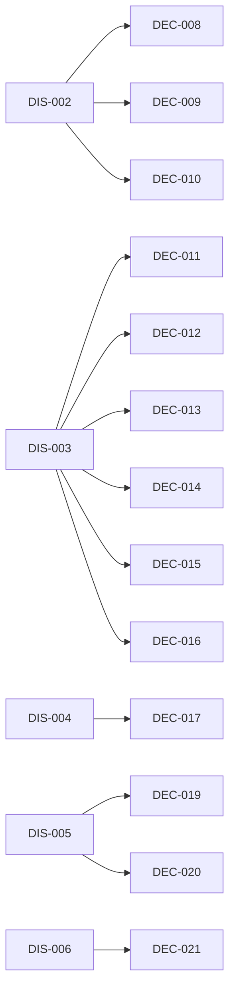

# Index

Generated by `tools/build_index.py` from note front matter; do not edit by hand.

## Discussions

| id | title | status | created | from | leads to | related |
|---|---|---|---|---|---|---|
| [DIS-001](discussions/DIS-001-deferred-disease-task-questions.md) | Deferred disease-task questions (precirrhosis, kidney tasks, image-level area) | parked | 2026-10-23 |  |  | [DEC-004](decisions/DEC-004-training-tasks.md), [DEC-006](decisions/DEC-006-losses-optim-tracking.md) |
| [DIS-002](discussions/DIS-002-workflow-and-folder-structure.md) | Workflow and folder structure review | concluded | 2026-10-27 |  | [DEC-008](decisions/DEC-008-repo-layout.md), [DEC-009](decisions/DEC-009-light-process-and-checks.md), [DEC-010](decisions/DEC-010-runs-record-task.md) | [DEC-003](decisions/DEC-003-trainrecipe-files-structure.md), [DEC-007](decisions/DEC-007-session-branches-no-worktrees.md) |
| [DIS-003](discussions/DIS-003-project-setup-structure.md) | Project setup structure review (milestone m-0) | concluded | 2026-10-28 |  | [DEC-011](decisions/DEC-011-docs-vs-research-notes.md), [DEC-012](decisions/DEC-012-dataset-docs-layout.md), [DEC-013](decisions/DEC-013-shared-score-formulas-losses.md), [DEC-014](decisions/DEC-014-gogs-git-remote.md), [DEC-015](decisions/DEC-015-commonbox-runs-models.md), [DEC-016](decisions/DEC-016-notes-hook-backlog-features.md) | [DIS-002](discussions/DIS-002-workflow-and-folder-structure.md), [DEC-002](decisions/DEC-002-dataset-files-structure.md), [DEC-007](decisions/DEC-007-session-branches-no-worktrees.md), [DEC-008](decisions/DEC-008-repo-layout.md), [DEC-009](decisions/DEC-009-light-process-and-checks.md) |
| [DIS-004](discussions/DIS-004-bmode-cropper.md) | B-mode cropper for ultrasound frames | concluded | 2026-10-28 |  | [DEC-017](decisions/DEC-017-bmode-cropper.md) | [DEC-012](decisions/DEC-012-dataset-docs-layout.md) |
| [DIS-005](discussions/DIS-005-labeling-tool-and-default-env.md) | Dedicated labeling tool for review tasks, and a default env matching the GPU box | concluded | 2026-10-28 |  | [DEC-019](decisions/DEC-019-label-studio-review-projects.md), [DEC-020](decisions/DEC-020-default-venv-matches-gpu-box.md) | [DEC-017](decisions/DEC-017-bmode-cropper.md), [DEC-018](decisions/DEC-018-plain-style-for-local-research.md), [DEC-012](decisions/DEC-012-dataset-docs-layout.md) |
| [DIS-006](discussions/DIS-006-human-friendly-communication.md) | Human-friendly communication between Claude and the user, research-writing standard, and links between documents | concluded | 2026-10-28 |  | [DEC-021](decisions/DEC-021-communication-and-research-writing-standards.md) | [DEC-009](decisions/DEC-009-light-process-and-checks.md), [DEC-011](decisions/DEC-011-docs-vs-research-notes.md) |

## Decisions

| id | title | status | created | from | leads to | related |
|---|---|---|---|---|---|---|
| [DEC-001](decisions/DEC-001-encrypted-data-store.md) | Encrypted data store for all off-workstation data | accepted | 2026-10-22 |  |  |  |
| [DEC-002](decisions/DEC-002-dataset-files-structure.md) | Dataset files structure | accepted | 2026-10-22 |  |  | [DEC-001](decisions/DEC-001-encrypted-data-store.md) |
| [DEC-003](decisions/DEC-003-trainrecipe-files-structure.md) | Train recipe, plan and run files structure | accepted | 2026-10-22 |  |  | [DEC-002](decisions/DEC-002-dataset-files-structure.md), [DEC-004](decisions/DEC-004-training-tasks.md) |
| [DEC-004](decisions/DEC-004-training-tasks.md) | Training tasks | accepted | 2026-10-22 |  |  | [DEC-002](decisions/DEC-002-dataset-files-structure.md), [DEC-003](decisions/DEC-003-trainrecipe-files-structure.md) |
| [DEC-005](decisions/DEC-005-enc1-dataset-style.md) | `enc1` dataset style and key handling for off-workstation training | accepted | 2026-10-22 |  |  | [DEC-001](decisions/DEC-001-encrypted-data-store.md), [DEC-002](decisions/DEC-002-dataset-files-structure.md) |
| [DEC-006](decisions/DEC-006-losses-optim-tracking.md) | Losses, optimisation, confusion-based metrics and result tracking | accepted | 2026-10-23 |  |  | [DEC-003](decisions/DEC-003-trainrecipe-files-structure.md), [DEC-004](decisions/DEC-004-training-tasks.md) |
| [DEC-007](decisions/DEC-007-session-branches-no-worktrees.md) | Sessions use branches in the main checkout, never git worktrees | accepted | 2026-10-27 |  |  |  |
| [DEC-008](decisions/DEC-008-repo-layout.md) | Repo layout - dataset CLI, no empty packages, notebook areas | accepted | 2026-10-27 | [DIS-002](discussions/DIS-002-workflow-and-folder-structure.md) |  | [DEC-002](decisions/DEC-002-dataset-files-structure.md), [DEC-003](decisions/DEC-003-trainrecipe-files-structure.md), [DEC-005](decisions/DEC-005-enc1-dataset-style.md), [DEC-007](decisions/DEC-007-session-branches-no-worktrees.md) |
| [DEC-009](decisions/DEC-009-light-process-and-checks.md) | Lighter task process and checks tiered by cost | accepted | 2026-10-27 | [DIS-002](discussions/DIS-002-workflow-and-folder-structure.md) |  | [DEC-007](decisions/DEC-007-session-branches-no-worktrees.md) |
| [DEC-010](decisions/DEC-010-runs-record-task.md) | Training runs record the board task they serve | accepted | 2026-10-27 | [DIS-002](discussions/DIS-002-workflow-and-folder-structure.md) |  | [DEC-006](decisions/DEC-006-losses-optim-tracking.md) |
| [DEC-011](decisions/DEC-011-docs-vs-research-notes.md) | docs/ describes how things work now; research_notes/ records why | accepted | 2026-10-28 | [DIS-003](discussions/DIS-003-project-setup-structure.md) |  | [DEC-007](decisions/DEC-007-session-branches-no-worktrees.md), [DEC-009](decisions/DEC-009-light-process-and-checks.md) |
| [DEC-012](decisions/DEC-012-dataset-docs-layout.md) | Dataset docs - style specs in docs/, one notes folder per dataset version | accepted | 2026-10-28 | [DIS-003](discussions/DIS-003-project-setup-structure.md) |  | [DEC-002](decisions/DEC-002-dataset-files-structure.md), [DEC-005](decisions/DEC-005-enc1-dataset-style.md), [DEC-008](decisions/DEC-008-repo-layout.md), [DEC-011](decisions/DEC-011-docs-vs-research-notes.md) |
| [DEC-013](decisions/DEC-013-shared-score-formulas-losses.md) | Losses reuse the matrix score formulas (soft confusion matrix, fdsc_ce) | accepted | 2026-10-28 | [DIS-003](discussions/DIS-003-project-setup-structure.md) |  | [DEC-004](decisions/DEC-004-training-tasks.md), [DEC-006](decisions/DEC-006-losses-optim-tracking.md) |
| [DEC-014](decisions/DEC-014-gogs-git-remote.md) | Self-hosted Gogs on machine01 as the git remote of both repos | accepted | 2026-10-28 | [DIS-003](discussions/DIS-003-project-setup-structure.md) |  | [DEC-007](decisions/DEC-007-session-branches-no-worktrees.md) |
| [DEC-015](decisions/DEC-015-commonbox-runs-models.md) | Common box on machine02 for runs, checkpoints and chosen models | accepted | 2026-10-28 | [DIS-003](discussions/DIS-003-project-setup-structure.md) |  | [DEC-001](decisions/DEC-001-encrypted-data-store.md), [DEC-003](decisions/DEC-003-trainrecipe-files-structure.md), [DEC-006](decisions/DEC-006-losses-optim-tracking.md), [DEC-010](decisions/DEC-010-runs-record-task.md) |
| [DEC-016](decisions/DEC-016-notes-hook-backlog-features.md) | Pre-commit hook for research_notes; Backlog decision, doc and draft features unused | accepted | 2026-10-28 | [DIS-003](discussions/DIS-003-project-setup-structure.md) |  | [DEC-009](decisions/DEC-009-light-process-and-checks.md), [DEC-011](decisions/DEC-011-docs-vs-research-notes.md), [DEC-012](decisions/DEC-012-dataset-docs-layout.md) |
| [DEC-017](decisions/DEC-017-bmode-cropper.md) | Classical B-mode box cropper, checked against label polygons and a reviewed set | accepted | 2026-10-28 | [DIS-004](discussions/DIS-004-bmode-cropper.md) |  | [DEC-012](decisions/DEC-012-dataset-docs-layout.md) |
| [DEC-018](decisions/DEC-018-plain-style-for-local-research.md) | Local research on machine01 uses the plain dataset style | accepted | 2026-10-28 |  |  | [DEC-002](decisions/DEC-002-dataset-files-structure.md), [DEC-005](decisions/DEC-005-enc1-dataset-style.md), [DEC-017](decisions/DEC-017-bmode-cropper.md) |
| [DEC-019](decisions/DEC-019-label-studio-review-projects.md) | Local Label Studio for review projects, one project per review task, driven through its API | accepted | 2026-10-28 | [DIS-005](discussions/DIS-005-labeling-tool-and-default-env.md) |  | [DEC-017](decisions/DEC-017-bmode-cropper.md), [DEC-018](decisions/DEC-018-plain-style-for-local-research.md), [DEC-012](decisions/DEC-012-dataset-docs-layout.md) |
| [DEC-020](decisions/DEC-020-default-venv-matches-gpu-box.md) | New default venv on machine01, matching the GPU box training env and running Label Studio | accepted | 2026-10-28 | [DIS-005](discussions/DIS-005-labeling-tool-and-default-env.md) |  | [DEC-019](decisions/DEC-019-label-studio-review-projects.md) |
| [DEC-021](decisions/DEC-021-communication-and-research-writing-standards.md) | Communication rules for Claude, a research-writing standard, and links between notes made by the index tool | accepted | 2026-10-28 | [DIS-006](discussions/DIS-006-human-friendly-communication.md) |  | [DEC-009](decisions/DEC-009-light-process-and-checks.md), [DEC-011](decisions/DEC-011-docs-vs-research-notes.md) |

## Graph

Arrows follow `from` / `outcomes` (discussion → decision → experiment).

