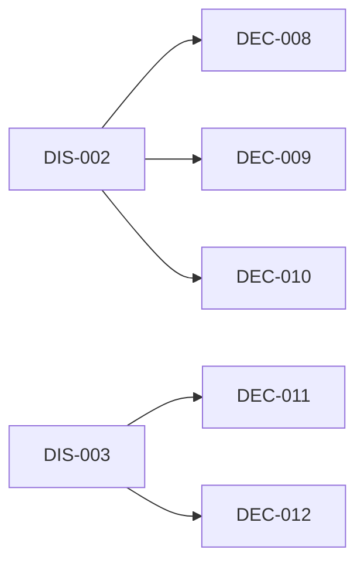

# Index

Generated by `tools/build_index.py` from note front matter; do not edit by hand.

## Discussions

| id | title | status | created | from | leads to | related |
|---|---|---|---|---|---|---|
| [DIS-001](discussions/DIS-001-deferred-disease-task-questions.md) | Deferred disease-task questions (precirrhosis, kidney tasks, image-level area) | parked | 2026-10-23 |  |  | DEC-004, DEC-006 |
| [DIS-002](discussions/DIS-002-workflow-and-folder-structure.md) | Workflow and folder structure review | concluded | 2026-10-27 |  | DEC-008, DEC-009, DEC-010 | DEC-003, DEC-007 |
| [DIS-003](discussions/DIS-003-project-setup-structure.md) | Project setup structure review (milestone m-0) | open | 2026-10-28 |  | DEC-011, DEC-012 | DIS-002, DEC-002, DEC-007, DEC-008, DEC-009 |

## Decisions

| id | title | status | created | from | leads to | related |
|---|---|---|---|---|---|---|
| [DEC-001](decisions/DEC-001-encrypted-data-store.md) | Encrypted data store for all off-workstation data | accepted | 2026-10-22 |  |  |  |
| [DEC-002](decisions/DEC-002-dataset-files-structure.md) | Dataset files structure | accepted | 2026-10-22 |  |  | DEC-001 |
| [DEC-003](decisions/DEC-003-trainrecipe-files-structure.md) | Train recipe, plan and run files structure | accepted | 2026-10-22 |  |  | DEC-002, DEC-004 |
| [DEC-004](decisions/DEC-004-training-tasks.md) | Training tasks | accepted | 2026-10-22 |  |  | DEC-002, DEC-003 |
| [DEC-005](decisions/DEC-005-enc1-dataset-style.md) | `enc1` dataset style and key handling for off-workstation training | accepted | 2026-10-22 |  |  | DEC-001, DEC-002 |
| [DEC-006](decisions/DEC-006-losses-optim-tracking.md) | Losses, optimisation, confusion-based metrics and result tracking | accepted | 2026-10-23 |  |  | DEC-003, DEC-004 |
| [DEC-007](decisions/DEC-007-session-branches-no-worktrees.md) | Sessions use branches in the main checkout, never git worktrees | accepted | 2026-10-27 |  |  |  |
| [DEC-008](decisions/DEC-008-repo-layout.md) | Repo layout - dataset CLI, no empty packages, notebook areas | accepted | 2026-10-27 | DIS-002 |  | DEC-002, DEC-003, DEC-005, DEC-007 |
| [DEC-009](decisions/DEC-009-light-process-and-checks.md) | Lighter task process and checks tiered by cost | accepted | 2026-10-27 | DIS-002 |  | DEC-007 |
| [DEC-010](decisions/DEC-010-runs-record-task.md) | Training runs record the board task they serve | accepted | 2026-10-27 | DIS-002 |  | DEC-006 |
| [DEC-011](decisions/DEC-011-docs-vs-research-notes.md) | docs/ describes how things work now; research_notes/ records why | accepted | 2026-10-28 | DIS-003 |  | DEC-007, DEC-009 |
| [DEC-012](decisions/DEC-012-dataset-docs-layout.md) | Dataset docs - style specs in docs/, one notes folder per dataset version | accepted | 2026-10-28 | DIS-003 |  | DEC-002, DEC-005, DEC-008, DEC-011 |

## Graph

Arrows follow `from` / `outcomes` (discussion → decision → experiment).

