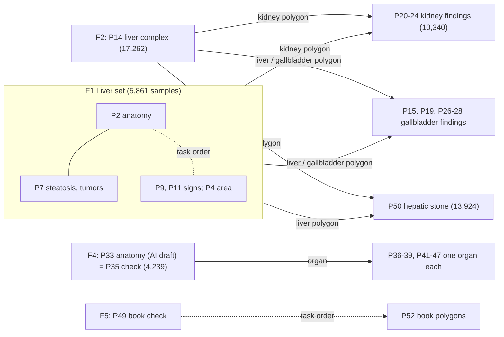

# Data interpretation rules of the labeling projects of dataset version 261023

Asked by the user on 2026-11-12 (no board task). Builds on
[labeling_qa_measures.md](labeling_qa_measures.md) (the QA report: measure codes A1-A7 and
B1-B3, categories C1-C5 of its Amendment 1, C6 and A8-A10 of Amendments 2-3). Names follow the
[glossary](../../../docs/glossary.md) (DEC-056: labeling project, tag group, tag, sample,
labeling task, given labeling). Tag lists:
[label_projects.yaml](../../../configs/data/label_projects.yaml); roles of choice tags:
[choice_labels.yaml](../../../configs/data/choice_labels.yaml) (DEC-036).

**Status: draft, exploratory.** Every rule here is a candidate. How far each rule is
respected in the labeled data is the next step and is not measured here; rules that are
not respected will be dropped. Aggregates only; no images, file names or identifiers.
Not reviewed. The user answered the open points on 2026-11-12 (see Decisions).

## Summary

1. **64 candidate rules**: 43 inside one labeling task (R01-R43, Section 2) and 21 between
   labeling projects (R44-R64, Section 3). Each rule names its subject tags, measure code
   and target, the reading of the target, and the statement the respect statistics will
   test ("expected in the data").
2. **The labeling projects share samples in five families** (Table 1, Figure 1). The 31,104
   samples with a crop row fall into a liver base of 23,027 samples (P2 and P7 on the
   same 5,861; P14 on 17,262 others), the projects routed from it by organ (P15-P28, P50),
   a Dom1 family of 4,239 samples (P33 = P35, then P36-47 by organ), and three projects that
   share no sample with any other (P29, P31, P32). The book images (P49, P52) have no crop
   rows and are linked only to each other.
3. **Same samples, same question, one project each**: P20-24 ask one kidney finding each on
   the same 10,340 samples; P27 and P28 ask one gallbladder finding each on the same 1,570.
   P26 asks P15's question again on samples P15 left unlabelled (0 samples visited by both).
4. **Task order links three of the projects without crop rows to P2**: P9 (1,212 of 1,261
   P2 tasks with `skip_anatomyunclear` carry it at the same position in P9; kappa 0.969,
   against 0.000 when shuffled), P11 (308 of its 339) and, weakly, P4 (4 of 6
   `skip_notultrasound`, 0.3 expected by chance). P1 has no such link (kappa -0.03 to 0.01
   on 6 tags, 8 comparisons), so its tags get rules inside the task only. P3 was never labeled.
5. **Cross-project rules exist only inside a family**, so the rules table stays short:
   P1, P29, P30, P31 and P32 have rules inside the task only.
6. **Four measure codes and one category were added** (user, 2026-11-12; QA report
   Amendments 2 and 3): A8 exclusive options, A9 implied tag, B4 repeat labeling inside one
   project, and A10 task-scope skip reason in the new category C6 skip-task.

## Decisions (user, 2026-11-12)

- **R04**: `thyroiditis_abscent` means no thyroid disease in the task, so it reads all three
  thyroid polygon tags as negative.
- **R10**: `heaptic_steatosis_absent` means no disease in tag group `fat_regions`. Its target
  is now the 10 disease tags of the group; `hepatic_steatosis__0` (no steatosis) and
  `__ignore` (not graded) are not diseases and do not conflict with it (analyst's reading).
- **R16**: `hepatic_steatosis_checked` means the whole tag group `fat_regions` (12 tags) was
  visited.
- **R19**: a skip reason that describes the image (role `quality`, `skip_notultrasound`,
  `skip_anatomyunclear`) leaves the sample out of every project. The 8 exclusion skips that
  name the project's own question leave out only their own labeling task (R18). They form
  measure A10 in the new category C6 skip-task; C5 stays "Other" (QA report Amendment 3).
- **R64**: repeat labelings of one sample in one project are expected to be the same: the
  same choice tags and similar polygon areas.
- **Codes**: A8, A9 and B4 are QA measures now (QA report Amendment 2); "proposed" is
  removed from them. A10 and category C6 follow from R19 (Amendment 3).
- **Role map**: `choice_labels.yaml` will be replaced by a fuller lookup table, so where the
  two differ (R10) the rules here count.
- **P11, P52**: incomplete projects. Their unvisited tasks were never worked on and are
  filtered out by the visit rule (R40); their visited tasks are read like every other
  project (R38). R41 and R43 are now part of R38 and R40.
- **Thresholds** (for respect and for polygon similarity): set by the user in the next
  phase, after seeing the values.

## Terms

- **Interpretation rule** (rule): a statement of how a given labeling of one tag changes
  the reading of another tag, a tag group, a labeling task or a sample. Each rule has a
  subject, a measure code and a target.
- **Subject**: the tag whose given labeling triggers the rule (labeling project, tag group,
  tag name), or a state of the labeling task (for example "no given labeling").
- **Measure code**: the QA measure the rule comes from: A1-A7, B1-B3 of the QA report, or
  A8, A9, B4 (QA report Amendment 2) or A10 (Amendment 3), both 2026-11-12. The category
  (C1-C6) follows in brackets.
- **Target**: what the rule changes: a tag, a tag group, the labeling task (all its tags),
  or the sample (the labeling tasks of other labeling projects on the same sample).
- **Scope**: where the target is looked for: the same labeling task, the same labeling
  group (one tag group of the task), or the same sample in another labeling project.
- **Reading**: how the target is read when the rule applies: negative (the finding is not
  there), missing (no label), left out (the sample or task gives no label), or compared
  (two entries of one fact).
- **Expected in the data**: the statement that the respect statistics will test.
- **Pn**: labeling project n (`project_id` n). "Same task" = the same labeling task.
- **Sample**: one image hash plus one crop box (DEC-044 rule 1, `CROP_KEY`). **Image**: the
  image hash alone; one image can hold several samples (several regions of one frame).
- **Visited**: the labeling task has at least one given labeling (any tag with a count above 0).
- **Family**: labeling projects that share their samples (Section 1).
- **Kappa**: Cohen's kappa, agreement of two yes/no labelings beyond chance (1 = perfect,
  0 = chance level).

## Data and method

Tables read on machine01 on 2026-11-12, in memory, read only (user's ok, DEC-052):
`taskcrops_df` (143,152 crop rows) and `flags_df` (5,559,898 labelings) of `261023_plain`.
The configs above were read for the tags. Nothing was written apart from this note.

1. Listed every tag of the 38 labeling projects from `label_projects.yaml` (621 tags).
2. For every QA measure of the QA report, wrote down which tags are its subjects and what
   they act on, from the tag groups, the role map and the label guide
   ([label-guide.md](../../../docs/label-guide.md) section 3, Q1-Q14).
3. Added links between tags that the QA report did not name but that the tag lists imply
   (options that exclude each other, one tag that implies another). These carry the codes A8
   and A9 (QA report Amendment 2).
4. **Project relationships**: placed each labeling task with a crop row on its sample and
   image, and counted for each pair of projects the shared samples, the shared visited
   samples and the shared images.
5. **Task-order link** for the projects without crop rows: sorted the tasks of each project
   by task id and compared a skip tag that both projects offer, position by position, as
   kappa. Two baselines: the same kappa with one project shuffled (200 shuffles, seed 0)
   and with one project shifted by one position. This is the method the QA report used for
   P49 and P52.
6. **Shared tags**: for each pair of projects that share samples, listed the tags with the
   same name in both, plus the one-meaning groups of label-guide Q7 (`ascites`,
   `liver_ascites`, `sign_liver_ascites`, `sign_liquid_near_liver`; `prostate`,
   `prostate_gland`) and the misspelling `prostatis`. These pairs give the second-pass rules
   (B3).
7. One row per pattern of tags, with every tag listed, so that each rule stays tag-level
   but the table stays short.

Code: one-off scripts, not in the repo.

## 1. Project relationships

Table 1. Families of labeling projects in 261023 by shared samples (31,104 samples with a
crop row; 2026-11-12). "Inside" = every sample of the later project is also a sample of
the earlier one(s). Counts are samples unless marked.

| Family | Labeling projects | Samples | How the projects are linked | Evidence |
|---|---|---:|---|---|
| F1 Liver set | P2, P7 | 5,861 (11 datasources) | the same samples | crop rows: 5,861 shared, 100% of each |
| | P9, P11 | (5,913 tasks each) | task order equals P2's | no crop rows; `skip_anatomyunclear` at the same position: P9 1,212 of 1,224 (kappa 0.969), P11 308 of 339 (0.324; P11 visited 1,517 tasks); shuffled 0.000, shifted 0.004-0.013 |
| | P4 | (5,913 tasks) | probably task order equals P2's | 4 of its 6 `skip_notultrasound` at the same position as P2 (0.3 expected by chance); too few to be sure |
| | P3 | (5,913 tasks) | not testable | never labeled |
| F2 Liver complex | P14 | 17,262 (49 datasources) | other samples than F1 | 96 samples shared with F1 |
| F3 Routed from F1 + F2 (organ routing, B2) | P20-24 (kidney findings) | 10,340 each | the same samples in all five; exactly the samples with a `kidney` polygon in P2 or P14 | 10,340 of 10,340 inside F1 + F2 |
| | P15 (gallbladder polyp) | 6,857 | inside F1 + F2; every sample with a `gallbladder` polygon (1,733) plus liver samples | 6,855 have a `liver` or `gallbladder` polygon in P2 or P14 |
| | P19 (stone), P27 (cholecystitis), P28 (tumor), P26 (polyp, second round) | 845; 1,570; 1,570; 712 | P27 = P28; P19 and P27 together are the 1,733 `gallbladder`-polygon samples (682 in both); P26 inside P27; P19, P26, P27, P28 all inside P15 | P15 and P26 visited no sample in common (0 of 711) |
| | P50 (hepatic stone) | 13,924 | inside F1 + F2, with a `liver` polygon | 13,923 of 13,924; 13,923 of the 15,339 `liver`-polygon samples were routed |
| F4 Dom1 | P33, P35 | 4,239 (3,258 images, 4 datasources) | the same samples | 100% of each |
| | P36-39, P41-47 (one organ each) | 11 to 2,411 each | each inside P33 / P35; one sample can go to several organ projects | 3,871 samples in at least one, 1,952 in two or more (e.g. P36 liver with P38 gallbladder: 987) |
| F5 Books | P49, P52 | no crop rows (13,659 and 10,948 tasks) | P52's tasks are P49's 10,948 visited tasks, in order | QA report section 5 (same label in 74.2% of matched polygon task-labels against 8.6% by chance) |
| Alone | P29 (breast), P31 (thyroid), P32 (gallbladder tumor) | 2,958; 77; 803 | share no sample with any other project | P32's 803 images all occur in F4, but with other crop boxes (1 sample shared with P50) |
| | P30 (lung), P1 (steatosis score) | no crop rows (3,949 and 5,913 tasks) | not placed | P1 against P2, P7 and P9 by task order: kappa -0.026 to 0.011 on 6 tags (8 comparisons); same grade as P7 at the same position in 39.8% of 4,657 tasks, 40.1% shuffled |

Figure 1. How the labeling projects of 261023 share samples. Solid arrows: the later
projects were given only samples where the earlier project recorded the organ (staged
routing, measure B2). Dotted lines: link by task order, inferred (projects without crop
rows). A plain line: the same samples. Not shown: P1, P3, P29, P30, P31, P32 (no shared
samples, or not placed).

Notes:

- **P7 lists each sample four times** (23,652 tasks); only the first 5,914 tasks in task
  order were visited, one per sample (5,808 samples) or two (53 samples). P2 and P7 hold the
  same samples, but in a different task order (3 of 5,913 positions match), so task order
  is not a general link between projects.
- **Repeat labeling inside one project** (samples with two or more visited tasks in one
  project): P2 52, P7 53, P20-24 104-105 each, P15, P19, P27 and P28 1 each. This is the
  subject of rule R64.
- **F4 has more samples than images** (4,239 against 3,258): some frames hold two regions,
  each its own sample. All rules here work on samples, so a rule does not pass from one
  region of a frame to the other.

## 2. Rules inside one labeling task

### 2.1 Explicit "absent" answer (A1)

Table 2. Rules from explicit "absent" answers (measure A1, category C4 double
conformance; the answer also closes the visit, C3). Reading for every row: target tags not
given in the same task are true negatives. Expected for every row: no target tag is given
in the same task.

| Rule | Subject (labeling project: tag) | Measure code | Target (scope) | Note |
|---|---|---|---|---|
| R01 | P15, P26 `gallbladder_polyp_absent`; P19 `gallbladder_stone_absent`; P20 `renal_calculus_absent`; P21 `nephritis_absent`; P22 `hydronephrosis_absent`; P23 `nephrocystosis_absent`; P24 `renal_carcinoma_absent`; P27 `cholecystitis_absent`; P28, P32 `gallbladder_tumor_absent` | A1 (C4) | the project's one polygon tag of the same finding, e.g. P20 `renal_calculus` (same task) | one finding per project (B1) |
| R02 | P29 `breast_disease_no` | A1 (C4) | polygon tags `breast_tumor`, `breast_abscess` (same task) | |
| R03 | P30 `lung_absent` | A1 (C4) | polygon tags `lung_disease_1`, `lung_disease_2` (same task) | both targets are ignored by recipes (label-guide Q8) |
| R04 | P31 `thyroiditis_abscent` | A1 (C4) | polygon tags `thyroid_tumor`, `thyroid_cyst`, `thyroiditis` (same task) | means no thyroid disease in the task (user, 2026-11-12) |
| R05 | P37 `kidney_nodisease`, P39 `bladder_nodisease`, P42 `prostate_nodisease`, P43 `disk_nodisease`, P45 `thyroid_nodisease`, P50 `no_hepatic_stone` (group `checking`) | A1 (C4) | every polygon tag of group `diseases` of the same project (same task) | |
| R06 | P46 `uterus_nodisease` | A1 (C4) | group `diseases` without `pregnancy` and `ovarian_follicle` (same task) | these two are not diseases (role map) |
| R07 | P7 `notfound` (group `tumor_check`) | A1 (C4) | tag group `tumor_regions`, 7 polygon tags (same task) | |
| R08 | P14 `anatomy_absent` | A1 (C4) | tag group `anatomy_liver`, 17 polygon tags (same task) | |
| R09 | P14 `signs_absent` | A1 (C4) | tag group `liver_signs`, 16 polygon tags (same task) | |
| R10 | P14 `heaptic_steatosis_absent` | A1 (C4) | the 10 disease tags of group `fat_regions`: `hepatic_steatosis__1`-`__3`, `hepatoma`, `hemangioma`, `hepatic_cyst`, `hepatic_cirrhosis`, `gastric_tumor`, `gallbladder_stone`, `hepatitis` (same task) | means no disease in the group (user, 2026-11-12); `__0` and `__ignore` are not diseases (analyst). The role map lists other targets; it will be replaced (user) |
| R11 | P49 `spine_nodisease`, `thyroid_nodisease`, `uterus_nodisease`, `prostate_nodisease`, `bladder_nodisease`, `kidney_nodisease`, `bursa_nodisease` (each in its group `check_disease__<Organ>`) | A1 (C4) | the disease choice tags of the same tag group (same task); uterus as R06 | choice against choice, not polygon |
| R12 | P47, P52 `bursa_nodisease` (a polygon: outline of a normal bursa) | A1, polygon form (added, analyst) | polygon tag `bursitis` (same task) | the only "absent" answer that is a polygon |

### 2.2 "Checked" mark (A2)

Table 3. Rules from "checked" marks (measure A2, category C3 visited check). Reading for
every row: with the mark, target tags not given are true negatives; without the mark and
without another closing answer, they are missing. Expected for every row: every task with
a given target tag also carries the mark (the mark was set every time).

| Rule | Subject (labeling project: tag) | Measure code | Target (scope) | Note |
|---|---|---|---|---|
| R13 | P36-39, P41-47, P50 `checked` (group `checking`) | A2 (C3) | every polygon tag of group `diseases` of the same project (same task) | P36, P38, P41, P44, P47 have no "absent" answer: the mark is their only closure |
| R14 | P9 `checked` (group `discard_reason`) | A2 (C3) | tag group `anatomy_liver`, 16 sign polygon tags (same task) | |
| R15 | P7 `checked` (group `tumor_check`) | A2 (C3) | tag group `tumor_regions` (same task) | in P7 it also means "found and drawn": R24 |
| R16 | P14 `anatomy_checked`, `signs_checked`, `hepatic_steatosis_checked`, `signal_regions_checked` | A2 (C3) | each mark's own tag group: `anatomy_liver`, `liver_signs`, `fat_regions`, `signal_regions` (same labeling group) | the visit is per labeling group, not per task; `hepatic_steatosis_checked` covers all 12 tags of `fat_regions`, disease tags included (user, 2026-11-12) |
| R17 | P14 `imagequality_checked` (group `image_quality`) | A2 (C3) (added, analyst; role `other` in the map) | the skip tags of group `image_quality` (same task): none given = quality accepted | expected also: never given with a skip tag of the group |

### 2.3 Skip reasons (A3, A10) and "cannot decide" (A4)

Table 4. Rules from skip reasons (measure A3, category C1 skip-sample; measure A10, category
C6 skip-task) and "cannot decide" answers (measure A4, category C2 skip-part). The skip tags of each project are
listed in Table 5.

| Rule | Subject (labeling project: tag) | Measure code | Target (scope) | Reading | Expected in the data |
|---|---|---|---|---|---|
| R18 | every skip tag of Table 5 | A3 (C1), A10 (C6) | the labeling task: all its other tags (same task) | left out: the task gives no label; its tags are missing, not negative | no other given labeling in the task, except other skip tags and text notes |
| R19 | the A3 skip tags, which describe the image (marked * in Table 5): role `quality`, `skip_notultrasound`, `skip_anatomyunclear` | A3 (C1) | the sample: every labeling task of the other projects on the same sample (Table 1 shows which projects share samples; for P4, P9, P11 through their task-order link) | left out of every project's labels (user, 2026-11-12) | the other projects' tasks on the same sample also carry a skip tag, or have no given labeling |
| R20 | P7 `cannotdiag` (group `tumor_check`) | A4 (C2) | tag group `tumor_regions` (same task) | missing, not negative; the rest of the task stays | no `tumor_regions` polygon in the task |
| R21 | P7, P14 polygon `hepatic_steatosis__ignore` (group `fat_regions`) | A4 (C2) | the grade polygon tags `hepatic_steatosis__0`-`__3` inside its outline (same task, pixel level) | the outlined area has no grade (not grade 0) | it does not overlap a grade polygon of the task (label-guide Q1: drawn beside graded areas) |

R19 is the user's reading (2026-11-12): a skip reason that describes the image leaves the
sample out of every project. The 8 exclusion skips that name the project's own question
(`skip_no_organ_found`, `skip_notliver`, `skip_smallliver`, `skip_notabdomen`,
`skip_otherdisease`, `skip_othercase`, `skip_toofat`, `skip_liver_c`) leave out only their
own labeling task (R18; user, 2026-11-12): "the stomach is not in view" does not make the
sample useless for the liver. These 8 are measure A10 in category C6 skip-task (QA report
Amendment 3, user 2026-11-12). R18 is also
the test inside the task for every skip tag: after a skip, the labeler is expected to give
nothing else. Where the task-order link is used (P4, P9, P11),
R19 is not an independent test: the link itself was found with skip tags.

Table 5. Skip tags (subjects of R18 and R19) per labeling project of 261023, with their
role in the map. Q = role `quality`, E = role `exclusion`. * = measure A3 (C1 skip-sample,
also a subject of R19: the sample is left out of every project); no mark = measure A10 (C6
skip-task: only the labeling task is left out). Every tag listed is a subject of R18.

| Labeling project | Skip tags |
|---|---|
| P1 | `skip_toofat` E, `skip_lowdim` Q*, `skip_cropped` Q*, `skip_liver_c` E, `skip_otherdisease` E |
| P2 | `skip_notultrasound` E*, `skip_lowdim` Q*, `skip_anatomyunclear` E* |
| P3, P4 | `skip_notultrasound` E*, `skip_lowdim` Q*, `skip_coarse` Q* |
| P7 | `skip_lowdim` Q*, `skip_notliver` E, `skip_smallliver` E, `skip_otherdisease` E |
| P9 | `skip_coarse` Q*, `skip_blurred` Q*, `skip_darkened` Q*, `skip_smallliver` E, `skip_brightened` Q*, `skip_cropped` Q*, `skip_lowdim` Q*, `skip_notliver` E, `skip_anatomyunclear` E* |
| P11 | `skip_lowdim` Q*, `skip_notliver` E, `skip_anatomyunclear` E* |
| P14 | `skip_notultrasound` E*, `skip_coarse` Q*, `skip_paperscan` Q*, `skip_olddevice` Q*, `skip_darkened` Q*, `skip_notabdomen` E, `skip_smallliver` E, `skip_brightened` Q*, `skip_cropped` Q*, `skip_blurred` Q*, `skip_toomanyannotations` Q* (`skip_untouched`: R42) |
| P15, P20-24, P26-32 | `skip_badimagequality` Q* |
| P33 | `skip_anatomyunclear` E* |
| P35 | `skip_badimagequality` Q*, `skip_othercase` E |
| P36-39, P41-47, P50 | `skip_no_organ_found` E, `skip_badimagequality` Q* |
| P49 | `skip_badimagequality` Q*, `skip_notultrasound` E*, `skip_othercase` E |
| P19, P52 | none |

### 2.4 Same fact entered twice (A5)

Table 6. Rules from two entries of one fact in one labeling task (measure A5, category C4
double conformance). Reading for every row: the two entries are compared; when they
disagree, the fact is a conflict.

| Rule | Subject (labeling project: tag) | Measure code | Target (scope) | Expected in the data |
|---|---|---|---|---|
| R22 | P7 grade choices `hepatic_steatosis__0`-`__3` (group `classify_case`) | A5 (C4) | grade polygon tags of group `fat_regions` (same task) | the chosen grade equals the highest drawn grade |
| R23 | P7 disease choices `hepatoma`, `hemangioma`, `hepatic_cyst`, `hepatic_cirrhosis`, `gastric_tumor` (group `classify_case`) | A5 (C4) (added, analyst) | the polygon tag of the same name in group `tumor_regions` (same task) | choice given if and only if the polygon is given |
| R24 | P7 `checked` (group `tumor_check`) | A5 (C4) | tag group `tumor_regions` (same task) | `checked` if and only if at least one `tumor_regions` polygon |
| R25 | P11 `hepatorenal_contrast_liverbrighter` (choice) | A5 (C4) (added, analyst) | polygon tag `sign_hepatorenal_wall_highecho` (same task) | both or neither (role-map note) |
| R26 | P14 polygon `liver_ascites` (group `anatomy_liver`) | A5 (C4) (added, analyst) | polygon tags `sign_liver_ascites`, `sign_liquid_near_liver` (group `liver_signs`, same task) | drawn together; one meaning (label-guide Q7) |

### 2.5 Options that exclude each other (A8) and implied tags (A9)

Two kinds of link are built into the tag lists; the QA report added them as measures in
Amendment 2 (user, 2026-11-12): **A8 exclusive options**: at most one tag of a set per task;
two given make the answer a conflict. **A9 implied tag**: the subject implies the target;
the subject without the target is a conflict. Both are double conformance (C4).

Table 7. Rules from exclusive options (A8) and implied tags (A9). Reading for
A8 rows: two tags of the set in one task make the set's answer a conflict (missing). For
A9 rows: a subject without its target is a conflict.

| Rule | Subject (labeling project: tag) | Measure code | Target (scope) | Expected in the data |
|---|---|---|---|---|
| R27 | P1, P7 grade choices `hepatic_steatosis__0`-`__3` (`classify_case`); P35, P49 the same tags (`check_disease__Liver`) | A8 (C4) | the other grades of the same group (same task) | at most one grade per task |
| R28 | P7 `checked`, `notfound`, `cannotdiag` (`tumor_check`) | A8 (C4) | each other (same task) | exactly one per visited task without a skip |
| R29 | P9 `hepatorenal_contrast_possible` | A8 (C4) | P9 `hepatorenal_contrast_impossible` (same task) | not both |
| R30 | P38, P49 `gallbladder_contracted`, `gallbladder_normalsized`, `gallbladder_dilated` (choices); P52 the same as polygons | A8 (C4) | each other (same task); `gallbladder_deformed` may join any | at most one size state per task (label-guide Q11) |
| R31 | P14 `anatomy_checked`, `signs_checked`, `hepatic_steatosis_checked` | A8 (C4) | the "absent" mark of the same group (same task) | not both (QA report section 3 reads the pairs as exclusive) |
| R32 | P9, P14 polygons `sign_liverskin_coarse`, `sign_liveredge_blunt`; P11 `sign_hepatorenal_wall_highecho`, `sign_gallbladderwall_vivid`, `sign_diaphragm_vivid` | A8 (C4) | their opposites: `sign_liverskin_smooth`, `sign_liveredge_sharp`; `sign_hepatorenal_wall_normal`, `sign_gallbladderwall_unvivid`, `sign_diaphragm_unvivid` / `_unseen` (same task) | not both |
| R33 | P35, P49, P52 generic `tumor`, `cyst` (`check_disease__AnyOrgan`) | A8 (C4) | the organ-specific tumor and cyst tags of the same project (same task) | not both (label-guide Q12: generic only when no organ-specific tag fits); weak, two lesions can differ |
| R34 | P35, P49 every tag of group `check_disease__<Organ>` (disease, "no disease" and size tags) for an organ with an anatomy tag | A9 (C4) | the organ choice of group `check_anatomy`: `bladder`, `gallbladder`, `kidney`, `knee`, `liver`, `lung`, `prostate` (P35) or `prostate_gland` (P49), `spine`, `stomach`, `thyroid`, `uterus` (same task) | the organ is chosen whenever a tag of its disease group is |
| R35 | P52 disease polygons of group `check_disease__<Organ>` | A9 (C4) | the organ polygon of group `check_anatomy` (same task) | the organ is drawn; weak, drawing the organ may not have been asked |
| R36 | P9, P11, P14 `hepatorenal_contrast_liverbrighter` | A9 (C4) | `hepatorenal_contrast_possible` (same task) | "liver brighter" only where the contrast could be judged |
| R37 | P14 polygon tags of `fat_regions` and `liver_signs` | A9 (C4) | the organ polygon of the finding in group `anatomy_liver`: `liver`; `gallbladder` for `gallbladder_stone`; `stomach` for `gastric_tumor` (same task) | the organ is drawn whenever its finding is (organ layer, DEC-034) |

### 2.6 Visit of a labeling task (C3, derived)

Table 8. Rules on whether a labeling task (or labeling group) was visited (category C3
visited check, derived from the project design: QA report Table 12).

| Rule | Subject | Measure code | Target (scope) | Reading | Expected in the data |
|---|---|---|---|---|---|
| R38 | any given labeling of a labeling task, in every project except P7 and P14 (R39) | C3, derived | every tag of the project (same task) | visited: tags not given are true negatives | every submitted task (`task_stat` `annotated`) has a given labeling |
| R39 | any given labeling of a labeling group, P7 and P14 | C3, derived | the tags of that tag group only (same labeling group) | a group with nothing given and no group mark was not visited: its tags are missing | not testable from the tables (reading only) |
| R40 | a labeling task with no given labeling (`task_stat` `empty` or `draft`, `annotated` without any mark, or no crop row and no mark), all projects | C3 | every tag of the task | missing, not negative | none (definition) |
| R41 | a P11 labeling task | C3, derived | every P11 tag | now part of R38 and R40: P11 is an incomplete project (user, 2026-11-12); its visited tasks are read by R38, its unvisited tasks are filtered out by R40 | as R38 |
| R42 | P14 `skip_untouched` | C3 (added, analyst; meaning not documented) | the labeling task (same task) | not visited: every tag missing | no other given labeling in the task |
| R43 | a P52 labeling task | C3, derived | every P52 tag | now part of R38 and R40: P52 is an incomplete project (user, 2026-11-12); its first 1,271 tasks were visited (QA report section 5), the rest are filtered out by R40 | as R38 |

In P11 and P52 a task where the labeler found nothing to mark looks the same as an unvisited
task, since neither project has an "absent" answer; R40 filters both out (analyst's note).

## 3. Rules between labeling projects

These rules apply only where projects share samples (Table 1). P1, P29, P30, P31 and P32
share none (or cannot be placed), so only the rules of Section 2 apply to them.

### 3.1 Staged routing (B2) and implied organ across projects (A9)

Table 9. Rules from staged routing (measure B2, category C5 other) and from a finding that
implies its organ in another project of the same family (A9). Reading of the B2
rows: the later task exists because the earlier tag puts the organ in view, so the later
project's "absent" answer is a real negative for an organ that is there.

| Rule | Subject (labeling project: tag) | Measure code | Target (scope) | Expected in the data |
|---|---|---|---|---|
| R44 | P2, P14 polygon `kidney` | B2 (C5) | the P20-24 labeling tasks on the same sample | every P20-24 sample has the polygon, and every sample with the polygon has P20-24 tasks |
| R45 | P2, P14 polygon `gallbladder` (for P19, P26, P27, P28); `liver` or `gallbladder` (for P15) | B2 (C5) | the P15, P19, P26, P27, P28 labeling tasks on the same sample | every sample of these projects has the source polygon |
| R46 | P2, P14 polygon `liver` | B2 (C5) | the P50 labeling task on the same sample | every P50 sample has the polygon |
| R47 | P33 organ polygon or P35 organ choice (`check_anatomy`) or disease choice (`check_disease__<Organ>`): `liver` → P36, `kidney` → P37, `gallbladder` → P38, `bladder` → P39, `lung` → P41, `prostate` → P42, `spine` → P43, `stomach` → P44, `thyroid` → P45, `uterus` → P46, `knee` → P47 | B2 (C5) | the organ project's labeling task on the same sample | every sample of an organ project has its organ in P33 or P35 |
| R48 | P36-39, P41-47, P50 `skip_no_organ_found` | B2 (C5) | the routing source tag of R46-R47 on the same sample | not given: the routed organ is in view (a given skip is a conflict with the source tag) |
| R49 | P7 polygon tags of `fat_regions` and `tumor_regions` | A9 (C4) (added, analyst) | the organ polygon in P2 on the same sample (F1): `liver`; `gallbladder` for `gallbladder_stone`; `stomach` for `gastric_tumor` | the organ is drawn in P2 whenever P7 draws its finding (organ layer, DEC-034) |
| R50 | P7, P9, P11 `skip_notliver` | A9 (C4) (added, analyst) | P2 polygon `liver` on the same sample (F1; P9, P11 through task order) | no `liver` polygon in P2 |

### 3.2 One finding per project (B1) and tags not asked

Table 10. Rules on how the answers of several one-finding projects on the same sample add
up (measure B1, category C5 other), and on tags that no project asked on a sample.

| Rule | Subject | Measure code | Target (scope) | Reading | Expected in the data |
|---|---|---|---|---|---|
| R51 | the P20-24 labeling tasks of one sample (`renal_calculus`, `nephritis`, `hydronephrosis`, `nephrocystosis`, `renal_carcinoma`) | B1 (C5) | the sample's kidney-finding set | each finding comes from its own project; the set is complete only when all five tasks were visited | every sample has a visited task in all five projects |
| R52 | the gallbladder tasks of one sample: P15 or P26 `gallbladder_polyp`, P19 `gallbladder_stone`, P27 `cholecystitis`, P28 `gallbladder_tumor` | B1 (C5) | the sample's gallbladder-finding set | each finding comes from its own project; a finding whose project has no task on the sample is missing (R54) | P27 and P28 are both visited on each of their samples |
| R53 | P15 and P26 (the same tags: `gallbladder_polyp`, `gallbladder_polyp_absent`) | B1 (C5) | the polyp answer of the sample | P26 continues P15: the answer comes from whichever project visited the sample | no sample visited in both |
| R54 | a tag that no visited labeling task on the sample offers | C3 | that tag on the sample | missing, not negative | none (definition) |

### 3.3 Second pass by another project (B3)

Table 11. Rules from two projects that judge the same fact on the same sample (measure
B3, category C4 double conformance). Reading for every row: two judgments of one fact;
when they disagree, the fact is a conflict. Expected for every row: the two agree (both
given or both not given), on samples visited and not skipped in both.

| Rule | Subject (labeling project: tag) | Measure code | Target (scope) | Shared samples | Note |
|---|---|---|---|---:|---|
| R55 | P35 organ choices (`check_anatomy`) offered in both: `liver`, `kidney`, `gallbladder`, `stomach`, `intestine`, `hepatic_duct`, `spine`, `pancreatin`, `knee`, `bladder`, `uterus`, `prostate`, `thyroid`, `heart`, `spleen`, `ascites` or `liver_ascites` | B3 (C4) | the P33 polygon of the same organ (`ascites` for both ascites choices), same sample | 4,239 | F4 |
| R56 | P35 disease choices (`check_disease__<Organ>`) offered in the organ project: Liver `hemangioma`, `hepatic_cirrhosis`, `hepatic_cyst`, `hepatitis`, `hepatoma`, `ascites` / `liver_ascites`; Kidney all 5; Gall_Bladder `cholecystitis`, `gallbladder_polyp`, `gallbladder_stone`, `gallbladder_tumor`; Urinary_Bladder `cystitis`, `cystolithiasis`; Lung `pleuritis` (and `lung` of `check_anatomy`); Prostate `prostate_cyst`, `prostate_stone`, `prostatis`; Spine `herniated_disk`; Stomach `gastric_tumor`; Thyroid all 3; Uterus `myoma_uterus`, `ovarian_cyst`, `ovarian_follicle`, `pregnancy`; Knee `bursitis` | B3 (C4) | the polygon tag of the same name in the organ project P36-39, P41-47 (`prostatis` → `prostatitis`, ascites → `liver_ascites`), same sample | 11 to 2,411 per organ project | F4 |
| R57 | P35 grade choices `hepatic_steatosis__0`-`__3` | B3 (C4) | P36 grade polygons, same sample | 2,411 | expected: the chosen grade equals the highest drawn grade (as R22) |
| R58 | P37 `kidney_nodisease`, P39 `bladder_nodisease`, P42 `prostate_nodisease`, P43 `disk_nodisease`, P45 `thyroid_nodisease`, P46 `uterus_nodisease` | B3 (C4) | the P35 disease choices of the same organ group, same sample | 19 to 880 | expected: no disease choice |
| R59 | P49 choices of every group (78 tags in both, e.g. `liver`, `hepatic_cirrhosis`, `kidney_nodisease`) | B3 (C4) | the P52 polygon of the same name and group, the task matched by order (F5, inferred link); a P49 `<organ>_nodisease` against the P52 disease polygons of its group | 10,948 tasks matched; P52 visited 1,271 | |
| R60 | P19 polygon `gallbladder_stone` and `gallbladder_stone_absent` | B3 (C4) | P7 polygon `gallbladder_stone` (`tumor_regions`), same sample | 845 | F1 with F3 |
| R61 | F1 tags against P14: P2 anatomy polygons (`liver`, `gallbladder`, `kidney`, `stomach`, `intestine`, `portal_vein`, `hepatic_duct`, `spleen`, `liver_ascites`); P7 grade choices and polygons, `hepatic_steatosis__ignore`, tumor polygons and choices (12 tags); P9 sign polygons (all 16); P4 `ultrasound_area`, `weak_signal_area`; P9, P11 `hepatorenal_contrast_possible`, `_liverbrighter` | B3 (C4) | the P14 tag of the same name, same sample (P4, P9, P11 through task order) | 96 | small n |
| R62 | P9 `hepatorenal_contrast_possible`, `hepatorenal_contrast_liverbrighter` | B3 (C4) | the same tag in P11, same sample (both through task order) | up to 1,517 (P11 visited) | F1, inferred link |
| R63 | P2 polygon `liver_ascites` | B3 (C4) | P9 polygons `sign_liver_ascites`, `sign_liquid_near_liver`, same sample (one meaning, label-guide Q7) | 5,913 tasks by order | F1, inferred link |

### 3.4 Repeat labeling inside one project (B4)

Table 12. Rule for a sample labeled more than once inside one labeling project (measure B4,
category C4 double conformance). Counts from Section 1.

| Rule | Subject | Measure code | Target (scope) | Reading | Expected in the data |
|---|---|---|---|---|---|
| R64 | a sample with two or more visited labeling tasks in one project (P2 52 samples, P7 53, P20-24 104-105 each, P15, P19, P27, P28 1 each) | B4 (C4) | the other visited tasks of the same project on the same sample | compared: the labelings should be the same; a difference makes the tag a conflict on that sample (user, 2026-11-12) | the same choice tags, and polygons of each tag over similar areas (threshold: next phase, set by the user after seeing the values) |

## 4. Not used

- `hepatic_steatosis__unknown` (P1, P7 choice; P3 polygon): not used at all (QA report
  Amendment 1). A task with `unknown` and no grade has no steatosis label.
- A6 AI verdict (P33 `ai_correct`, `ai_almost`, `changed`) and A7 text notes: ignored
  (Amendment 1). The P33 verdict still counts as a given labeling for R38.
- `has_other_disease`, `has_other_anatomy` (P35, P49): category C5, no rule yet. A
  candidate: a sample with `has_other_disease` is not a "no disease" negative.
- Links at image level only: P32's 803 images also occur in F4 with other crop boxes, and
  F4 frames with two regions. No rule uses them, because the rules work on samples.

## 5. Limitations

- Exploratory; one analyst; no second check of the scripts. The scripts are one-off and
  not in the repo.
- The links of P4, P9 and P11 to P2, and of P49 to P52, are inferred from task order. The P4
  link rests on 6 tasks. P1 and P30 could not be placed on samples at all.
- The task-order links were found with skip tags, so the respect statistics of R19 and
  R50 on those projects are not independent tests.
- Rules come from the tag lists, the role map and the label guide. Nothing records what the
  labelers were told, so some rules (marked "analyst" or "weak") may not match the
  instructions. The respect statistics are the check.
- Shared tags were matched by name, the Q7 one-meaning groups and one misspelling. Tags with
  the same meaning under other names are not paired.

## 6. Open points

None in this note. Next phase: the respect statistics of each rule; the user sets the
thresholds after seeing the values.
