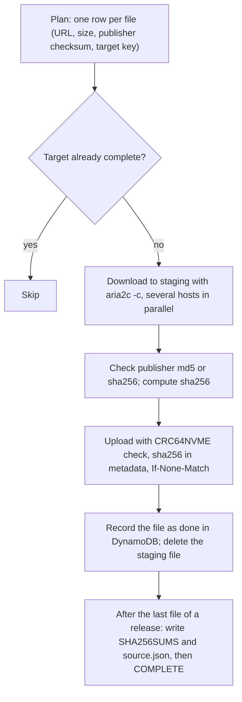

# AWS design for public ultrasound datasets: a private S3 bucket, an EC2 downloader, and scoped long-lived access

Research notes for the epic 4 report (public ultrasound datasets), written 2026-11-26 from the project's
AWS files and records and from AWS documentation and price lists. Nothing here was run against AWS.
The AWS MCP documentation tools (`aws___search_documentation`, `aws___retrieve_skill`) were not
available in this session, so AWS pages were read with WebFetch.

Conventions. Prices are for us-east-1 (US East, N. Virginia), in USD, without tax. "GB" means a
gigabyte as AWS bills it (2^30 bytes), and 1 TB = 1,024 GB. Throughput is in MB/s (10^6 bytes per
second) or Gbps (10^9 bits per second). "Unverified" marks a fact that is not confirmed at its
source in this session. Abbreviations: S3 (Amazon Simple Storage Service), EC2 (Amazon Elastic
Compute Cloud), EBS (Elastic Block Store, the EC2 disks), gp3 (the general-purpose SSD type of EBS),
IAM (Identity and Access Management), STS (Security Token Service), SSM (AWS Systems Manager),
KMS (Key Management Service), SSE-S3 and SSE-KMS (server-side encryption with S3-managed keys or with
KMS keys), NAT (network address translation), IMDSv2 (version 2 of the EC2 instance metadata service),
CA (certificate authority), CRL (certificate revocation list), CRC (cyclic redundancy check),
SLR (service-linked role), OAC (CloudFront origin access control), WAF (web application firewall).
Project terms: machine01 is the project's trusted workstation that holds the data root; enc1 is the
project's encrypted store format; the aws agent is the project's subagent for AWS work (DEC-026, AWS
work goes to the aws agent); aws-labelstud is the project's Label Studio server on EC2; "the user"
is the account administrator.

## 1. What do the project's AWS files and records say today, and which facts in the brief need correcting?

### Takeaway
Most facts in the brief hold. Four need correcting or sharpening: `aws login` credentials last
15 minutes each and are refreshed for up to 12 h; the agent's EC2 rights are not limited to the Label
Studio stack (only SSM sessions and Run Command are); aws-labelstud (the Label Studio server on EC2)
has TCP 443 open, so "no inbound ports" would be a stricter rule for a downloader; and DEC-063 (public
non-patient datasets root) itself asks for a new decision before any public dataset that may hold
patient text is stored.

### Cited Findings
- Region: the agent policy denies every action outside us-east-1 except IAM, STS, CloudFront,
  Route 53, `s3:ListAllMyBuckets`, `s3:GetBucketLocation` and `tag:GetResources` (statement
  `DenyOutsideUsEast1`) — [claude-agent-deploy.json](../../../deploy/aws/claude-agent-deploy.json)
- The IAM user `claude-agent` has console sign-in only and no access keys; Claude signs in with
  `aws login --profile agent-toolkit`, described as "12 h credentials, renewable for 90 days". The
  agent cannot change its own policies: the user pastes a new policy version in the IAM console —
  [deploy/aws/README.md](../../../deploy/aws/README.md)
- AWS states for `aws login`: "The short-term credentials expire in 15 minutes, but the CLI and SDKs
  will automatically refresh them as needed up to 12 hours. When the refresh token expires, you'll be
  prompted to log in again." The page gives no 90-day figure. Support: AWS CLI v2 yes, Boto3 yes
  ("Requires CRT"), SDK for Go V2 no, SDK for Go V1 yes — [AWS SDKs and Tools Reference, Login
  credentials provider](https://docs.aws.amazon.com/sdkref/latest/guide/feature-login-credentials.html)
- The signing-role template says "login credentials last 15 minutes"; the role has
  `MaxSessionDuration` 43200 s, the boundary, trust in the user `claude-agent` only, `s3:GetObject` on
  `datasets/*_enc1/*` and `runs/*`, `s3:PutObject` on `runs/*` —
  [claude-agent-runpod-presign.yaml](../../../deploy/aws/claude-agent-runpod-presign.yaml)
- S3 rights: `s3:*` only on `arn:aws:s3:::claude-agent-*` buckets and objects (`S3OnlyAgentBuckets`),
  object actions denied elsewhere (`DenyS3ObjectsOutsideAgentBuckets`), and `s3:PutObject` denied in
  every bucket for keys matching `*_plain*` or `*_submit1*` (`DenyPlainStyleUploads`) —
  [claude-agent-deploy.json](../../../deploy/aws/claude-agent-deploy.json)
- EC2 rights: statement `Ec2ForLabelStudio` allows `ec2:Describe*`, `RunInstances`,
  `Start/Stop/TerminateInstances`, `CreateTags`, security groups, Elastic IPs, launch templates and
  `ModifyInstanceAttribute` on `"Resource": "*"` with no condition. Only `ssm:StartSession` and
  `ssm:SendCommand` are limited to instances tagged `Project=sonoai-labelstudio`
  (`SsmSessionsOnLabelStudioOnly`, `RunCommandOnLabelStudioOnly`). There is no action to create a
  VPC, subnet, VPC endpoint, internet gateway or NAT gateway —
  [claude-agent-deploy.json](../../../deploy/aws/claude-agent-deploy.json)
- IAM rights: roles `claude-agent-*` may be created and given policies only with the boundary
  `claude-agent-boundary` (`CreateAgentRolesOnlyWithBoundary`); instance profiles `claude-agent-*`
  (`AgentInstanceProfiles`); `iam:PassRole` on `claude-agent-*` roles (`ManageAgentRoles`); IAM read
  (`iam:Get*`, `iam:List*`); service-linked roles only for Lambda, API Gateway and Lambda replication
  (`LambdaServiceLinkedRoles`); `sts:AssumeRole` only on `claude-agent-runpod-presign`; boundary removal
  and policy edits denied. No `iam:CreateUser`, `iam:CreateAccessKey`, `rolesanywhere:*`, `kms:*`,
  `cloudtrail:*`, `budgets:*` or `secretsmanager:*` —
  [claude-agent-deploy.json](../../../deploy/aws/claude-agent-deploy.json)
- The boundary allows CloudWatch Logs writes, `dynamodb:*`, `lambda:InvokeFunction`, X-Ray, the SSM
  agent's actions and `s3:*` on `claude-agent-*` buckets; it denies `iam:*`, `sts:AssumeRole` and
  `organizations:*`. It allows no Secrets Manager, no Parameter Store read and no KMS action —
  [claude-agent-boundary.json](../../../deploy/aws/claude-agent-boundary.json)
- The data bucket `claude-agent-sonoai-data`: SSE-S3, versioning on, noncurrent versions expire after
  30 days, all four Block Public Access settings, `BucketOwnerEnforced`, kept on stack deletion, a
  TLS-only deny, a deny of `*_plain*` and `*_submit1*` keys, and a deny of any `PutObject` outside
  `datasets/*_enc1/*`, `code/*`, `runs/*.enc` and `runs/*/kdf.json` —
  [sonoai-data-bucket.yaml](../../../deploy/aws/sonoai-data-bucket.yaml)
- aws-labelstud (the Label Studio server on EC2): role with the boundary plus the AWS managed policy
  `AmazonSSMManagedInstanceCore` and read on `datasets/*_enc1/*` and `code/*`; inbound TCP 443 from
  anywhere ("HTTPS for Label Studio and ACME TLS-ALPN"); egress TCP 443 and 80 only; IMDSv2 required;
  encrypted gp3; tag `Project=sonoai-labelstudio`; subnet and VPC passed as parameters (a default-VPC
  subnet) — [aws-labelstud.yaml](../../../deploy/aws/aws-labelstud.yaml),
  [deploy/aws/README.md](../../../deploy/aws/README.md)
- The README's cost line says the Elastic IP's public IPv4 costs "about $0.005/h, from memory"; AWS
  lists $0.005 per hour for in-use and for idle public IPv4 addresses —
  [deploy/aws/README.md](../../../deploy/aws/README.md), [Amazon VPC pricing](https://aws.amazon.com/vpc/pricing/)
- DEC-023 (S3 for enc1 files, EC2 for Label Studio) put enc1 dataset files on S3 and Label Studio on
  EC2 — [DEC-023](../../decisions/DEC-023-aws-s3-for-enc1-and-ec2-for-label-studio.md)
- DEC-024 (plain data never leaves machine01): "Hard rule: plain-style data never leaves machine01";
  "S3 holds enc1 images only" — [DEC-024](../../decisions/DEC-024-plain-never-leaves-machine01-ec2-label-studio-decrypts-in-ram.md)
- DEC-063 (public non-patient datasets root): public datasets without patient data live under
  `SONOAI_PUBLIC_DATA_ROOT` and may be copied to the GPU box and RunPod; "Scraped ultrasound images are
  not covered here: they may hold burned-in patient text and stay under the scraping rules (enc1 store
  only)"; "A later public dataset that may hold patient data (for example scraped ultrasound) needs its
  own decision" — [DEC-063](../../decisions/DEC-063-public-non-patient-datasets-root.md)
- DEC-082 (scraped Roboflow Universe images stored plain in a private bucket): rule 1 (scope) covers
  "only scraped Universe data" and the epic 2 index tables; rule 2 (where) lists a new private bucket,
  proposed name `claude-agent-sonoai-scrape`, the scraper EC2 instance and machine01; rule 3 (the
  bucket) asks for all four Block Public Access settings, SSE-KMS or SSE-S3, a TLS-only deny, "access
  only for the `claude-agent` IAM user and the scraper instance role, no public or shared presigned
  links", by CloudFormation under `deploy/aws/`; rule 4 (kept apart) says "Nothing from the project
  dataset goes to the scrape bucket or the scraper instance" and dedup runs on machine01; rule 6 amends
  DEC-063 for Universe images only —
  [DEC-082](../../decisions/DEC-082-scraped-universe-images-plain-in-a-private-s3-bucket.md)
- DEC-086 (a 12 h signing role) is superseded by DEC-088 (a 1 h signing-role session and a 45-minute
  refresh loop): "A 12 h AssumeRole from `aws login` credentials was then refused because it exceeds
  the 1 h limit for role chaining"; machine01 re-signs the POST policy every ~45 minutes —
  [DEC-086](../../decisions/DEC-086-runpod-presigning-role-12h.md),
  [DEC-088](../../decisions/DEC-088-runpod-presigning-role-1h-refresh-loop.md)
- TASK-201 (the scrape bucket template) is "In Progress", assigned to the aws agent; deploy only with
  the user's go-ahead —
  [TASK-201](../../../backlog/tasks/task-201%20-%20Private-S3-bucket-for-scraped-Universe-images-by-CloudFormation-all-Block-Public-Access-settings-server-side-encryption-TLS-only-policy-access-for-claude-agent-only-DEC-082.md)
- The TASK-201 (scrape bucket template) draft, unmerged, in the worktree
  `../ml_research-wt/aws-t201-scrape-bucket/deploy/aws/sonoai-scrape-bucket.yaml`: SSE-S3 with
  `BucketKeyEnabled: true`, all four Block Public Access settings, `BucketOwnerEnforced`, no versioning,
  a lifecycle rule that aborts incomplete multipart uploads after 7 days, a TLS-only deny, and a deny
  for every principal except the user `claude-agent` and the account root; its README draft says "Not
  deployed until the user says so" — local file, read 2026-11-25 (no public URL)
- TASK-210 (the epic 2 scraper EC2 instance and role) is "To Do"; it asks for SSM access "(no inbound
  ports, as aws-labelstud)" and "the Roboflow API key from a secret store resolved at run time" —
  [TASK-210](../../../backlog/tasks/task-210%20-%20Epic-2-scraper-EC2-instance-CloudFormation-instance-and-role-with-access-to-the-scrape-bucket-only-Roboflow-API-key-in-a-secret-store-start-and-stop-through-the-aws-agent-one-test-run-DEC-081-point-7-DEC-082.md)
- TASK-221 (signing credentials that outlive the 15-minute login credentials) is Done; its options were
  (a) a signing role (chosen in DEC-086), (b) "a dedicated IAM user with long-term access keys for
  signing only, kept on machine01 (SigV4 URLs up to 7 days; long-term keys to rotate)", (c) re-signing
  often —
  [TASK-221](../../../backlog/tasks/task-221%20-%20Decide-signing-credentials-for-the-DEC-083-presigned-URLs-and-POST-policy-that-live-longer-than-the-15-minute-aws-login-credentials.md)
- The AWS row of the services doc lists the bucket `claude-agent-sonoai-data`, aws-labelstud and the
  IAM user `claude-agent` (`aws login`) — [docs/services.md](../../../docs/services.md)

### Inferences
- Corrections to the brief: (1) `aws login` gives 15-minute credentials, refreshed up to 12 h, then a
  new login; the "90 days" in the README is not confirmed. (2) The agent can already launch, stop and
  terminate any EC2 instance in us-east-1; what is limited to aws-labelstud is SSM shell, SSH and Run
  Command. (3) aws-labelstud is not an example of "no inbound ports": it has 443 open for outside
  helpers; TASK-210 (scraper EC2 instance) already plans the stricter "no inbound ports" pattern.
  (4) The data bucket also accepts `code/` and encrypted checkpoint backups under `runs/`.
- The agent can build a downloader today (instance, role with the boundary, instance profile,
  `PassRole`), but it cannot open an SSM session or send Run Command to it unless the instance carries
  `Project=sonoai-labelstudio`. Reusing that tag would blur the guard; a new tag value needs the user.
- The tag guard is weak against the agent itself, because `ec2:CreateTags` is allowed on every
  resource.
- Any key that contains `_plain` or `_submit1` is refused for uploads by `claude-agent` in every
  bucket. Publisher file names must be turned into safe keys, with the original name kept in metadata.
- The downloader has to live in the default VPC (no VPC or endpoint creation rights), as aws-labelstud
  does.
- Public ultrasound datasets are neither DEC-063 material (public non-patient datasets root) nor
  DEC-082 material (scraped Universe images stored plain): a new decision record is needed before
  anything is stored.

### Gaps
- The README's "renewable for 90 days" could not be confirmed on the AWS page read.
- Live AWS state was not checked (constraint: no AWS calls): whether the scrape bucket exists, whether
  the default VPC has an S3 gateway endpoint or IPv6, and the account-level Block Public Access.
- DEC-025 (aws-labelstud public HTTPS), DEC-027 (SSH only through SSM), DEC-081 (epic 2 mission) and
  DEC-083 (RunPod data from S3) were seen only through references in the files above.

## 2. Should the public datasets go into the DEC-082 scrape bucket under a new prefix, or into a new bucket, and which key layout supports stage 2?

### Takeaway
A new bucket (example name `claude-agent-sonoai-public`) fits better. Its content is write-once, so
Object Lock default retention can cover the whole bucket. It leaves DEC-082 (scraped Universe images
stored plain in a private bucket) untouched and keeps the archive away from scraper code. The key
layout keeps the bytes exactly as published under `raw/`, and adds checksums and source metadata
beside them. Stage 2 (dedup on machine01, new versioned datasets, a "super-dataset" built at
runtime) then works from small manifests and fingerprints, not from copies.

### Cited Findings
- DEC-082 (scraped Universe images stored plain in a private bucket) rule 1 (scope) limits it to
  "only scraped Universe data"; rule 3 (the bucket) allows "access only for the `claude-agent` IAM user
  and the scraper instance role, no public or shared presigned links"; rule 6 amends DEC-063 (public
  non-patient datasets root) for Roboflow Universe images only —
  [DEC-082](../../decisions/DEC-082-scraped-universe-images-plain-in-a-private-s3-bucket.md)
- DEC-082's consequences list the texts to change for its exception: the CLAUDE.md hard rule on plain
  data, command-policy rule D1, the patient-data guard hook, docs/services.md and the scraping READMEs
  — [DEC-082](../../decisions/DEC-082-scraped-universe-images-plain-in-a-private-s3-bucket.md)
- Default retention: "When you set a retention period on a bucket, you specify a duration, in either
  days or years, for how long to protect every object version placed in the bucket"; an explicit
  per-object retention "override[s] any bucket property retention settings"; Object Lock "works only in
  buckets that have S3 Versioning enabled" — [S3 User Guide, Object
  Lock](https://docs.aws.amazon.com/AmazonS3/latest/userguide/object-lock.html)
- Object Lock can be enabled on an existing bucket; "After you enable Object Lock on a bucket, you
  can't disable Object Lock or suspend versioning for that bucket" — [S3 User Guide, Configuring Object
  Lock](https://docs.aws.amazon.com/AmazonS3/latest/userguide/object-lock-configure.html)
- "Retention periods and legal holds don't prevent new versions of the object from being created, or
  delete markers to be added on top of the object" — [S3 User Guide, Object
  Lock](https://docs.aws.amazon.com/AmazonS3/latest/userguide/object-lock.html)
- A write with `If-None-Match: *` fails with "412 Precondition Failed" when the key exists; in a
  versioned bucket it checks the current version only; it works with PutObject, CompleteMultipartUpload
  and CopyObject — [S3 User Guide, Conditional
  writes](https://docs.aws.amazon.com/AmazonS3/latest/userguide/conditional-writes.html)
- Policy space: S3 bucket policies up to 20 KB and IAM policies 5 KB (as the page states); "thousands of
  access points per AWS Region per account, with a policy up to 20 KB in size for each access point" —
  [S3 User Guide, S3 Access Grants](https://docs.aws.amazon.com/AmazonS3/latest/userguide/access-grants.html)
- S3 Intelligent-Tiering "auto-tiering has a minimum eligible object size of 128 KB"; smaller objects
  stay at Frequent Access rates (WebFetch summary of the page) — [Amazon S3
  pricing](https://aws.amazon.com/s3/pricing/)
- Largest object 48.8 TiB; at most 10,000 parts per upload; parts of 5 MiB to 5 GiB — [S3 User Guide,
  Multipart upload limits](https://docs.aws.amazon.com/AmazonS3/latest/userguide/qfacts.html)
- The TASK-201 (scrape bucket template) draft has no versioning and denies every principal except the
  user `claude-agent` and the account root — local worktree file
  `../ml_research-wt/aws-t201-scrape-bucket/deploy/aws/sonoai-scrape-bucket.yaml` (read 2026-11-25)

### Inferences
Table 1. Where the public ultrasound datasets could live: a new prefix in the DEC-082 scrape bucket
(scraped Universe images stored plain), or a new bucket.

| Aspect | New prefix in `claude-agent-sonoai-scrape` | New bucket, for example `claude-agent-sonoai-public` |
|---|---|---|
| Records to change | Amend DEC-082 rule 1 (scope) and rule 3 (who may access); amend DEC-063's last bullet (later public datasets need their own decision) | One new DEC for public ultrasound datasets, amending DEC-063's last bullet; DEC-082 unchanged |
| Object Lock | Bucket-wide default retention would also lock the scraper's working files; only per-object retention fits, which needs `s3:PutObjectRetention` for the writer | Bucket-wide default retention fits, because everything in it is write-once |
| Template work | Rework the TASK-201 (scrape bucket template) draft before its first deploy: versioning, Object Lock, new principals | One more template, copied from the TASK-201 draft, plus Object Lock |
| Access list in the bucket policy | Mixes the scraper role, the downloader role and readers of two scopes | Only the downloader role, readers and `claude-agent` |
| Reach of a mistake | A scraper bug or a broad delete can reach the archive | Scraper code never touches the archive |
| Cost tracking | Shared bucket; needs per-prefix analysis | Per bucket |
| Guard texts to update (CLAUDE.md hard rule, command-policy D1, guard hook, services.md) | Yes, scope of the exception grows | Yes, a second exception is added |
| IAM change for the agent | None (`claude-agent-*` name) | None (`claude-agent-*` name) |

- Recommendation: a new bucket, made by a new CloudFormation template (for example
  `deploy/aws/sonoai-public-bucket.yaml`, stack `sonoai-public-bucket`), Object Lock enabled at creation,
  kept on stack deletion. A new DEC sets what may go in (raw releases, their manifests and fingerprints,
  curated versions of public data; never project images, tables, fingerprints or names, as in DEC-082
  rule 4, kept apart) and whether images are stored plain or encrypted.
- Name caution: "public" in the name of a private bucket can mislead a reader, and it echoes DEC-063's
  public root, whose content may go to the GPU box and RunPod. A neutral name is the alternative; the
  name is part of the new decision.
- "Super-dataset" here means the user's term: a set built at runtime by code from several chosen,
  versioned curated datasets. A "release" means one dataset version as its publisher published it.

**Proposed key layout (not in the repo; placeholders in angle brackets): look at which prefixes are write-once.**

```text
s3://claude-agent-sonoai-public/
  raw/<source>/<release>/files/<safe key of the published file>   bytes exactly as downloaded, write-once
  raw/<source>/<release>/_meta/source.json                        URLs, DOI, licence, retrieval time, HTTP headers
                                                                  (ETag, Last-Modified, Content-Length), publisher checksums,
                                                                  original file names
  raw/<source>/<release>/_meta/SHA256SUMS                         sha256 of every file, computed while downloading
  raw/<source>/<release>/_meta/COMPLETE                           written last: the release is complete
  manifests/<source>/<release>/members-v<k>.parquet               one row per member of each archive: archive key,
                                                                  member path, size, sha256
  fingerprints/<source>/<release>/<method>-v<k>.parquet           perceptual hashes or embeddings of the public images
  extracted/<source>/<release>/v<k>/shard-<n>.tar                 optional: members repacked as shards, own manifest
  curated/<name>/<version>/dataset.yaml                           recipe, licences, counts of one curated version
  curated/<name>/<version>/manifest.parquet                       rows point to raw or extracted members by key,
                                                                  S3 version ID and sha256
  catalog/sources.jsonl, catalog/curated.jsonl                    small indexes of releases and curated versions
```

- Every prefix above is written once; a correction makes a new `v<k>` or `<version>`, never an
  overwrite, which matches DEC-053 (a written table is never changed) and lets bucket-wide Object Lock
  retention apply.
- Dedup against the project dataset (stage 2, on machine01, as DEC-082 rule 4 requires for Universe
  data): the EC2 side computes fingerprints of public images only; machine01 downloads the
  `fingerprints/` and `manifests/` files (megabytes: a 64-bit hash is 8 bytes, so 1,000,000 images
  take 8 MB plus keys), compares them with the project's own fingerprints locally, and keeps the match
  list on machine01, because it is derived from project data.
- New versioned datasets: a curated version is a manifest of references, not a copy; its rows carry the
  S3 version ID and sha256, so the version stays reproducible even if a key is reused later.
- The "super-dataset" at runtime: a short YAML lists (curated name, version) pairs; code loads the
  manifests, checks sha256 on read, drops cross-set duplicates by sha256 and fingerprint groups, and
  splits by source. The mapping from a public source to a project datasource ID stays on machine01.
- Per-prefix reader scope (section 6, options for long-lived access) must include the `raw/` or
  `extracted/` prefixes that a curated manifest points to; the simpler alternative is to repack each
  curated version's members under `curated/<name>/<version>/`, at the price of a second stored copy.
- Storage class per prefix: large archives and shards in Intelligent-Tiering; small metadata in
  S3 Standard (Intelligent-Tiering does not tier objects under 128 KB). Section 4 (storage classes and
  costs) has the numbers.

### Gaps
- Whether public ultrasound images are stored plain or encrypted on S3 is a decision for the new DEC;
  DEC-063 (public non-patient datasets root) requires one.
- Whether lifecycle rules filtered by prefix and Intelligent-Tiering interact with Object Lock without
  surprises was not checked at the source (expected to work; unverified).

## 3. How should the bucket be protected as a backup?

### Takeaway
Use versioning plus Object Lock in governance mode with a bucket-wide default retention. Add a bucket
policy that denies permanent deletes and retention bypass to everyone but the account root, and the
same denies for the agent in its own policy. Skip compliance mode and MFA delete. Keep SSE-S3, all
four Block Public Access settings and a TLS-only policy, as the project's buckets already do. Log
with S3 server access logs to a separate log bucket (free apart from log storage); CloudTrail data
events are optional at $0.10 per 100,000 events.

### Cited Findings
- Compliance mode: "a protected object version can't be overwritten or deleted by any user, including
  the root user"; "The only way to delete an object under the compliance mode before its retention date
  expires is to delete the associated AWS account" — [S3 User Guide, Object
  Lock](https://docs.aws.amazon.com/AmazonS3/latest/userguide/object-lock.html)
- Governance mode: overriding needs `s3:BypassGovernanceRetention` and the header
  `x-amz-bypass-governance-retention:true`; "By default, the Amazon S3 console includes the
  `x-amz-bypass-governance-retention:true` header" — [S3 User Guide, Object
  Lock](https://docs.aws.amazon.com/AmazonS3/latest/userguide/object-lock.html)
- A legal hold "remains in place until you explicitly remove it"; anyone with `s3:PutObjectLegalHold`
  can place or remove it — [S3 User Guide, Object Lock](https://docs.aws.amazon.com/AmazonS3/latest/userguide/object-lock.html)
- A delete without a version ID on a locked object adds a delete marker (200 OK); a delete with a
  version ID returns 403 — [S3 User Guide, Object Lock](https://docs.aws.amazon.com/AmazonS3/latest/userguide/object-lock.html)
- "S3 buckets with Object Lock can't be used as destination buckets for server access logs" — [S3 User
  Guide, Configuring Object Lock](https://docs.aws.amazon.com/AmazonS3/latest/userguide/object-lock-configure.html)
- MFA delete: "only the bucket owner (root account) can enable MFA delete"; "you cannot enable MFA
  Delete using the AWS Management Console. You must use the AWS Command Line Interface (AWS CLI) or the
  API"; "You cannot use MFA delete with lifecycle configurations" — [S3 User Guide, Configuring MFA
  delete](https://docs.aws.amazon.com/AmazonS3/latest/userguide/MultiFactorAuthenticationDelete.html)
- Conditional writes can be enforced in a bucket policy with `s3:if-none-match` or `s3:if-match`;
  for multipart uploads `s3:ObjectCreationOperation` exempts CreateMultipartUpload and UploadPart; with
  such a policy, CopyObject into that prefix fails (403 without the header, 501 with it) — [S3 User
  Guide, Enforce conditional writes](https://docs.aws.amazon.com/AmazonS3/latest/userguide/conditional-writes-enforce.html)
- KMS: "Each AWS KMS key that you create in AWS KMS costs $1/month (prorated hourly)"; the S3 example
  bills requests at "$0.03 / 10,000 requests"; "a free tier of 20,000 requests/month"; AWS managed keys
  have no monthly fee but their API requests are charged — [AWS KMS pricing](https://aws.amazon.com/kms/pricing/)
- Server access logs to an S3 bucket: "There is no charge for log delivery. You pay only for the storage
  of the log files"; the destination must be in the same Region and account; delivery is best effort and
  a record "might not be delivered at all" — [S3 User Guide, Server access
  logging](https://docs.aws.amazon.com/AmazonS3/latest/userguide/ServerLogs.html)
- CloudTrail: data events "$0.10 per 100,000 data events delivered"; the first copy of management
  events is free and Event history (90 days of management events) is "available for no charge" — [AWS
  CloudTrail pricing](https://aws.amazon.com/cloudtrail/pricing/)
- "By default, Amazon S3 doesn't enable data events"; CloudTrail data events and server access logs both
  record presigned requests and identify the signer — [S3 User Guide, presigned
  URLs](https://docs.aws.amazon.com/AmazonS3/latest/userguide/using-presigned-url.html)
- Data transfer from US East (N. Virginia) to another Region: "$0.020 per GB" (AWS Price List,
  AWSDataTransfer, publication 2026-11-19) — [AWS Price List, AWSDataTransfer
  us-east-1](https://pricing.us-east-1.amazonaws.com/offers/v1.0/aws/AWSDataTransfer/current/us-east-1/index.csv)
- The agent may not act outside us-east-1 (`DenyOutsideUsEast1`) and has `s3:*` on its buckets,
  including policy, versioning, lifecycle and Object Lock actions —
  [claude-agent-deploy.json](../../../deploy/aws/claude-agent-deploy.json)
- The project's data bucket uses SSE-S3 (AES256), Block Public Access, `BucketOwnerEnforced` and a
  TLS-only deny — [sonoai-data-bucket.yaml](../../../deploy/aws/sonoai-data-bucket.yaml)
- S3 Batch Operations "Compute checksum" can compute full-object MD5 checksums of multipart objects at
  rest — [S3 User Guide, Checking object
  integrity](https://docs.aws.amazon.com/AmazonS3/latest/userguide/checking-object-integrity.html)

### Inferences
Table 2. Backup protections for the new public-datasets bucket: what each stops, its cost, who can set
it today, and the recommendation.

| Protection | What it stops | Cost | Who can set it today | Recommendation |
|---|---|---|---|---|
| Versioning | Loss on overwrite or simple delete (old versions stay) | Storage of old versions | Agent | On (Object Lock needs it) |
| Object Lock, governance mode, bucket default retention | Permanent delete or overwrite of a locked version by anyone without `s3:BypassGovernanceRetention` | Objects stay billed until retention ends | Agent, but the agent can also bypass it unless denied | On; for example 365 days, extended later |
| Object Lock, compliance mode | Any delete by anyone, root included, until retention ends | Storage committed for the whole period | Agent | No: a licence takedown could not be honoured |
| Legal hold | Deletes until the hold is removed | None | Holders of `s3:PutObjectLegalHold` | Optional, for curated versions cited in papers |
| MFA delete | Version deletes and versioning changes without the root's MFA code | None | Root user only, CLI or API only | No: root-only and not usable with lifecycle rules |
| Deny-delete bucket policy | Version deletes and retention bypass by any principal except root | None | Agent (it can also remove it unless denied) | On, with the matching deny in the agent policy |
| Replication | Loss of the bucket or the Region | Second copy, replication requests; $0.020 per GB to another Region | Same Region: agent; other Region: user | Optional; a Deep Archive replica if the publishers' copies are at risk |
| SSE-S3 | Access to the stored bytes inside AWS | Free | Agent | On (as the project's buckets) |
| SSE-KMS with a customer managed key | Reads without key permission; logs each key use | $1 per key-month and $0.03 per 10,000 requests after 20,000 free | User (no `kms:*` for the agent) | No, for public data |
| Block Public Access, all four settings | Public ACLs and public policies | Free | Agent | On |
| TLS-only deny | Requests over plain HTTP | Free | Agent | On |
| Server access logs to a separate bucket | Unseen access (best effort) | Log storage only | Agent | On (log bucket without Object Lock) |
| CloudTrail data events | Unseen object-level calls (complete record) | $0.10 per 100,000 events | User (no `cloudtrail:*`) | Optional |

Footnote to Table 2: "Agent" means the IAM user `claude-agent` with its current policy; "user" means
the account administrator in the AWS console.

- Governance, not compliance: dataset licences or publishers can ask for removal; compliance mode would
  make that impossible short of closing the account.
- Because the agent has `s3:*` on its buckets, every protection it can set, it can also undo. Real
  protection needs explicit denies in `claude-agent-deploy.json` (section 7, policy changes), applied by
  the user.
- With bucket-wide retention, job state must not live in this bucket. The boundary already allows
  `dynamodb:*`, so a small DynamoDB table with conditional writes can hold per-file status.
- Replication: the main risks are deletion and mistakes, which versioning and Object Lock cover. A
  second Region adds $0.020 per GB once (204.80 USD for 10 TB) plus the replica's storage, and needs
  the user because the agent is limited to us-east-1.
- The TASK-201 (scrape bucket template) draft sets `BucketKeyEnabled: true` with SSE-S3; S3 Bucket
  Keys reduce KMS requests, so the setting should have no effect with SSE-S3 (unverified).

**Proposed bucket policy (not in the repo; `<account-id>` is a placeholder, a template would use `${AWS::AccountId}`): look at the root exception and the `raw/` no-overwrite rule.**

```json
{
  "Version": "2012-10-17",
  "Statement": [
    {
      "Sid": "DenyInsecureTransport",
      "Effect": "Deny",
      "Principal": "*",
      "Action": "s3:*",
      "Resource": ["arn:aws:s3:::claude-agent-sonoai-public", "arn:aws:s3:::claude-agent-sonoai-public/*"],
      "Condition": {"Bool": {"aws:SecureTransport": "false"}}
    },
    {
      "Sid": "DenyEveryoneExceptListedPrincipals",
      "Effect": "Deny",
      "Principal": "*",
      "Action": "s3:*",
      "Resource": ["arn:aws:s3:::claude-agent-sonoai-public", "arn:aws:s3:::claude-agent-sonoai-public/*"],
      "Condition": {"ArnNotEquals": {"aws:PrincipalArn": [
        "arn:aws:iam::<account-id>:user/claude-agent",
        "arn:aws:iam::<account-id>:role/claude-agent-public-downloader",
        "arn:aws:iam::<account-id>:role/claude-agent-public-reader",
        "arn:aws:iam::<account-id>:root"
      ]}}
    },
    {
      "Sid": "DenyPermanentDeletesAndBypassExceptRoot",
      "Effect": "Deny",
      "Principal": "*",
      "Action": [
        "s3:DeleteObjectVersion",
        "s3:BypassGovernanceRetention",
        "s3:PutBucketObjectLockConfiguration",
        "s3:PutBucketVersioning"
      ],
      "Resource": ["arn:aws:s3:::claude-agent-sonoai-public", "arn:aws:s3:::claude-agent-sonoai-public/*"],
      "Condition": {"ArnNotEquals": {"aws:PrincipalArn": "arn:aws:iam::<account-id>:root"}}
    },
    {
      "Sid": "NoOverwritesUnderRaw",
      "Effect": "Deny",
      "Principal": "*",
      "Action": "s3:PutObject",
      "Resource": "arn:aws:s3:::claude-agent-sonoai-public/raw/*",
      "Condition": {
        "Null": {"s3:if-none-match": "true"},
        "Bool": {"s3:ObjectCreationOperation": "true"}
      }
    }
  ]
}
```

- The second statement follows the TASK-201 (scrape bucket template) draft; the last statement adapts
  AWS's Example 2 of enforced conditional writes to `If-None-Match`. Neither was tested. Any extra role
  that acts on the bucket (replication, Batch Operations) must be added to the list.
- The no-overwrite rule only works with clients that send `If-None-Match` (the S3 API calls
  `put-object --if-none-match "*"` and `complete-multipart-upload --if-none-match "*"` do); other tools
  would be refused, so it fits the project's own uploader code, not ad hoc copies.

### Gaps
- Whether the root user can always delete a bucket policy that locks everyone out was not checked here
  (unverified).
- S3 Bucket Keys and replication request prices were not fetched.
- The licences of the target datasets (takedown or redistribution terms) are covered by other notes,
  not here.

## 4. Which storage class, and what do storage, requests and data transfer cost for 1, 5 and 20 TB?

### Takeaway
Store raw archives in Intelligent-Tiering. It has no retrieval fee, falls to $0.0125 per GB-month after
30 days without access and to $0.004 after 90 days. Small metadata stays in S3 Standard. Deep Archive
($0.00099 per GB-month) suits only a second, cold copy. Few large archives cost far less in requests
than millions of small files. Copying data from EC2 into S3 is free if no NAT gateway is used. Copying
S3 to machine01 costs $0.09 per GB after 100 GB free per month, so it is the largest cost line unless
machine01 pulls only fingerprints and chosen subsets.

### Cited Findings
- AWS Price List for S3 in us-east-1, publication 2026-11-25T15:26:11Z (partial file; rows quoted as
  written): "$0.0125 per GB-Month of storage used in Intelligent-Tiering, Infrequent Access Tier";
  "$0.004 per GB-Month of storage used in Intelligent-Tiering, Archive Instant Access tier"; "$0.0025
  per 1,000 Objects per month in Intelligent-Tiering"; "$0.004 per GB-Month of storage used in Glacier
  Instant Retrieval"; "$0.03 per GB - flat fee for all bytes retrieved in Glacier Instant Retrieval";
  "$0.02 per 1,000 PUT, COPY, POST or LIST requests to Glacier Instant Retrieval"; "$0.02 per 1,000
  transitions to Glacier Instant Retrieval"; "$0.0036 per GB / month of storage used - Amazon Glacier";
  "$0.00099 per Gigabyte Month for TimedStorage-INT-DAA-ByteHrs" (Intelligent-Tiering Deep Archive
  Access tier); "$0.0025 per GB Bulk retrieval fee from Glacier Deep Archive"; "$0.005 per 1,000 PUT,
  COPY, POST, or LIST requests"; "$0.004 per 10,000 GET and all other requests" — [AWS Price List, S3
  us-east-1](https://pricing.us-east-1.amazonaws.com/offers/v1.0/aws/AmazonS3/current/us-east-1/index.csv)
- S3 Standard at $0.023 per GB-month for the first 50 TB ($0.022 next 450 TB, $0.021 above 500 TB):
  secondary sources dated 2026, one saying its rates come from the AWS Price List API (the AWS pricing
  page did not render its tables for WebFetch) — [CloudZero, S3
  pricing](https://www.cloudzero.com/blog/s3-pricing), [DevZero, AWS S3
  pricing](https://www.devzero.io/blog/aws-s3-pricing)
- S3 Glacier Deep Archive launched "From just $0.00099 per GB-month" (AWS announcement, March 2019, via
  search result) — [AWS What's New, S3 Glacier Deep
  Archive](https://aws.amazon.com/about-aws/whats-new/2019/03/S3-glacier-deep-archive)
- Minimum durations and sizes: Glacier Instant Retrieval 90 days and 128 KB; Glacier Flexible Retrieval
  90 days; Deep Archive 180 days; Deep Archive adds "40 KB of additional metadata for each archived
  object" (8 KB at Standard rates, 32 KB at Deep Archive rates); "DELETE and CANCEL requests are free";
  LIST is billed at the Standard PUT rate (WebFetch summary of the page) — [Amazon S3
  pricing](https://aws.amazon.com/s3/pricing/)
- Restores: Glacier Instant Retrieval objects are "immediately available using GET"; Deep Archive
  Standard retrieval "within 12 hours", Bulk "within 48 hours" — [S3 User Guide, archive retrieval
  options](https://docs.aws.amazon.com/AmazonS3/latest/userguide/restoring-objects-retrieval-options.html)
- Transfer: "Data transferred in from the internet" is free; data from an S3 bucket to any AWS service in
  the same Region is not charged; "Data transferred out to the internet for the first 100GB per month" is
  free, aggregated across services and Regions (WebFetch summary) — [Amazon S3
  pricing](https://aws.amazon.com/s3/pricing/)
- Internet egress from us-east-1: "$0.090 per GB - first 10 TB / month data transfer out beyond the
  global free tier", "$0.085 per GB - next 40 TB", "$0.070 per GB - next 100 TB", "$0.050 per GB -
  greater than 150 TB"; "$0.000 per GB - data transfer in per month"; S3 Transfer Acceleration adds
  "$0.040 per GB" (AWS Price List, AWSDataTransfer, publication 2026-11-19T10:58:41Z) — [AWS Price List,
  AWSDataTransfer us-east-1](https://pricing.us-east-1.amazonaws.com/offers/v1.0/aws/AWSDataTransfer/current/us-east-1/index.csv)
- NAT gateway: AWS's example (US East, Ohio) charges "$0.045 per hour" and data processing per GB
  processed; third-party guides give $0.045 per hour and $0.045 per GB for N. Virginia — [Amazon VPC
  pricing](https://aws.amazon.com/vpc/pricing/), [Cloudburn, NAT gateway
  pricing](https://cloudburn.io/blog/aws-nat-gateway-pricing)
- "There are no data processing or hourly charges for using Gateway Type VPC endpoints" — [Amazon VPC
  pricing](https://aws.amazon.com/vpc/pricing/)
- CloudFront flat-rate plans: monthly allowances of 1 M requests and 100 GB (Free), 10 M and 50 TB
  (Pro), 125 M and 50 TB (Business), 500 M and 50 TB (Premium, $1,000 per month, configurable up to
  600 TB); "you will not incur overage charges, regardless of how much you exceed your allowance", but
  sustained excess may lead to adjusted delivery; data transfer from Amazon S3 to CloudFront "continues
  to be free"; one plan covers one distribution; OAC keeps an S3 bucket private behind the distribution
  — [CloudFront Developer Guide, flat-rate pricing
  plans](https://docs.aws.amazon.com/AmazonCloudFront/latest/DeveloperGuide/flat-rate-pricing-plan.html)
- Pro costs $15 per month and Business $200 per month (search summary of the AWS launch blog; not
  fetched) — [AWS Networking blog, flat-rate pricing
  plans](https://aws.amazon.com/blogs/networking-and-content-delivery/introducing-flat-rate-pricing-plans-with-no-overages)

### Inferences
Table 3. Monthly storage cost by storage class, us-east-1, USD per month (1 TB = 1,024 GB; storage
only, no requests or retrieval).

| Storage class (price per GB-month) | 1 TB | 5 TB | 20 TB | Minimum stay, cost of that minimum for 20 TB |
|---|---|---|---|---|
| S3 Standard ($0.023, secondary source) | 23.55 | 117.76 | 471.04 | none |
| Intelligent-Tiering, Infrequent Access tier, after 30 days without access ($0.0125) | 12.80 | 64.00 | 256.00 | none known (unverified) |
| Intelligent-Tiering, Archive Instant Access tier, after 90 days without access ($0.004) | 4.10 | 20.48 | 81.92 | none known (unverified) |
| Glacier Instant Retrieval ($0.004) | 4.10 | 20.48 | 81.92 | 90 days: 245.76 |
| Glacier Flexible Retrieval ($0.0036) | 3.69 | 18.43 | 73.73 | 90 days: 221.18 |
| Glacier Deep Archive ($0.00099) | 1.01 | 5.07 | 20.28 | 180 days: 121.65 |

Footnote to Table 3: one full read costs extra in Glacier Instant Retrieval ($0.03 per GB: 30.72,
153.60 and 614.40 USD for 1, 5 and 20 TB) and in Deep Archive (Bulk $0.0025 per GB: 2.56, 12.80 and
51.20 USD, plus a restore wait of up to 48 h; the Standard rate was not verified). Intelligent-Tiering
has no retrieval fee for its instant tiers, and its Frequent Access price is assumed equal to
S3 Standard (unverified). Intelligent-Tiering monitoring adds $0.0025 per 1,000 objects of 128 KB or
more per month.

Table 4. Request costs for the same data as 1,000,000 small files or as a few large archives, USD,
one-time (n = number of requests).

| Upload pattern | n requests | S3 Standard or Intelligent-Tiering ($0.005 per 1,000) | Glacier Instant Retrieval ($0.02 per 1,000) | Deep Archive ($0.05 per 1,000, unverified) |
|---|---|---|---|---|
| 1,000,000 small files, one PUT each | 1,000,000 | 5.00 | 20.00 | 50.00 |
| 1,000 archives of 1 GB, 64 MiB parts | 18,000 | 0.09 | 0.36 | 0.90 |
| 10 TB in 8 MiB parts (a common client default, unverified) | 1,310,720 | 6.55 | 26.21 | 65.54 |
| 10 TB in 64 MiB parts | 163,840 | 0.82 | 3.28 | 8.19 |
| 10 TB in 512 MiB parts | 20,480 | 0.10 | 0.41 | 1.02 |

Footnote to Table 4: each multipart upload also makes one create and one complete request. Moving
1,000,000 objects to Glacier Instant Retrieval by lifecycle later costs another 20.00 USD
($0.02 per 1,000 transitions), so upload straight into the target class. Intelligent-Tiering never
tiers objects under 128 KB, so many small files gain nothing from it.

Table 5. Data transfer paths for the downloader and their cost, us-east-1.

| Path | Price | 2 TB, USD | 10 TB, USD |
|---|---|---|---|
| Internet to EC2 | $0.000 per GB | 0.00 | 0.00 |
| EC2 in a public subnet to S3 in the same Region | not charged (S3 lists transfer in as free) | 0.00 | 0.00 |
| EC2 in a private subnet through a NAT gateway | $0.045 per GB plus $0.045 per hour (N. Virginia per-GB rate from third-party sources) | 92.16 plus hours | 460.80 plus hours |
| EC2 to S3 through an S3 gateway endpoint | no hourly or per-GB charge | 0.00 | 0.00 |
| S3 to machine01 over the internet | $0.090 per GB after 100 GB free per month | 175.32 | 912.60 |
| S3 to machine01 through CloudFront on the Pro flat-rate plan | $15 per month (price unverified), 50 TB allowance | 15.00 | 15.00 |

Footnote to Table 5: the S3 to machine01 rows assume no other internet egress in the account that
month. 1 TB and 5 TB cost 83.16 and 451.80 USD at the internet rate; 20 TB costs 1,783.50 USD (10 TB at
$0.090 per GB, the rest at $0.085 per GB).

- Recommendation: upload raw archives with `--storage-class INTELLIGENT_TIERING`; stage 2 will read them
  soon after the download, which costs nothing extra in Intelligent-Tiering. Glacier Instant Retrieval
  is cheaper only if the data is almost never read: for 10 TB it saves 368.64 USD over the first 90 days
  (491.52 USD in Intelligent-Tiering against 122.88 USD), and one full read costs 307.20 USD.
- Deep Archive fits only a second copy that is read in an emergency (10 TB: 10.14 USD per month, 180-day
  minimum, restores within 12 to 48 h).
- Ways to limit S3 to machine01 cost, cheapest first: (1) pull only `fingerprints/` and `manifests/`
  (megabytes) for dedup, then only the chosen members; (2) download what machine01 needs directly from
  the publishers, as machine01 already does with `aria2c`, and keep S3 as the backup; (3) use the
  100 GB free per month; (4) never use S3 Transfer Acceleration for this (it adds $0.040 per GB).
- CloudFront, kept short: the Pro flat-rate plan would cut a 10 TB copy from 912.60 USD to about
  15 USD per month, and S3 to CloudFront transfer is free. It needs a distribution (the agent has
  `cloudfront:*`), viewer restriction to machine01 (WAF rule or signed URLs), the user's plan
  subscription, and a new decision, because a CloudFront host name is internet-facing and DEC-082
  rule 3 (who may access the scrape bucket) bans shared presigned links for scraped data.

### Gaps
- S3 Standard and Intelligent-Tiering Frequent Access prices come from secondary sources; the Deep
  Archive PUT and Standard retrieval prices were not found at the source.
- Whether Intelligent-Tiering has a minimum storage duration was not checked (believed none;
  unverified).
- The CloudFront Pro price, the largest object CloudFront serves, and whether a Free Tier account may
  subscribe were not confirmed at the source.
- The AWS CLI's default multipart chunk size (8 MiB from memory) was not confirmed.

## 5. How should the EC2 downloader be built: instance, network, disk, tools, integrity, job design, logging, cost and time?

### Takeaway
A small network-optimised instance is enough: c6in.large at 0.1134 USD/h On-Demand, about 0.030 USD/h
Spot. Its sustained network baseline is 3.125 Gbps, and the internet gateway limits instances under
32 vCPUs to 5 Gbps. Put it in a default-VPC public subnet with a public IPv4 address (0.005 USD/h) and
no NAT gateway. Give it no inbound ports, access only through SSM, and build it by CloudFormation. The
real limits are the publishers' servers and the disk: staging on gp3 halves the c6in.large EBS
baseline of 195 MB/s, so use instance-store NVMe (m6idn.large) or stream large files. Integrity is
checked three ways: the publisher's checksum, a sha256 computed while downloading, and S3's default
CRC64NVME check on upload. A plan-driven loop makes the job resumable and idempotent.

### Cited Findings
- Bandwidth: traffic through an internet gateway is "Limited to 5 Gbps" for instance types with fewer
  than 32 vCPUs and to 50% of the instance bandwidth above 32; single-flow traffic is limited to 5 Gbps
  outside a cluster placement group; "up to" instances burst "for a limited time, typically from 5 to
  60 minutes", and burst is "on a best effort basis" — [EC2 User Guide, instance network
  bandwidth](https://docs.aws.amazon.com/AWSEC2/latest/UserGuide/ec2-instance-network-bandwidth.html)
- Baseline / burst bandwidth in Gbps: c6in.large 3.125 / 25.0, c6in.xlarge 6.25 / 30.0, c6in.2xlarge
  12.5 / 40.0, c7gn.medium 3.125 / 25.0, c7gn.large 6.25 / 30.0, c8gn.large 6.25 / 30.0 — [EC2 Instance
  Types Guide, compute optimized network specifications](https://docs.aws.amazon.com/ec2/latest/instancetypes/co.html)
- c6in.large: 2 vCPU, 4 GiB, On-Demand $0.1134/h, Spot $0.030/h, EBS throughput 195.3125 MB/s baseline
  and 3,125 MB/s maximum, no instance storage (third-party price list, updated 2026-11-26) —
  [instances.vantage.sh, c6in.large](https://instances.vantage.sh/aws/ec2/c6in.large)
- m6idn.large: 2 vCPU, 8 GiB, On-Demand $0.15912/h, Spot $0.045/h, 118 GiB NVMe SSD instance storage,
  network "up to 25", EBS 195.3125 MB/s baseline (third-party, updated 2026-11-26) —
  [instances.vantage.sh, m6idn.large](https://instances.vantage.sh/aws/ec2/m6idn.large)
- gp3 (AWS example, "in a region that charges"): $0.08 per GB-month, a free baseline of 3,000 IOPS and
  125 MB/s, $0.005 per provisioned IOPS-month and $0.06 per provisioned MB/s-month above the baseline —
  [Amazon EBS pricing](https://aws.amazon.com/ebs/pricing/)
- Public IPv4: $0.005 per hour, in use or idle — [Amazon VPC pricing](https://aws.amazon.com/vpc/pricing/);
  the charge started on 1 February 2024 (search results on the AWS blog and What's New) — [AWS News
  Blog, public IPv4 address charge](https://aws.amazon.com/blogs/aws/new-aws-public-ipv4-address-charge-public-ip-insights/),
  [AWS What's New, 750 free hours of public IPv4](https://aws.amazon.com/fr/about-aws/whats-new/2024/02/aws-free-tier-750-hours-free-public-ipv4-addresses/)
- Spot: an interruption notice comes "two minutes before Amazon EC2 stops or terminates your Spot
  Instance"; AWS recommends checking "every 5 seconds" through instance metadata
  (`spot/instance-action`) or EventBridge — [EC2 User Guide, Spot interruption
  notices](https://docs.aws.amazon.com/AWSEC2/latest/UserGuide/spot-instance-termination-notices.html)
- "If you use the AWS CLI or an API to request a Spot Instance, you must first ensure that this role
  exists" (`AWSServiceRoleForEC2Spot`; created with `aws iam create-service-linked-role
  --aws-service-name spot.amazonaws.com`) — [EC2 User Guide, Spot service-linked
  role](https://docs.aws.amazon.com/AWSEC2/latest/UserGuide/service-linked-roles-spot-instance-requests.html)
- AWS CLI `aws s3 cp -` uploads from standard input; `--expected-size` "is needed only when a stream is
  being uploaded to s3 and the size is larger than 50GB", or the upload may hit "the default part limit
  of 10,000"; `--no-overwrite` "prevents overwriting of files at the destination"; `--checksum-algorithm`
  and `--storage-class` (including INTELLIGENT_TIERING, GLACIER_IR, DEEP_ARCHIVE) exist — [AWS CLI
  reference, s3 cp](https://docs.aws.amazon.com/cli/latest/reference/s3/cp.html)
- s5cmd: "a very fast S3 and local filesystem execution tool"; a quoted user test says "For uploads,
  s5cmd is 32x faster than s3cmd and 12x faster than aws-cli" and downloads "can saturate a 40Gbps link
  (~4.3 GB/s)"; `s5cmd pipe` uploads from stdin; `--numworkers` and `--concurrency`; it "verifies the
  integrity of files uploaded to Amazon S3 by checking the `Content-MD5` and `X-Amz-Content-Sha256`
  headers"; it uses the EC2 IAM role when on EC2 (README, release not shown) —
  [s5cmd on GitHub](https://github.com/peak/s5cmd)
- Mountpoint for Amazon S3: "writes must always start from the beginning of the file and must be made
  sequentially"; no rename on general purpose buckets; deletes only with `--allow-delete`; overwrites
  only with `--allow-overwrite` and `O_TRUNC`; "optimized for reading large files sequentially" —
  [Mountpoint semantics](https://github.com/awslabs/mountpoint-s3/blob/main/doc/SEMANTICS.md)
- Checksums: "The `CRC64NVME` checksum algorithm is the default checksum algorithm used for checksum
  calculations"; "all AWS-owned clients calculate a checksum of the object and send it with the upload
  request. S3 then independently calculates a checksum value"; "AWS SDKs do not automatically calculate
  MD5 checksums", a precalculated MD5 can be sent in `x-amz-checksum-md5`; precalculated values are
  accepted for multipart uploads "using the full object checksum type" — [S3 User Guide, Checking object
  integrity](https://docs.aws.amazon.com/AmazonS3/latest/userguide/checking-object-integrity.html)
- The default integrity protections were announced on 1 December 2024 (date from search results) —
  [AWS What's New, S3 default data integrity
  protections](https://aws.amazon.com/about-aws/whats-new/2024/12/amazon-s3-default-data-integrity-protections)
- The price list has "$0.004 per GB fee for bytes processed to compute checksum" rows for the Glacier
  classes and Intelligent-Tiering — [AWS Price List, S3
  us-east-1](https://pricing.us-east-1.amazonaws.com/offers/v1.0/aws/AmazonS3/current/us-east-1/index.csv)
- Conditional writes return 412 when the key exists and let only the first of several concurrent
  writers succeed; AWS recommends a lifecycle rule with `AbortIncompleteMultipartUpload` — [S3 User
  Guide, Conditional writes](https://docs.aws.amazon.com/AmazonS3/latest/userguide/conditional-writes.html)
- The project already resumes downloads with `aria2c -c` (DEC-088, 1 h signing-role session, rule 3) —
  [DEC-088](../../decisions/DEC-088-runpod-presigning-role-1h-refresh-loop.md)
- The boundary lets agent-made roles write CloudWatch Logs and use DynamoDB —
  [claude-agent-boundary.json](../../../deploy/aws/claude-agent-boundary.json)

### Inferences
Table 6. Candidate downloader instances, us-east-1, Linux (prices from instances.vantage.sh, updated
2026-11-26; bandwidth from AWS).

| Instance | vCPU, memory | Network baseline / burst, Gbps | EBS baseline, MB/s | Local NVMe | On-Demand, USD/h | Spot example, USD/h (saving) |
|---|---|---|---|---|---|---|
| c6in.large | 2, 4 GiB | 3.125 / 25 | 195 | none | 0.1134 | 0.030 (73.5%) |
| m6idn.large | 2, 8 GiB | not fetched / up to 25 | 195 | 118 GiB | 0.15912 | 0.045 (71.7%) |
| c6in.xlarge | 4, 8 GiB (not fetched) | 6.25 / 30 | not fetched | none | not fetched (about 0.227 if twice c6in.large; unverified) | not fetched |
| c7gn.large, c8gn.large (Graviton, ARM) | not fetched | 6.25 / 30 | not fetched | none | not fetched | not fetched |

- Choice: m6idn.large when the largest archive fits in about 100 GiB of NVMe staging; c6in.large with
  streaming uploads when files are larger or sources are reliable. A bigger instance only helps when many
  fast publishers serve in parallel, and below 32 vCPUs the internet gateway still caps at 5 Gbps.
- Disk: if every byte is written to gp3 and read back for upload, both passes share the instance's EBS
  baseline (assumption, unverified), so c6in.large plus gp3 sustains about 98 MB/s. NVMe instance storage
  avoids that limit but is lost when the instance stops or is interrupted, so only finished uploads count.
- Network: a default-VPC public subnet with an auto-assigned public IPv4 (0.24 USD per 48 h); no NAT
  gateway (it would add 0.045 USD per GB). IPv6-only is not worth it: many publishers may serve IPv4 only
  (unverified), and IPv4-only hosts would then need NAT64 through a NAT gateway. An S3 gateway endpoint is
  free but needs `ec2:CreateVpcEndpoint` from the user and changes bucket conditions from `aws:SourceIp`
  to `aws:SourceVpce`; it is only needed for a private subnet.
- Access: a security group with no inbound rules; egress 443 and 80 as aws-labelstud, plus other ports
  only if a host needs them; IMDSv2 required; `AmazonSSMManagedInstanceCore` plus the boundary, as
  aws-labelstud; tag `Project=sonoai-download`; `InstanceInitiatedShutdownBehavior: terminate`, so that
  the job can end the instance itself.
- Template: `deploy/aws/sonoai-public-downloader.yaml` (stack `sonoai-public-downloader`), role and
  instance profile `claude-agent-public-downloader` with `PermissionsBoundary` set, built and deployed by
  the aws agent after the user's go-ahead. Descriptions use hyphens, never em dashes.
- Tools: `aria2c` for HTTP(S) and FTP with several connections and resume (`-c`); `curl` piped into
  `aws s3 cp - --expected-size` for very large files from reliable hosts; `s5cmd` for many files in
  parallel; Mountpoint only for sequential reads in stage 2, not as a download target, because `aria2c`
  writes segments out of order.
- Integrity: compute sha256 (and md5 when the publisher gives md5) while the bytes pass; compare with the
  publisher's value; upload with the default CRC64NVME check; store sha256 and the publisher's checksum in
  object metadata and in `SHA256SUMS`. Computing md5 on the instance is free; S3 Batch Operations
  "Compute checksum" can do it at rest later, apparently at about 0.004 USD per GB for the classes seen
  in the price list (Standard row not seen).
- Many small loose files: pack them on the instance into tar shards before upload (fewer requests,
  eligible for Intelligent-Tiering), with a member manifest that maps each shard member to its published
  path and sha256.
- Job state: a DynamoDB table with conditional puts (allowed by the boundary), not the archive bucket,
  because the archive bucket's objects are locked. Logs: one JSON line per file (no URLs with tokens, no
  secrets) to CloudWatch Logs, or write-once objects under `logs/`.
- Publishers that need a login (tokens) need a secret on the instance; the boundary allows no Secrets
  Manager read today, which TASK-210 (scraper EC2 instance) also needs for its Roboflow key.

**Figure 1 source (Mermaid, proposed; not in the repo): look at the skip step, which makes every step safe to repeat.**



Figure 1. Proposed per-file loop of the downloader. After a crash or a Spot interruption the same plan is
run again: finished files are skipped, partial downloads resume with `aria2c -c` if the staging disk
survived, uploads never overwrite, and incomplete multipart uploads are removed by a lifecycle rule
after 7 days. On a Spot notice (checked every 5 s) the loop takes no new file.

### Gaps
- No measured throughput for the publishers likely in epic 4 (Zenodo, figshare, Mendeley Data, Kaggle,
  Google Drive, university servers); per-IP limits and quotas were not checked.
- The m6idn.large baseline bandwidth, c6in.xlarge and Graviton prices, CloudWatch Logs prices and
  DynamoDB prices were not fetched.
- `rclone` features (for example Google Drive transfers) and the `aria2c` checksum options were not
  re-checked in their manuals.
- Whether EBS read and write share one bandwidth limit, and how long EBS burst lasts, was not checked.

## 6. Which credentials give long-lasting access to one bucket or one prefix, and which are safe?

### Takeaway
On EC2 the answer is an instance profile role (option A): no long-lived key exists at all, and the
agent can build it today. A literally long-lasting credential outside AWS can be IAM Roles Anywhere
(option C: a certificate on machine01, sessions up to 12 h), which is AWS's recommended way. The other
is an IAM user access key (option B), the simpler fallback, safe enough only with one-prefix scope,
denied deletes, a source-IP condition and rotation. S3 Access Points or Access Grants (option D),
presigned URLs (option E) and AssumeRole from `aws login` (option F) do not give a long-lasting
credential by themselves. Options B and C need the user in the IAM console; the agent's policy cannot
create users, keys or Roles Anywhere resources.

### Cited Findings
- Presigned URL lifetimes: "IAM user – Valid up to 7 days when you're using AWS Signature Version 4";
  role credentials: "The presigned URL expires when the role session expires"; EC2 role credentials
  "typically 6 hours"; console URLs "between 1 minute and 12 hours"; URLs are "bearer tokens"; use
  `aws:SourceIp` on the public endpoint and `aws:SourceVpc` or `aws:SourceVpce` through a VPC endpoint;
  `s3:signatureAge` can cap a signature's age — [S3 User Guide, presigned
  URLs](https://docs.aws.amazon.com/AmazonS3/latest/userguide/using-presigned-url.html)
- The same page gives a policy that denies all access from outside an address range:
  `"NotIpAddressIfExists": {"aws:SourceIp": ...}` with `"BoolIfExists": {"aws:ViaAWSService": "false"}`
  — [S3 User Guide, presigned URLs](https://docs.aws.amazon.com/AmazonS3/latest/userguide/using-presigned-url.html)
- Roles Anywhere: workloads outside AWS get temporary credentials using "X.509 certificates issued by your
  certificate authority"; a trust anchor references "either AWS Private CA or an external CA
  certificate"; a profile can carry one session policy — [IAM Roles Anywhere User Guide,
  introduction](https://docs.aws.amazon.com/rolesanywhere/latest/userguide/introduction.html)
- `durationSeconds` "can range from 900 seconds (15 minutes) up to 43200 seconds (12 hours)", limited by
  the profile and by the role's `MaxSessionDuration`; "CreateSession is an X.509 wrapper around
  AssumeRole" — [IAM Roles Anywhere, CreateSession](https://docs.aws.amazon.com/rolesanywhere/latest/userguide/authentication-create-session.html)
- Role trust: the service principal `rolesanywhere.amazonaws.com` with `sts:AssumeRole`,
  `sts:TagSession` and `sts:SetSourceIdentity`, conditions on `aws:SourceArn` (the trust anchor's
  canonical ARN) and on certificate fields such as `aws:PrincipalTag/x509Subject/CN`; end-entity
  certificates must be X.509v3 with Digital Signature key usage and SHA256 or stronger; revocation by
  imported CRLs or CRL distribution points, not OCSP — [IAM Roles Anywhere, trust
  model](https://docs.aws.amazon.com/rolesanywhere/latest/userguide/trust-model.html)
- AWS Private CA costs "$400 per private CA per month" (general-purpose mode) or "$50 per private CA per
  month" (short-lived certificate mode), with a 30-day trial — [AWS Private CA
  pricing](https://aws.amazon.com/private-ca/pricing/)
- Role chaining "limits your ... role session to a maximum of one hour"; with a `DurationSeconds` above
  one hour "the operation fails"; an IAM user is advised only for "Workloads that cannot use IAM roles"
  and similar cases — [IAM User Guide, IAM roles](https://docs.aws.amazon.com/IAM/latest/UserGuide/id_roles_terms-and-concepts.html)
- IAM best practices: "Require workloads to use temporary credentials with IAM roles"; for workloads
  outside AWS, "You can use IAM Roles Anywhere"; for long-term keys, "update the access keys when
  needed" using "IAM access last used information" — [IAM User Guide, security best
  practices](https://docs.aws.amazon.com/IAM/latest/UserGuide/best-practices.html)
- S3 Access Grants grant "read-only, write-only, or read-write access on a per-S3-prefix basis" to IAM
  principals or directory users — [S3 User Guide, S3 Access
  Grants](https://docs.aws.amazon.com/AmazonS3/latest/userguide/access-grants.html)
- GetDataAccess needs the `s3:GetDataAccess` permission and returns STS credentials whose duration
  defaults to 1 hour, from 900 to 43200 seconds — [S3 Control API,
  GetDataAccess](https://docs.aws.amazon.com/AmazonS3/latest/API/API_control_GetDataAccess.html)
- An access point is addressed by an ARN of the form `arn:aws:s3:<region>:<account>:accesspoint/<name>`
  (CLI example) — [AWS CLI reference, s3 cp](https://docs.aws.amazon.com/cli/latest/reference/s3/cp.html)
- The project's test showed a 12 h AssumeRole from `aws login` credentials refused under the 1 h
  role-chaining limit (DEC-088, 1 h signing-role session and 45-minute refresh loop) —
  [DEC-088](../../decisions/DEC-088-runpod-presigning-role-1h-refresh-loop.md)
- The agent has no `iam:CreateUser`, `iam:CreateAccessKey` or `rolesanywhere:*`; its `sts:AssumeRole`
  covers only `claude-agent-runpod-presign` — [claude-agent-deploy.json](../../../deploy/aws/claude-agent-deploy.json)

### Inferences
Table 7. Six ways to give scoped access to one bucket or prefix, compared.

| Option | Secret and its lifetime | Scope to one bucket or prefix | Long-lived secret on machine01 | Allowed by today's `claude-agent` policy | Who acts |
|---|---|---|---|---|---|
| A. EC2 instance profile role | None; role credentials from instance metadata, rotated, about 6 h each | Yes, by the role policy | None (EC2 only) | Yes: role `claude-agent-*` with the boundary, instance profile, `PassRole`, `RunInstances` | aws agent builds the stack; the user gives the go-ahead |
| B. IAM user with an access key | Access key, valid until deleted | Yes, by the user policy; `aws:SourceIp` possible | Yes, the secret key | No: no `iam:CreateUser` or `iam:CreateAccessKey` | User, IAM console |
| C. IAM Roles Anywhere | Certificate and private key (lifetime set by the CA); sessions 15 min to 12 h | Yes, by the role policy and the profile's session policy | Yes, the private key, which never leaves machine01 | Partly: the role yes; trust anchor and profile no (no `rolesanywhere:*`) | User (CA, trust anchor, profile, certificate); agent (role stack) |
| D. S3 Access Points or Access Grants | Needs some other credential; Access Grants sessions 15 min to 12 h | Yes, per prefix | Whatever the caller already uses | No: access point and Access Grants ARNs are not `arn:aws:s3:::claude-agent-*` | User |
| E. Presigned URL or POST policy | Bearer URL; up to 7 days with IAM user keys, otherwise at most the signing session | One object (URL) or key conditions (POST) | No, but anyone holding the URL can use it | Yes, within 15 minutes (login) or 1 h (role) | Agent signs |
| F. AssumeRole from `aws login` | Role session at most 1 h (role chaining); login refreshes up to 12 h | Yes, by the role policy | No | The role yes; the caller needs a new `sts:AssumeRole` statement | User adds the statement |

Footnote to Table 7: "today's policy" is [claude-agent-deploy.json](../../../deploy/aws/claude-agent-deploy.json)
as read on 2026-11-25. Options C and B also allow presigned URLs longer than the 1 h of DEC-088 (1 h
signing-role session and 45-minute refresh loop): up to 12 h with option C and up to 7 days with
option B. Using either for RunPod would depart from DEC-088 and needs `/consult`.

- Which options meet "a long-lasting key to a specific bucket or S3 folder" safely: option C (Roles
  Anywhere) best, because the private key is never sent, sessions are short, and a CRL can revoke the
  certificate. Option B (IAM user key) is acceptable only with all of: read-only or write-only scope on
  one prefix, an explicit deny of deletes, an `aws:SourceIp` condition when machine01's public address is
  fixed, storage outside the repo and outside `.env` with file mode 600 (or a keyring), rotation on a
  fixed schedule (for example 90 days, a project choice), and alerts on use. Option A (EC2 instance role)
  is the answer for the downloader, where no key is needed. Options D, E and F do not provide a
  long-lasting credential.
- Option F (AssumeRole from `aws login`) is still useful on machine01: a profile with `role_arn` and
  `source_profile = agent-toolkit` lets the CLI renew 1 h role sessions automatically while the login
  lasts (12 h). Tools built on SDKs without login support (Go V2 per AWS's table) would need a
  `credential_process` bridge (unverified for each tool).
- Order of work for option C (Roles Anywhere): (1) the user makes a private CA on machine01 with
  `openssl` (free; AWS Private CA at 50 to 400 USD per month is not worth it here) and keeps the CA key
  offline; (2) the user creates the trust anchor and turns on CRL checks; (3) the aws agent deploys the
  role `claude-agent-public-reader` (boundary; trust policy below); (4) the user creates the profile;
  (5) the user issues machine01's certificate and sets up the AWS signing helper as
  `credential_process` (helper options not verified here).
- For option B the user creates the user (for example `sonoai-public-reader`), attaches the policy
  below, creates one key, and installs it on machine01 in its own profile. Claude never sees the
  secret, as the project's secret rules require. Rotation: create a second key, switch, deactivate the
  old one, then delete it once "last used" shows no use.

**Example policy for option A, the downloader instance role (proposed; not in the repo): look at the prefixes and the deny.**

```json
{
  "Version": "2012-10-17",
  "Statement": [
    {
      "Sid": "ListOnlyOwnPrefixes",
      "Effect": "Allow",
      "Action": "s3:ListBucket",
      "Resource": "arn:aws:s3:::claude-agent-sonoai-public",
      "Condition": {"StringLike": {"s3:prefix": ["raw/*", "manifests/*", "fingerprints/*"]}}
    },
    {
      "Sid": "ListOpenMultipartUploads",
      "Effect": "Allow",
      "Action": "s3:ListBucketMultipartUploads",
      "Resource": "arn:aws:s3:::claude-agent-sonoai-public"
    },
    {
      "Sid": "WriteOnceAndReadOwnPrefixes",
      "Effect": "Allow",
      "Action": [
        "s3:PutObject",
        "s3:GetObject",
        "s3:GetObjectAttributes",
        "s3:AbortMultipartUpload",
        "s3:ListMultipartUploadParts"
      ],
      "Resource": [
        "arn:aws:s3:::claude-agent-sonoai-public/raw/*",
        "arn:aws:s3:::claude-agent-sonoai-public/manifests/*",
        "arn:aws:s3:::claude-agent-sonoai-public/fingerprints/*"
      ]
    },
    {
      "Sid": "NoDeletesNoLockOrBucketChanges",
      "Effect": "Deny",
      "Action": [
        "s3:DeleteObject",
        "s3:DeleteObjectVersion",
        "s3:BypassGovernanceRetention",
        "s3:PutObjectRetention",
        "s3:PutObjectLegalHold",
        "s3:PutBucket*",
        "s3:DeleteBucket*",
        "s3:PutLifecycleConfiguration"
      ],
      "Resource": ["arn:aws:s3:::claude-agent-sonoai-public", "arn:aws:s3:::claude-agent-sonoai-public/*"]
    }
  ]
}
```

**Example policy for long-lived read access to one prefix, for the option C role or the option B user (proposed; `<name>` and the address are placeholders): look at the last statement, which only option B needs.**

```json
{
  "Version": "2012-10-17",
  "Statement": [
    {
      "Sid": "ListOnePrefix",
      "Effect": "Allow",
      "Action": "s3:ListBucket",
      "Resource": "arn:aws:s3:::claude-agent-sonoai-public",
      "Condition": {"StringLike": {"s3:prefix": ["curated/<name>/*"]}}
    },
    {
      "Sid": "ReadOnePrefix",
      "Effect": "Allow",
      "Action": [
        "s3:GetObject",
        "s3:GetObjectVersion",
        "s3:GetObjectAttributes",
        "s3:GetObjectVersionAttributes"
      ],
      "Resource": "arn:aws:s3:::claude-agent-sonoai-public/curated/<name>/*"
    },
    {
      "Sid": "NoWritesNoDeletes",
      "Effect": "Deny",
      "Action": ["s3:PutObject", "s3:DeleteObject", "s3:DeleteObjectVersion", "s3:BypassGovernanceRetention"],
      "Resource": "arn:aws:s3:::claude-agent-sonoai-public/*"
    },
    {
      "Sid": "OptionBOnlyFromMachine01PublicAddress",
      "Effect": "Deny",
      "Action": "*",
      "Resource": "*",
      "Condition": {
        "NotIpAddressIfExists": {"aws:SourceIp": "<machine01 public IPv4>/32"},
        "BoolIfExists": {"aws:ViaAWSService": "false"}
      }
    }
  ]
}
```

**Example trust policy for the option C role `claude-agent-public-reader` (adapted from AWS's trust model page; placeholders in angle brackets): look at the two conditions.**

```json
{
  "Version": "2012-10-17",
  "Statement": [
    {
      "Effect": "Allow",
      "Principal": {"Service": "rolesanywhere.amazonaws.com"},
      "Action": ["sts:AssumeRole", "sts:TagSession", "sts:SetSourceIdentity"],
      "Condition": {
        "StringEquals": {"aws:PrincipalTag/x509Subject/CN": "machine01-public-reader"},
        "ArnEquals": {"aws:SourceArn": "arn:aws:rolesanywhere:us-east-1:<account-id>:trust-anchor/<trust-anchor-id>"}
      }
    }
  ]
}
```

- The read policy above covers one curated prefix; a curated manifest that points into `raw/` needs those
  source prefixes added (see section 2, key layout).
- Action names `s3:GetObjectAttributes` and `s3:GetObjectVersionAttributes` are from memory and should be
  checked with IAM Access Analyzer policy validation before use.

### Gaps
- IAM Roles Anywhere pricing was not confirmed (believed to have no extra charge; unverified).
- The signing helper's support for keys held in a TPM or PKCS#11 device was not confirmed in the pages
  read.
- Which transfer tools on machine01 (`s5cmd`, `rclone`, Boto3 without CRT) accept `credential_process`
  or login profiles was not checked per tool.
- S3 Access Grants pricing was not found.

## 7. What changes would this need in `claude-agent-deploy.json` or the boundary, and who must make them?

### Takeaway
The bucket stack needs no IAM change: its name starts with `claude-agent-` and the agent has `s3:*`
and `cloudformation:*`. The downloader needs small changes, all applied by the user in the IAM console:
a new tag value for SSM and Run Command, the Spot service-linked role, and Secrets Manager read in the
boundary if a publisher needs a token. Protecting the backup from the agent itself needs explicit
denies in the agent's policy. Options B (IAM user key) and C (Roles Anywhere) are set up by the user.

### Cited Findings
- "Edit the JSON here, then paste it into the IAM console as a new policy version (the agent cannot
  change its own policies)"; the managed policies must be named `claude-agent-deploy` and
  `claude-agent-boundary` — [deploy/aws/README.md](../../../deploy/aws/README.md)
- `DenyBoundaryRemovalAndPolicyEdits` denies `iam:CreatePolicyVersion`, `iam:DeletePolicy`,
  `iam:SetDefaultPolicyVersion` and boundary changes; `SsmSessionsOnLabelStudioOnly` and
  `RunCommandOnLabelStudioOnly` use `"ssm:resourceTag/Project": "sonoai-labelstudio"`;
  `LambdaServiceLinkedRoles` lists only `lambda.amazonaws.com`, `apigateway.amazonaws.com` and
  `replicator.lambda.amazonaws.com` — [claude-agent-deploy.json](../../../deploy/aws/claude-agent-deploy.json)
- The boundary has no `secretsmanager:*` and no `ssm:GetParameter` —
  [claude-agent-boundary.json](../../../deploy/aws/claude-agent-boundary.json)
- A Spot request through the CLI or API needs `AWSServiceRoleForEC2Spot` to exist first — [EC2 User
  Guide, Spot service-linked role](https://docs.aws.amazon.com/AWSEC2/latest/UserGuide/service-linked-roles-spot-instance-requests.html)
- Flat-rate plan subscriptions need the permissions of the `CloudFrontFullAccess` managed policy —
  [CloudFront Developer Guide, flat-rate pricing
  plans](https://docs.aws.amazon.com/AmazonCloudFront/latest/DeveloperGuide/flat-rate-pricing-plan.html)
- TASK-210 (scraper EC2 instance) plans a secret store for the Roboflow key —
  [TASK-210](../../../backlog/tasks/task-210%20-%20Epic-2-scraper-EC2-instance-CloudFormation-instance-and-role-with-access-to-the-scrape-bucket-only-Roboflow-API-key-in-a-secret-store-start-and-stop-through-the-aws-agent-one-test-run-DEC-081-point-7-DEC-082.md)

### Inferences
Table 8. Changes the design needs in the agent's IAM setup, and who makes them (all IAM changes by the
user in the IAM console).

| Change | Where | Why | Needed for |
|---|---|---|---|
| None | - | Bucket name `claude-agent-*`; `s3:*` covers Object Lock, versioning, policy, lifecycle and logging; `cloudformation:*` | The bucket and log bucket stacks |
| Add `sonoai-download` to the tag condition of both SSM statements | `claude-agent-deploy.json` (`SsmSessionsOnLabelStudioOnly`, `RunCommandOnLabelStudioOnly`) | Today only aws-labelstud can be reached | Watching and fixing the downloader |
| Create `AWSServiceRoleForEC2Spot` once, or add `spot.amazonaws.com` to `LambdaServiceLinkedRoles` | IAM (one command) or `claude-agent-deploy.json` | CLI or API Spot requests need the role | Spot instances |
| `ec2:CreateVpcEndpoint` limited to the S3 gateway service | `claude-agent-deploy.json` | Only if a private subnet is used | Private subnet (not recommended) |
| `secretsmanager:GetSecretValue` on `claude-agent-*` secrets | `claude-agent-boundary.json` and the role policy | Publisher tokens at run time; the user stores the values | Publishers that need a login |
| Deny `s3:BypassGovernanceRetention`, `s3:DeleteObjectVersion`, `s3:PutBucketPolicy`, `s3:DeleteBucketPolicy`, `s3:PutBucketVersioning`, `s3:PutBucketObjectLockConfiguration`, `s3:PutLifecycleConfiguration`, `s3:DeleteBucket` on the archive bucket | `claude-agent-deploy.json` | The agent's `s3:*` could undo every protection | Backup protection |
| An `sts:AssumeRole` statement for a machine01 reader role | `claude-agent-deploy.json` | The agent may assume only the RunPod signing role | Option F (AssumeRole from `aws login`) |
| IAM user and key, or CA, trust anchor and profile | IAM and Roles Anywhere consoles | The agent has no IAM user, key or Roles Anywhere rights | Option B (IAM user key) or option C (Roles Anywhere) |
| CloudTrail data events trail, AWS Budgets alert, KMS keys, flat-rate plan | Their consoles | No `cloudtrail:*`, `budgets:*` or `kms:*` for the agent; plan subscription rights not confirmed | Audit, cost alert, SSE-KMS, cheaper egress |

**Proposed edit to two statements of `claude-agent-deploy.json` (lines with Sids `SsmSessionsOnLabelStudioOnly` and `RunCommandOnLabelStudioOnly`): look at the list of tag values.**

```json
"Condition": {
  "StringEquals": { "ssm:resourceTag/Project": ["sonoai-labelstudio", "sonoai-download"] }
}
```

**Proposed new deny statement for `claude-agent-deploy.json` (after the archive bucket exists): look at the resource, which is the archive bucket only.**

```json
{
  "Sid": "ProtectPublicArchiveFromAgent",
  "Effect": "Deny",
  "Action": [
    "s3:BypassGovernanceRetention",
    "s3:DeleteObjectVersion",
    "s3:PutBucketPolicy",
    "s3:DeleteBucketPolicy",
    "s3:PutBucketVersioning",
    "s3:PutBucketObjectLockConfiguration",
    "s3:PutLifecycleConfiguration",
    "s3:DeleteBucket"
  ],
  "Resource": ["arn:aws:s3:::claude-agent-sonoai-public", "arn:aws:s3:::claude-agent-sonoai-public/*"]
}
```

- After the deny statement, any change to the archive bucket's policy or lifecycle goes through the user
  (or a temporary policy change); that is the intended cost of protecting the backup from the agent.
- The boundary itself needs no change for option A (EC2 instance role) beyond the optional Secrets
  Manager read: it already allows `s3:*` on `claude-agent-*`, CloudWatch Logs, DynamoDB and the SSM
  agent.
- Under the project's rules, the stacks are built by the aws agent (DEC-026, AWS work goes to the aws
  agent), and every deploy waits for the user's go-ahead (command policy). Changes to the guard texts
  that a new DEC brings (CLAUDE.md, command policy, hooks) also wait for the user.

### Gaps
- The exact IAM actions for a CloudFront flat-rate subscription, and whether `cloudfront:*` covers them,
  were not confirmed.
- Whether a Spot launch through `RunInstances` needs any permission beyond the service-linked role was
  not checked.

## 8. What would downloading 2 TB and 10 TB from mixed hosts cost end to end, and how long would it take?

### Takeaway
The download itself is cheap: about 10 USD for 2 TB in a 48 h window and about 26 USD for 10 TB in a
96 h window, On-Demand (6 and 18 USD on Spot). Storage costs 47.10 USD per month for 2 TB and
235.52 USD for 10 TB in S3 Standard, falling to 8.19 and 40.96 USD per month in Intelligent-Tiering after
90 days without access. Copying everything to machine01 once costs 175.32 and 912.60 USD, more than a
year of compute. Time depends on the publishers: at an assumed 50 to 400 MB/s overall, 2 TB takes 1.5 to
12 h and 10 TB 7.6 to 61 h.

### Cited Findings
- Instance prices: c6in.large $0.1134/h On-Demand and $0.030/h Spot; m6idn.large $0.15912/h and
  $0.045/h (third-party, updated 2026-11-26) — [instances.vantage.sh,
  c6in.large](https://instances.vantage.sh/aws/ec2/c6in.large), [instances.vantage.sh,
  m6idn.large](https://instances.vantage.sh/aws/ec2/m6idn.large)
- gp3 example rates $0.08 per GB-month and $0.06 per MB/s-month above 125 MB/s, with a 30-day month in
  AWS's example — [Amazon EBS pricing](https://aws.amazon.com/ebs/pricing/)
- Public IPv4 $0.005/h — [Amazon VPC pricing](https://aws.amazon.com/vpc/pricing/)
- S3 PUT $0.005 per 1,000; Intelligent-Tiering tiers $0.0125 and $0.004 per GB-month — [AWS Price
  List, S3 us-east-1](https://pricing.us-east-1.amazonaws.com/offers/v1.0/aws/AmazonS3/current/us-east-1/index.csv)
- Internet egress $0.090 per GB for the first 10 TB after the free 100 GB — [AWS Price List,
  AWSDataTransfer us-east-1](https://pricing.us-east-1.amazonaws.com/offers/v1.0/aws/AWSDataTransfer/current/us-east-1/index.csv)
- Network limits: c6in.large baseline 3.125 Gbps; 5 Gbps through an internet gateway below 32 vCPUs —
  [EC2 Instance Types Guide](https://docs.aws.amazon.com/ec2/latest/instancetypes/co.html), [EC2 User
  Guide, network bandwidth](https://docs.aws.amazon.com/AWSEC2/latest/UserGuide/ec2-instance-network-bandwidth.html)

### Inferences
Table 9. Assumptions behind the estimates.

| Assumption | Value |
|---|---|
| Data size | 2 TB = 2,048 GB and 10 TB = 10,240 GB, in few large archives |
| Overall download rate from mixed publishers | 50 MB/s (slow), 200 MB/s (middle), 400 MB/s (fast); no measured source |
| Instance | c6in.large On-Demand, 48 h window for 2 TB, 96 h window for 10 TB |
| Staging disk | gp3, 500 GB for 2 TB and 1,024 GB for 10 TB, provisioned at 500 MB/s; plus a 20 GB root volume |
| Upload | Intelligent-Tiering, 64 MiB parts, no NAT gateway |
| Copy to machine01 | everything once, in one month, no other egress that month |

Table 10. Estimated time and cost for 2 TB and 10 TB (USD; Spot figures use the example Spot prices of
Table 6).

| Item | 2 TB | 10 TB |
|---|---|---|
| Download time at 50 / 200 / 400 MB/s, h | 12.2 / 3.1 / 1.5 | 61.1 / 15.3 / 7.6 |
| Download time if staged on gp3 with c6in.large (about 98 MB/s, assumed EBS limit), h | 6.2 | 31.2 |
| Instance, On-Demand (Spot) | 5.44 (1.44) | 10.89 (2.88) |
| gp3 staging and throughput | 4.17 | 13.92 |
| Root volume and public IPv4 | 0.35 | 0.69 |
| S3 PUT requests (n = 32,768 or 163,840 parts) | 0.16 | 0.82 |
| One-time total, On-Demand (Spot) | 10.12 (6.12) | 26.32 (18.31) |
| Storage per month: S3 Standard | 47.10 | 235.52 |
| Storage per month: Intelligent-Tiering after 90 days without access | 8.19 | 40.96 |
| Storage per month: Deep Archive (second copy only) | 2.03 | 10.14 |
| Copy all to machine01 once: S3 over the internet | 175.32 | 912.60 |
| Copy all to machine01 once: CloudFront Pro flat-rate plan (price unverified) | 15.00 | 15.00 |
| Same data through a NAT gateway by mistake (per-GB part only) | 92.16 | 460.80 |

- Year-one example for 10 TB in Intelligent-Tiering, untouched after month 1: storage about 860.16 USD
  (235.52 in month 1, 128.00 in months 2 and 3, 40.96 in months 4 to 12), plus 26.32 USD one-time.
  Adding one full copy to machine01 brings the total to about 1,799 USD over S3 or about 901 USD over
  CloudFront Pro.
- The planning window should allow for the slowest publisher: 2 days for 2 TB and 4 days for 10 TB keep
  the On-Demand instance under 11 USD.
- With m6idn.large and NVMe staging instead of gp3, the one-time cost is about 8.15 USD for 2 TB and
  16.79 USD for 10 TB On-Demand (2.67 and 5.83 USD on Spot), and the gp3 limit disappears; files larger
  than about 100 GiB must then be streamed.

### Gaps
- No measured download rates from the publishers epic 4 will use; the 50, 200 and 400 MB/s rates are
  assumptions, and rate limits or quotas (for example on cloud-drive links) could dominate.
- Spot prices change hourly; the examples are single readings from a third-party list.
- The estimates leave out CloudWatch Logs and DynamoDB charges (expected to be under 1 USD; prices not
  fetched).
